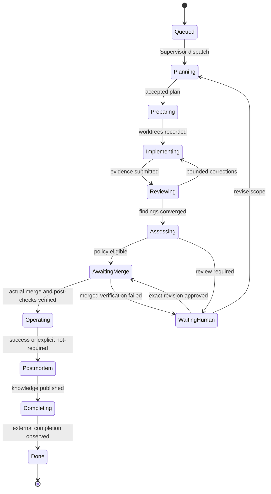
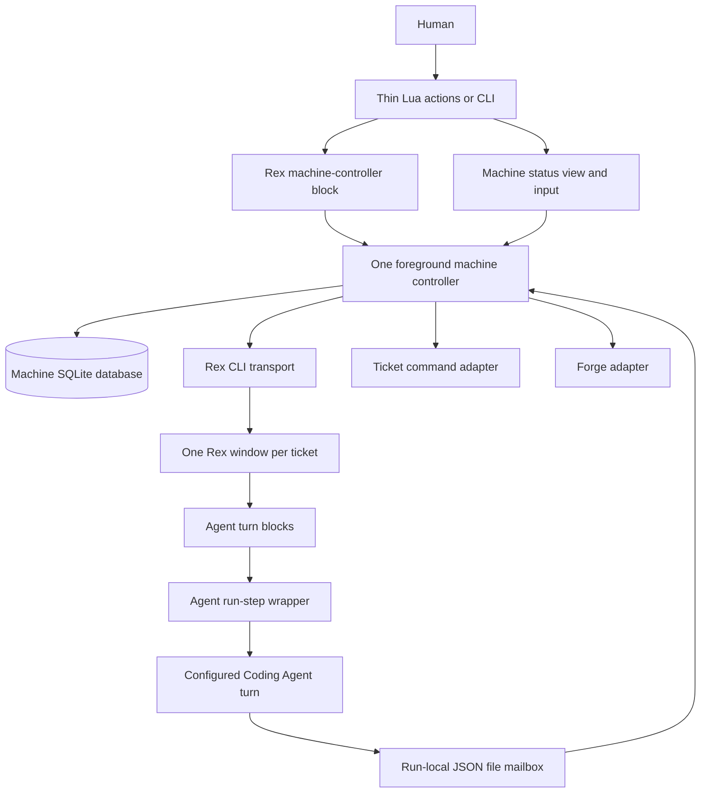

# rex-projects prototype implementation plan

Build a Rex plugin that runs cooperating Agents for software delivery and recurring operations.
Keep the factory in a Rust binary named `rex-projects`. Keep Lua limited to Rex integration.
This is an implementation brief for another Coding Agent. It does not authorize implementation, deployment, or a merge.
Status is **reviewed implementation plan**. The user authorized publication after the final design review. Confirmed requirements and proposed defaults are distinguished below; implementation remains a separate instruction.
Deliver PR0 through PR7 in order, with the limited parallel work described in the dependency graph.

## How to read this

One box is one unit of work. Every box names the evidence that checks it.
Check a box only when its evidence exists. Evidence may be a test receipt, CLI transcript, screenshot, artifact hash, or commit SHA.
The body is a how-to. The appendices define contracts and record reasoning.
Use `poteto-mode/playbooks/autopilot-stack.md` as the execution playbook when available. This plan never grants permission to merge.
If that playbook is unavailable, use this plan's gates directly and stop each PR at merge-ready.
Repository [AGENTS.md](../AGENTS.md) takes precedence over generic playbook mechanics.
Tests alone are not sufficient verification. A PR is verified only when its unit, live, and perf boxes are all checked.
The perf boxes define proposed engineering budgets, not measured performance claims.
Vocabulary is in [GLOSSARY.md](../GLOSSARY.md). Architectural constraints are in [ADR 0001](adr/0001-rust-core-and-rex-process-ownership.md).

## Program checklist

### Arm the program

- [x] Complete the Appendix A design review. The user authorized the documentation PR after the final review fixes. Obtain a separate execution instruction before starting PR0.
- [ ] Read `git show origin/main:AGENTS.md`, `docs/github-actions.md`, and this plan at the implementation branch head. Record the SHAs.
- [ ] Read applicable local skills by their installed paths. Do not assume a `pstack/` directory exists in this repository.
- [ ] Record the execution owner, target Rex server, disposable test repositories, selected Agent CLI versions, and artifact directory.
- [ ] For unattended execution, establish the execution playbook's audit cadence. Use `/loop 1h` only if the execution environment supports it and the user authorizes that automation. Otherwise state the replacement mechanism before an unattended run.
- [ ] Send a status message only when evidence, a decision, or a blocker changes. Never report a successful external operation from an Agent's statement alone.

### Spawn owners

- [ ] Use one owner per active PR and a separate worktree for each owner. Do not let owners edit the same checkout.
- [ ] Follow `PR0 -> PR1 -> PR2 -> PR3 -> PR4 -> PR5 -> PR6 -> PR7` as the safe default sequence.
- [ ] After PR2, develop the ticket command adapter and the Rex transport in separate worktrees if their agreed protocol types are stable. Integrate both in PR3.
- [ ] After PR4, develop knowledge formatting separately from the merge gate. Integrate knowledge after PR6. Do not build against an unconfirmed product decision.
- [ ] Keep all interaction-changing PRs at merge-ready until the human reviews their transcripts and recordings.

### PR mechanics

- [ ] Run `mise install` for pinned tools. Read `docs/github-actions.md` before changing workflow files, CI scripts, or CI configuration.
- [ ] Run `mise run fix`, inspect its diff, and revert unrelated automatic changes. Run `mise run lint` and `mise run test` before submission.
- [ ] Preserve existing Lua checks. The CI-only Rust package and checks are established separately from this implementation plan; PR1 adds runtime source and expands the existing Rust checks as needed. Keep the toolchain pinned through `mise`.
- [ ] Use signed commits and Conventional Commit PR titles. End commit messages with the contributing Agent's `Co-authored-by` trailer.
- [ ] Verify trailers before pushing. Open PRs against the default branch, or against their dependency in a deliberate stack.
- [ ] Follow the repository's approval, required-check, and `/merge` workflow. This plan does not override those gates.

### Verdict and merge

- [ ] Have an independent reviewer inspect the exact PR head, connected code, command receipts, and fault-injection results.
- [ ] Run every live scenario listed for that PR. Ten lanes are coverage partitions. Run them sequentially if the machine or rate limits cannot support parallel execution.
- [ ] Recheck changed behavior at every new head. Reuse receipts only when the relevant artifact and tested behavior are unchanged and the reviewer records why.
- [ ] Present interaction changes with screenshots and a short video before a human approves the PR.
- [ ] Immediately before requesting `/merge`, put all contributing Agent trailers at the end of the PR body with no subsequent text.
- [ ] Verify the merged commit trailers with `git show -s --format=%B <merge-sha> | git interpret-trailers --parse`.

### Boot recipe

- [ ] Fetch and check out the exact PR head in an isolated worktree. Record the current default branch SHA as the regression baseline.
- [ ] For Rust-equipped PRs, build that head, record source revision, dirty flag, and executable digest, and select it through Lua's development `cli` option. Verify the immutable snapshot and running owner's digest before live checks. PR0 has no Rust runtime implementation yet; use disposable lifecycle fixtures and bootstrap stubs rather than claiming to run future behavior.
- [ ] Run `mise install`, `mise run lint`, and `mise run test` using disposable state and cache directories.
- [ ] Use the Rex skill and installed `rex __internal skill` to drive real Rex. Use normal CLI argv for `rex-projects`. Do not substitute mocks for live acceptance.
- [ ] Use a temporary local Git remote, a disposable GitHub repository, a fixture ticket CLI, and an explicit test Agent profile. Real credentials stay outside artifacts.
- [ ] Save each scenario under `/tmp/rex-projects-<pr-id>/lane-<n>/`. Save CLI transcripts and JSON receipts beside the named screenshot.
- [ ] Render terminal transcripts as screenshots when there is no graphical interaction. A screenshot supplements the receipt and never proves a database or remote state by itself.
- [ ] For regression lanes, execute the same existing behavior at trunk and head. If trunk lacks the feature, record that fact and test the added behavior plus the user-visible end state at head.
- [ ] For perf probes, use a fixed dataset and clock, interleave trunk and head runs, record all samples, and separate process spawn, remote wait, and local computation.

## Prove Rex process and Agent lifecycle (PR0)

**Depends on.** None.

**Files.**

- [ ] Create or update `docs/verification/rex-capabilities.md`. Record the reviewed diff.
- [ ] Create or update `tests/fixtures/rex/`. Record the reviewed diff.
- [ ] Create or update `docs/verification/agent-capabilities.md`. Record the reviewed diff.

**Build.**

- [ ] Record Rex version, server identity, API descriptions, terminal options, event names, and CLI error shapes. Keep sanitized receipts.
- [ ] Verify documented config-load `rex.exec` behavior, its timeout budget, platform detection, and the bounded download and checksum commands required by Appendix O. A cold `setup()` waits for bootstrap; do not promise unsupported asynchronous config-load callbacks or detached download processes.
- [ ] Prove a Lua Action can create a Rex terminal block that runs a foreground command and returns within the Action deadline. Do not keep the Rust runner in an Action-scoped rex.exec.start handle.
- [ ] Use disposable known programs and installed Agent CLIs to prove Rex block ownership, finite headless turns, process exit reporting, startup markers, structured output, shutdown, continuation, and config reload. Verify automatic permissions, login-environment capture, repository mise/tool resolution, inherited hooks and skills, MCP, and Rex events. Probe markers through each actual provider tool shell and a descendant, including resumed turns, and prove a disposable human decision is rejected without mutation; block unattended profiles with missing or unverified propagation. Verify the installed Rex naming flag and a marker-aware hook wrapper suppress only factory session-naming instructions while retaining normal-user naming, skills, MCP, and Rex events. Run actual automatic providers against a fixture AGENTS.md that requests push, PR creation, and `/merge`; verify their role contract stops at commit. Treat this as cooperative behavior, not same-user isolation. Prove mailbox exchange with a Codex workspace-write fixture without opening SQLite. Do not depend on the later Rust mailbox or scheduler.
- [ ] Prove one ticket tab contains successive and concurrent role blocks and can be focused and zoomed through the APIs the dashboard uses. Probe Lua's development override without depending on a published Rust release. PR0 verifies the Rex primitives; PR3 verifies Rust's archive, recycling, retention, and resource-ownership policy once that implementation exists.
- [ ] Choose and record the supported minimum Rex version and Agent launch mechanism. Stop dependent work if lifecycle guarantees cannot be demonstrated.

**You see.**

- [ ] Capability report distinguishes observed, documented, inferred, and unsupported behavior. No background process escapes the test session. Save a CLI transcript and independent state observations.

**Verify, unit.** Tests alone are not sufficient verification. A PR is verified only when its unit, live, and perf boxes are all checked.

- [ ] Add behavior tests for this PR's Build items and the corresponding Appendix M scenarios. Run `mise run lint` and `mise run test`. Save command output.

**Verify, live.** Tests alone are not sufficient verification. A PR is verified only when its unit, live, and perf boxes are all checked. Ten lanes on `inherit-parent` at the PR head, per the boot recipe.

- [ ] Lane 1. Regression lane against trunk. Missing feature on trunk and a successful foreground child at head. Save `/tmp/rex-projects-pr0/lane-1/result.png`. Pass when the named outcome is observed in the actual process, state, or remote resource and the receipt identifies the tested SHA.
- [ ] Lane 2. Launch an argv containing spaces, quotes, and shell metacharacters without interpretation. Save `/tmp/rex-projects-pr0/lane-2/result.png`. Pass when the named outcome is observed in the actual process, state, or remote resource and the receipt identifies the tested SHA.
- [ ] Lane 3. Create a block with shell disabled and verify a nonzero program exit remains nonzero. Save `/tmp/rex-projects-pr0/lane-3/result.png`. Pass when the named outcome is observed in the actual process, state, or remote resource and the receipt identifies the tested SHA.
- [ ] Lane 4. Close only the test controller block and observe its process exits. Save `/tmp/rex-projects-pr0/lane-4/result.png`. Pass when the named outcome is observed in the actual process, state, or remote resource and the receipt identifies the tested SHA.
- [ ] Lane 5. Destroy the disposable session and observe test child process outcomes. Save `/tmp/rex-projects-pr0/lane-5/result.png`. Pass when the named outcome is observed in the actual process, state, or remote resource and the receipt identifies the tested SHA.
- [ ] Lane 6. Reload Lua configuration, verify that registered Actions are not duplicated, and verify that a failed reload retains the last valid Action. Preserve an existing fixture child across reload. Test real two-Project admission without a duplicate machine controller in PR2, after that controller exists. Save `/tmp/rex-projects-pr0/lane-6/result.png`. Pass when the named outcome is observed in the actual process, state, or remote resource and the receipt identifies the tested SHA.
- [ ] Lane 7. Discard or interrupt a Rex create reply and identify any created block from a fresh listing before retrying. State whether the fault was injected into the CLI output or the request transport. Save `/tmp/rex-projects-pr0/lane-7/result.png`. Pass when the named outcome is observed in the actual process, state, or remote resource and the receipt identifies the tested SHA.
- [ ] Lane 8. With the installed Codex workspace-write sandbox, exchange one atomic run-local request and receipt without access to SQLite, WAL, or SHM files. Separately record Claude Code's actual automatic permissions and inherited user integrations. Verify the marker-aware Rex hook keeps ordinary-session naming but omits factory naming instructions, and record unsupported naming/event capabilities as warnings. Correlate startup, Rex block, and process without the later Rust mailbox. Save `/tmp/rex-projects-pr0/lane-8/result.png`. Pass when the named outcome is observed in the actual process, state, or remote resource and the receipt identifies the tested SHA.
- [ ] Lane 9. Have the installed Agent end a headless turn with structured output, then start a continuation with an explicit new input. Test busy-turn cancellation without typing into a terminal or approval prompt. Save `/tmp/rex-projects-pr0/lane-9/result.png`. Pass when the named outcome is observed in the actual process, state, or remote resource and the receipt identifies the tested SHA.
- [ ] Lane 10. Disconnect the CLI transport and reconcile from a fresh listing. Save `/tmp/rex-projects-pr0/lane-10/result.png`. Pass when the named outcome is observed in the actual process, state, or remote resource and the receipt identifies the tested SHA.

**Verify, perf.** Tests alone are not sufficient verification. A PR is verified only when its unit, live, and perf boxes are all checked.

- [ ] Metric. Record read-only Rex capability-query duration and process count. No scheduler or project status command exists at this stage.
- [ ] Probe. Run the installed rex api describe session.new_window before and after the discovery fixtures for 20 samples. Run the disposable lifecycle fixture separately. Record command output, wall time, and leaked process count.
- [ ] Baseline. Record trunk samples first, or record that the feature is absent. Do not invent a ratio for unlike workflows.
- [ ] Rule. Read-only local capability queries must finish within 2 seconds at p95. The completed lifecycle fixture must leave zero unintended live processes. This is a proposed local budget, not a measured result.

**Review gate.** The operator reviews before merge.

- [ ] Present the relevant screenshot and a 30 to 60 second video of the CLI or Rex interaction. Include error and recovery behavior. Wait for the operator's review.

**Merge.**

- [ ] Obtain the independent exact-head verdict, required checks, and repository approval. Follow the Program checklist. This plan ends at merge-ready until the user authorizes landing.

## Add Rust boundaries and versioned contracts (PR1)

**Depends on.** PR0.

**Files.**

- [ ] Create or update `Cargo.toml`. Record the reviewed diff.
- [ ] Create or update `Cargo.lock`. Record the reviewed diff.
- [ ] Create or update `src/main.rs`. Record the reviewed diff.
- [ ] Create or update `src/cli.rs`. Record the reviewed diff.
- [ ] Create or update `src/domain/`. Record the reviewed diff.
- [ ] Create or update `src/protocol/`. Record the reviewed diff.
- [ ] Create or update `src/config.rs`. Record the reviewed diff.
- [ ] Create or update `schemas/`. Record the reviewed diff.
- [ ] Create or update `schemas/version.v1.json` and document the csm-ci `cargo-raw` release contract in `docs/release-assets.md`. Release builds and uploaded artifacts are produced by the managed csm-ci service; do not add a repository-local release builder.
- [ ] Create or update `mise.toml`. Record the reviewed diff.
- [ ] Create or update `.github/workflows/`. Record the reviewed diff.

**Build.**

- [ ] Add one Rust package and the rex-projects binary. Keep modules within one crate until a real consumer needs a separate crate.
- [ ] Implement branded identifiers, request and response envelopes, configuration parsing, validation errors, and JSON Schema emission. Load named profiles from adjacent `profiles/<name>/` directories as specified in Appendix L.
- [ ] Add config validate, config apply, doctor, schema, and version commands. Apply a validated complete configuration snapshot atomically in SQLite. Make stdout machine-readable under --json and reserve stderr for diagnostics.
- [ ] Wire cargo fmt --check, cargo clippy with warnings denied, and cargo test into existing mise tasks and CI. Preserve workflow security checks. Configure the managed csm-ci `cargo-raw` release for the Appendix O targets and SHA-256 metadata; publication is a separate authorized release step. Use the development-only `cargo xtask` verifier to update a Lua pin only after signed assets are available and validated.

**You see.**

- [ ] Invalid configuration names its key and writes no state. doctor reports missing capabilities without creating sessions or tickets. Save a CLI transcript and independent state observations.

**Verify, unit.** Tests alone are not sufficient verification. A PR is verified only when its unit, live, and perf boxes are all checked.

- [ ] Add behavior tests for this PR's Build items and the corresponding Appendix M scenarios. Run `mise run lint` and `mise run test`. Save command output.

**Verify, live.** Tests alone are not sufficient verification. A PR is verified only when its unit, live, and perf boxes are all checked. Ten lanes on `inherit-parent` at the PR head, per the boot recipe.

- [ ] Lane 1. Regression lane against trunk. Existing Lua checks remain green against trunk and head. Save `/tmp/rex-projects-pr1/lane-1/result.png`. Pass when the named outcome is observed in the actual process, state, or remote resource and the receipt identifies the tested SHA.
- [ ] Lane 2. Validate the minimum configuration with separate profile directories and named role references; reject a missing referenced profile or an inline Agent definition. Save `/tmp/rex-projects-pr1/lane-2/result.png`. Pass when the named outcome is observed in the actual process, state, or remote resource and the receipt identifies the tested SHA.
- [ ] Lane 3. Reject an unknown configuration field with a file and key path; a failed config apply leaves the previous complete snapshot active. Save `/tmp/rex-projects-pr1/lane-3/result.png`. Pass when the named outcome is observed in the actual process, state, or remote resource and the receipt identifies the tested SHA.
- [ ] Lane 4. Reject an unsupported schema version. Save `/tmp/rex-projects-pr1/lane-4/result.png`. Pass when the named outcome is observed in the actual process, state, or remote resource and the receipt identifies the tested SHA.
- [ ] Lane 5. Accept paths containing whitespace as a single argument. Save `/tmp/rex-projects-pr1/lane-5/result.png`. Pass when the named outcome is observed in the actual process, state, or remote resource and the receipt identifies the tested SHA.
- [ ] Lane 6. Report a missing ticket adapter executable. Save `/tmp/rex-projects-pr1/lane-6/result.png`. Pass when the named outcome is observed in the actual process, state, or remote resource and the receipt identifies the tested SHA.
- [ ] Lane 7. Report an unsupported Rex capability. Save `/tmp/rex-projects-pr1/lane-7/result.png`. Pass when the named outcome is observed in the actual process, state, or remote resource and the receipt identifies the tested SHA.
- [ ] Lane 8. Emit stable schema and validate checked-in fixtures against it. Save `/tmp/rex-projects-pr1/lane-8/result.png`. Pass when the named outcome is observed in the actual process, state, or remote resource and the receipt identifies the tested SHA.
- [ ] Lane 9. Run with no writable state directory and keep doctor read-only. Save `/tmp/rex-projects-pr1/lane-9/result.png`. Pass when the named outcome is observed in the actual process, state, or remote resource and the receipt identifies the tested SHA.
- [ ] Lane 10. Run --help and --json error paths without a terminal. Save `/tmp/rex-projects-pr1/lane-10/result.png`. Pass when the named outcome is observed in the actual process, state, or remote resource and the receipt identifies the tested SHA.

**Verify, perf.** Tests alone are not sufficient verification. A PR is verified only when its unit, live, and perf boxes are all checked.

- [ ] Metric. Record config validate duration, peak memory, and external-call count for a configuration with 100 registered repositories and 100 profile directories.
- [ ] Probe. Run config validate for 20 interleaved trunk and head samples where available. Trunk has no Rust command, so record unsupported and apply the absolute head budget. No scheduler fixture is required yet.
- [ ] Baseline. Record trunk samples first, or record that the feature is absent. Do not invent a ratio for unlike workflows.
- [ ] Rule. Configuration validation must finish within 250 ms at p95 and perform zero external calls. Record the machine and fixture. These are proposed limits.

**Review gate.** The operator reviews before merge.

- [ ] Present the relevant screenshot and a 30 to 60 second video of the CLI or Rex interaction. Include error and recovery behavior. Wait for the operator's review.

**Merge.**

- [ ] Obtain the independent exact-head verdict, required checks, and repository approval. Follow the Program checklist. This plan ends at merge-ready until the user authorizes landing.

## Persist ownership and reconcile interrupted effects (PR2)

**Depends on.** PR1.

**Files.**

- [ ] Create or update `src/store/`. Record the reviewed diff.
- [ ] Create or update `src/engine/`. Record the reviewed diff.
- [ ] Create or update `src/effects.rs`. Record the reviewed diff.
- [ ] Create or update `src/commands/run.rs`. Record the reviewed diff.
- [ ] Create or update `src/commands/agent.rs`. Record the reviewed diff.
- [ ] Create or update `src/mailbox/` and `src/dashboard/`. Record the reviewed diff.
- [ ] Create or update `migrations/`. Record the reviewed diff.
- [ ] Create or update `tests/recovery.rs`. Record the reviewed diff.

**Build.**

- [ ] Implement Appendix F SQLite schema, one machine controller owner, and Project-scoped runtimes and Supervisor ownership. Keep network calls and child processes outside transactions.
- [ ] Implement a pure transition function and a bounded scheduler. Persist state transitions and outgoing effects in the same transaction.
- [ ] Implement foreground machine `run`, `run --once`, Project start, pause, resume, status, and stop, plus machine stop and a minimal terminal dashboard over published status and the durable command queue. Agent commands use the scoped run-local mailbox and host broker; no sandboxed command opens SQLite and no daemon socket is required. Resume parked roles as finite turns from durable continuations.
- [ ] Add effect reconciliation, inbox deduplication, operation identifiers, retry budgets, and uncertain outcome handling. Never promise exactly-once remote execution.

**You see.**

- [ ] Restarting after every injected crash converges to one logical result or a named unresolved effect. A stale owner cannot apply new commands. Save a CLI transcript and independent state observations.

**Verify, unit.** Tests alone are not sufficient verification. A PR is verified only when its unit, live, and perf boxes are all checked.

- [ ] Add behavior tests for this PR's Build items and the corresponding Appendix M scenarios. Run `mise run lint` and `mise run test`. Save command output.

**Verify, live.** Tests alone are not sufficient verification. A PR is verified only when its unit, live, and perf boxes are all checked. Ten lanes on `inherit-parent` at the PR head, per the boot recipe.

- [ ] Lane 1. Regression lane against trunk. Trunk lacks runtime and head completes a fixture cycle. Save `/tmp/rex-projects-pr2/lane-1/result.png`. Pass when the named outcome is observed in the actual process, state, or remote resource and the receipt identifies the tested SHA.
- [ ] Lane 2. Two run commands for different Projects cannot start two machine controllers. One controller manages both Projects with distinct logical Supervisors, claims, waits, and resource accounting. Save `/tmp/rex-projects-pr2/lane-2/result.png`. Pass when the named outcome is observed in the actual process, state, or remote resource and the receipt identifies the tested SHA.
- [ ] Lane 3. Two local Projects cannot claim one external ticket concurrently. Save `/tmp/rex-projects-pr2/lane-3/result.png`. Pass when the named outcome is observed in the actual process, state, or remote resource and the receipt identifies the tested SHA.
- [ ] Lane 4. Crash before transaction commit leaves no partial transition. Save `/tmp/rex-projects-pr2/lane-4/result.png`. Pass when the named outcome is observed in the actual process, state, or remote resource and the receipt identifies the tested SHA.
- [ ] Lane 5. Crash after effect intent leaves one pending operation. Save `/tmp/rex-projects-pr2/lane-5/result.png`. Pass when the named outcome is observed in the actual process, state, or remote resource and the receipt identifies the tested SHA.
- [ ] Lane 6. Crash after remote success reconciles rather than repeats the write. Save `/tmp/rex-projects-pr2/lane-6/result.png`. Pass when the named outcome is observed in the actual process, state, or remote resource and the receipt identifies the tested SHA.
- [ ] Lane 7. Expired lease does not authorize stealing from an unidentified live owner. Save `/tmp/rex-projects-pr2/lane-7/result.png`. Pass when the named outcome is observed in the actual process, state, or remote resource and the receipt identifies the tested SHA.
- [ ] Lane 8. Duplicate run-local requests return the original committed receipt after controller restart; cross-run authority and path traversal fail. A role parked for human input resumes in a new turn with the same logical ownership. Save `/tmp/rex-projects-pr2/lane-8/result.png`. Pass when the named outcome is observed in the actual process, state, or remote resource and the receipt identifies the tested SHA.
- [ ] Lane 9. Pause keeps human waits and blocks new work. Save `/tmp/rex-projects-pr2/lane-9/result.png`. Pass when the named outcome is observed in the actual process, state, or remote resource and the receipt identifies the tested SHA.
- [ ] Lane 10. Restart with a future database schema fails without modifying it. Save `/tmp/rex-projects-pr2/lane-10/result.png`. Pass when the named outcome is observed in the actual process, state, or remote resource and the receipt identifies the tested SHA.

**Verify, perf.** Tests alone are not sufficient verification. A PR is verified only when its unit, live, and perf boxes are all checked.

- [ ] Metric. Record local command duration, child-process count, external-call count, and memory after the fixture reaches its final state. Exclude LLM and remote wait from local duration.
- [ ] Probe. Run the same supported read-only status command at trunk and head in interleaved order for 20 samples. If trunk has no command, record unsupported and measure head against the absolute budget. Also drive this PR's longest local fixture to completion.
- [ ] Baseline. Record trunk samples first, or record that the feature is absent. Do not invent a ratio for unlike workflows.
- [ ] Rule. With 100 tickets, 20 runs, and a local fixture adapter, status must finish within 500 ms at p95 and one idle scheduling tick must issue at most one ticket-page query plus the configured due observations. At PR2, populate durable fixture rows directly and use the effect test double. The real adapter budget starts in PR3. No per-Agent tight polling is allowed. Treat these as proposed budgets and record machine details before changing them.

**Review gate.** The operator reviews before merge.

- [ ] Present the relevant screenshot and a 30 to 60 second video of the CLI or Rex interaction. Include error and recovery behavior. Wait for the operator's review.

**Merge.**

- [ ] Obtain the independent exact-head verdict, required checks, and repository approval. Follow the Program checklist. This plan ends at merge-ready until the user authorizes landing.

## Connect Rex, tickets, worktrees, and Agent profiles (PR3)

**Depends on.** PR2.

**Files.**

- [ ] Create or update `src/adapters/rex.rs`. Record the reviewed diff.
- [ ] Create or update `src/adapters/tickets.rs`. Record the reviewed diff.
- [ ] Create or update `src/adapters/agents/`. Record the reviewed diff.
- [ ] Create or update `src/process.rs`. Record the reviewed diff.
- [ ] Create or update `src/worktrees.rs`. Record the reviewed diff.
- [ ] Create or update `src/hooks.rs` and rex-projects hook fixtures. Record the reviewed diff.
- [ ] Create or update `tests/adapters/`. Record the reviewed diff.
- [ ] Create or update `examples/`. Record the reviewed diff.
- [ ] Create or update `lua/rex_projects/init.lua`, `lua/rex_projects/bootstrap.lua`, and `lua/rex_projects/runtime_version.lua`. Record the reviewed diff.

**Build.**

- [ ] Implement RexCliTransport behind the runtime contract in Appendix G. Keep future direct transport possible without implementing an undocumented socket protocol.
- [ ] Implement one-use environment handoff, scoped context markers, Rex naming-capability checks and warnings, and per-run native or host commit selection. Never rely on the Rex app's initial PATH or modify personal hooks automatically.
- [ ] Implement `setup()` bootstrap from the exact release and asset digests embedded in Lua, following Appendix O. Support the explicit Lua `cli` override for an unpublished build. Reuse verified cache entries, download missing default assets without manual binary installation, snapshot developer binaries, and pass one verified absolute CLI path and digest to every Action, launch, and displayed command. A running different binary requires a controlled restart, not hot replacement.
- [ ] Implement the configurable ticket command protocol, pagination, capability discovery, revision preconditions, mutation reconciliation, and fixtures.
- [ ] Launch run-step through a Rex API terminal block inside the ticket's persistent tab. run-step starts the configured Coding Agent as a foreground child with its verified automatic permissions and normal user integrations. The dashboard focuses that tab and its relevant block. Do not use built-in Agent subagents for factory roles.
- [ ] Implement configuration-authorized clone URLs, managed clones, serialized fresh fetches, planned bases, per-Worker worktrees, worktree registration, and preservation on interruption. Never use a user's working checkout or infer URLs from ticket prose.
- [ ] Implement repository rex-projects hooks with the existing bounded process runner and effect journal. Preserve user Git and provider hooks. Bind required local-check receipts to the exact head, hook configuration, and source tree; reject failed or source-mutating checks before review or publication.

**You see.**

- [ ] From an empty cache, setup obtains the pinned fixture release and enables Actions. A Lua development override runs the exact PR build instead. One fixture ticket creates one tab with Coordinator and Worker blocks and isolated Worker worktrees. Restart finds the same tab, runs, branches, and worktrees. Save a CLI transcript and independent state observations.

**Verify, unit.** Tests alone are not sufficient verification. A PR is verified only when its unit, live, and perf boxes are all checked.

- [ ] Add behavior tests for this PR's Build items and the corresponding Appendix M scenarios. Run `mise run lint` and `mise run test`. Save command output.

**Verify, live.** Tests alone are not sufficient verification. A PR is verified only when its unit, live, and perf boxes are all checked. Ten lanes on `inherit-parent` at the PR head, per the boot recipe.

- [ ] Lane 1. Regression lane against trunk. Trunk lacks integration and head starts a fixture Agent through Rex. Save `/tmp/rex-projects-pr3/lane-1/result.png`. Pass when the named outcome is observed in the actual process, state, or remote resource and the receipt identifies the tested SHA.
- [ ] Lane 2. Ticket list pagination covers more than one page. Save `/tmp/rex-projects-pr3/lane-2/result.png`. Pass when the named outcome is observed in the actual process, state, or remote resource and the receipt identifies the tested SHA.
- [ ] Lane 3. Adapter emits malformed JSON and produces a bounded error. Save `/tmp/rex-projects-pr3/lane-3/result.png`. Pass when the named outcome is observed in the actual process, state, or remote resource and the receipt identifies the tested SHA.
- [ ] Lane 4. Ticket changes during claim and no stale mutation occurs. Save `/tmp/rex-projects-pr3/lane-4/result.png`. Pass when the named outcome is observed in the actual process, state, or remote resource and the receipt identifies the tested SHA.
- [ ] Lane 5. A command times out after creating a ticket and is reconciled. Save `/tmp/rex-projects-pr3/lane-5/result.png`. Pass when the named outcome is observed in the actual process, state, or remote resource and the receipt identifies the tested SHA.
- [ ] Lane 6. Agent startup fails and no false running state remains. Save `/tmp/rex-projects-pr3/lane-6/result.png`. Pass when the named outcome is observed in the actual process, state, or remote resource and the receipt identifies the tested SHA.
- [ ] Lane 7. Two Projects share one managed clone with distinct worktrees. Verify a native Worker signed commit and a sandboxed host-manifest commit with untracked, deleted, mode, and symlink changes. Recover after direct commit and after interrupted host index sync, without duplicate commits or overwriting staged changes. Keep branch and PR identity; the user's checkout stays untouched. Inject an unexplained remote push and duplicate PR, pause publication, and reconcile without overwriting remote state or creating another PR. Verify managed clone automatic maintenance is disabled. Save `/tmp/rex-projects-pr3/lane-7/result.png`. Pass when the named outcome is observed in the actual process, state, or remote resource and the receipt identifies the tested SHA.
- [ ] Lane 8. Worktree creation crashes between git success and local recording. Save `/tmp/rex-projects-pr3/lane-8/result.png`. Pass when the named outcome is observed in the actual process, state, or remote resource and the receipt identifies the tested SHA.
- [ ] Lane 9. Agent result carries another role identity and is rejected. Save `/tmp/rex-projects-pr3/lane-9/result.png`. Pass when the named outcome is observed in the actual process, state, or remote resource and the receipt identifies the tested SHA.
- [ ] Lane 10. Lose a Rex create reply and reconcile one ticket tab before retry. Reuse it for later roles, focus and zoom the selected block, and recycle archived completed blocks promptly. Verify eligible terminal tabs close after retention and reopen as history without an Agent; pins and live or unknown work prevent closure. Save `/tmp/rex-projects-pr3/lane-10/result.png`. Pass when the named outcome is observed in the actual process, state, or remote resource and the receipt identifies the tested SHA.

**Verify, perf.** Tests alone are not sufficient verification. A PR is verified only when its unit, live, and perf boxes are all checked.

- [ ] Metric. Record local command duration, child-process count, external-call count, and memory after the fixture reaches its final state. Exclude LLM and remote wait from local duration.
- [ ] Probe. Run the same supported read-only status command at trunk and head in interleaved order for 20 samples. If trunk has no command, record unsupported and measure head against the absolute budget. Also drive this PR's longest local fixture to completion.
- [ ] Baseline. Record trunk samples first, or record that the feature is absent. Do not invent a ratio for unlike workflows.
- [ ] Rule. With 100 tickets, 20 runs, and a local fixture adapter, status must finish within 500 ms at p95 and one idle scheduling tick must issue at most one ticket-page query plus the configured due observations. No per-Agent tight polling is allowed. Treat these as proposed budgets and record machine details before changing them.

**Review gate.** The operator reviews before merge.

- [ ] Present the relevant screenshot and a 30 to 60 second video of the CLI or Rex interaction. Include error and recovery behavior. Wait for the operator's review.

**Merge.**

- [ ] Obtain the independent exact-head verdict, required checks, and repository approval. Follow the Program checklist. This plan ends at merge-ready until the user authorizes landing.

## Run goal and operations workflows (PR4)

**Depends on.** PR3.

**Files.**

- [ ] Create or update `src/engine/supervisor.rs`. Record the reviewed diff.
- [ ] Create or update `src/engine/coordinator.rs`. Record the reviewed diff.
- [ ] Create or update `src/roles/`. Record the reviewed diff.
- [ ] Create or update `prompts/`. Record the reviewed diff.
- [ ] Create or update `schemas/agent-results/`. Record the reviewed diff.
- [ ] Create or update `tests/workflows.rs`. Record the reviewed diff.

**Build.**

- [ ] Implement one logical Supervisor per Project and one Coordinator per active TicketRun. Reconstruct context after each process restart.
- [ ] Implement bounded goal ticket creation and operations recipe matching. Keep goal changes and final Project completion human-gated.
- [ ] Implement Planner selection, multi-repository plan DAGs, Worker execution, Reviewer findings, correction rounds, and Supervisor interventions.
- [ ] Treat `implementation_ready` as a proposed handoff. Wait for provider exit and required rex-projects hooks before accepting the handoff or starting a Reviewer. A changed head or hook definition invalidates its previous hook receipts.
- [ ] Enforce role request permissions, instruction and plan hashes, retry ceilings, resource caps, event severity, and child-role restrictions in Rust.

**You see.**

- [ ] Both Project modes consume tickets. Irregularities reach the Coordinator and unresolved loops stop with an actionable human request. Save a CLI transcript and independent state observations.

**Verify, unit.** Tests alone are not sufficient verification. A PR is verified only when its unit, live, and perf boxes are all checked.

- [ ] Add behavior tests for this PR's Build items and the corresponding Appendix M scenarios. Run `mise run lint` and `mise run test`. Save command output.

**Verify, live.** Tests alone are not sufficient verification. A PR is verified only when its unit, live, and perf boxes are all checked. Ten lanes on `inherit-parent` at the PR head, per the boot recipe.

- [ ] Lane 1. Regression lane against trunk. Compare any existing lifecycle at trunk and the new end-to-end fixture at head. Save `/tmp/rex-projects-pr4/lane-1/result.png`. Pass when the named outcome is observed in the actual process, state, or remote resource and the receipt identifies the tested SHA.
- [ ] Lane 2. A lost creation reply and an eventually consistent index expose duplicate goal tickets; retain one canonical ticket, annotate and cancel the duplicate, and keep only one delivery claim. Save `/tmp/rex-projects-pr4/lane-2/result.png`. Pass when the named outcome is observed in the actual process, state, or remote resource and the receipt identifies the tested SHA.
- [ ] Lane 3. Goal ticket budget prevents another creation. Save `/tmp/rex-projects-pr4/lane-3/result.png`. Pass when the named outcome is observed in the actual process, state, or remote resource and the receipt identifies the tested SHA.
- [ ] Lane 4. Operations Project matches a declared recipe without inventing a goal. Save `/tmp/rex-projects-pr4/lane-4/result.png`. Pass when the named outcome is observed in the actual process, state, or remote resource and the receipt identifies the tested SHA.
- [ ] Lane 5. Ambiguous recipe produces a human request. Save `/tmp/rex-projects-pr4/lane-5/result.png`. Pass when the named outcome is observed in the actual process, state, or remote resource and the receipt identifies the tested SHA.
- [ ] Lane 6. Coordinator can request planning but cannot submit a code change as a Worker. Save `/tmp/rex-projects-pr4/lane-6/result.png`. Pass when the named outcome is observed in the actual process, state, or remote resource and the receipt identifies the tested SHA.
- [ ] Lane 7. Planner spawns a Rex research role within its allowed budget. Save `/tmp/rex-projects-pr4/lane-7/result.png`. Pass when the named outcome is observed in the actual process, state, or remote resource and the receipt identifies the tested SHA.
- [ ] Lane 8. Worker reports an unexpected dependency and pauses affected work. Save `/tmp/rex-projects-pr4/lane-8/result.png`. Pass when the named outcome is observed in the actual process, state, or remote resource and the receipt identifies the tested SHA.
- [ ] Lane 9. Required local rex-projects hooks fail, mutate source, and then succeed after a Worker correction. Reviewer starts only with matching successful receipts. Later Reviewer feedback keeps the same branch, PR, and tab and invalidates old receipts while the ticket stays In Progress. Save `/tmp/rex-projects-pr4/lane-9/result.png`. Pass when the named outcome is observed in the actual process, state, or remote resource and the receipt identifies the tested SHA.
- [ ] Lane 10. A dashboard intervention targets the Coordinator and notifies its Supervisor; stop or finish the active finite Worker turn safely, invalidate conflicting work, and resume with the new direction without terminal injection. Save `/tmp/rex-projects-pr4/lane-10/result.png`. Pass when the named outcome is observed in the actual process, state, or remote resource and the receipt identifies the tested SHA.

**Verify, perf.** Tests alone are not sufficient verification. A PR is verified only when its unit, live, and perf boxes are all checked.

- [ ] Metric. Record local command duration, child-process count, external-call count, and memory after the fixture reaches its final state. Exclude LLM and remote wait from local duration.
- [ ] Probe. Run the same supported read-only status command at trunk and head in interleaved order for 20 samples. If trunk has no command, record unsupported and measure head against the absolute budget. Also drive this PR's longest local fixture to completion.
- [ ] Baseline. Record trunk samples first, or record that the feature is absent. Do not invent a ratio for unlike workflows.
- [ ] Rule. With 100 tickets, 20 runs, and a local fixture adapter, status must finish within 500 ms at p95 and one idle scheduling tick must issue at most one ticket-page query plus the configured due observations. No per-Agent tight polling is allowed. Treat these as proposed budgets and record machine details before changing them.

**Review gate.** The operator reviews before merge.

- [ ] Present the relevant screenshot and a 30 to 60 second video of the CLI or Rex interaction. Include error and recovery behavior. Wait for the operator's review.

**Merge.**

- [ ] Obtain the independent exact-head verdict, required checks, and repository approval. Follow the Program checklist. This plan ends at merge-ready until the user authorizes landing.

## Gate merges and durable human decisions (PR5)

**Depends on.** PR4.

**Files.**

- [ ] Create or update `src/adapters/forge/`. Record the reviewed diff.
- [ ] Create or update `src/merge/`. Record the reviewed diff.
- [ ] Create or update `src/human/`. Record the reviewed diff.
- [ ] Create or update `src/review_bundle.rs`. Record the reviewed diff.
- [ ] Create or update `tests/merge_safety.rs`. Record the reviewed diff.
- [ ] Create or update `tests/human_contract.rs`. Record the reviewed diff.

**Build.**

- [ ] Implement GitHub first behind the normalized forge interface. Parse remote host and repository identity without assuming github.com.
- [ ] Implement per-repository merge settings and instructions as the typed ordered procedure in Appendix I. Bind optional PR-body updates, exactly one merge execution or request, and required merge-commit verification to the assessment and durable step receipts. After a squash merge, repair owned stacked branches with the exact recorded rebase boundary and explicit-SHA force-with-lease; rebuild every head-bound check and review before merge.
- [ ] Implement deterministic blockers, evidence coverage, structured Agent risk assessment, confidence reporting, exact-revision human decisions, and a guarded merge executor.
- [ ] Implement local static HTML review bundles and command-based presentation adapters with durable request get, list, respond, expire, and cancel commands.

**You see.**

- [ ] A low-risk PR can merge only under its enabled repository policy. A changed head invalidates the assessment and human approval. Save a CLI transcript and independent state observations.

**Verify, unit.** Tests alone are not sufficient verification. A PR is verified only when its unit, live, and perf boxes are all checked.

- [ ] Add behavior tests for this PR's Build items and the corresponding Appendix M scenarios. Run `mise run lint` and `mise run test`. Save command output.

**Verify, live.** Tests alone are not sufficient verification. A PR is verified only when its unit, live, and perf boxes are all checked. Ten lanes on `inherit-parent` at the PR head, per the boot recipe.

- [ ] Lane 1. Regression lane against trunk. Trunk lacks merge policy and head refuses a failing required check. Save `/tmp/rex-projects-pr5/lane-1/result.png`. Pass when the named outcome is observed in the actual process, state, or remote resource and the receipt identifies the tested SHA.
- [ ] Lane 2. Auto-merge disabled creates a current human review request and projects In Review. After valid review completion, project In Progress even when automated checks or merge execution remain pending. Save `/tmp/rex-projects-pr5/lane-2/result.png`. Pass when the named outcome is observed in the actual process, state, or remote resource and the receipt identifies the tested SHA.
- [ ] Lane 3. Repository A and B apply different review requirements. Save `/tmp/rex-projects-pr5/lane-3/result.png`. Pass when the named outcome is observed in the actual process, state, or remote resource and the receipt identifies the tested SHA.
- [ ] Lane 4. High confidence cannot offset a deterministic blocker. Save `/tmp/rex-projects-pr5/lane-4/result.png`. Pass when the named outcome is observed in the actual process, state, or remote resource and the receipt identifies the tested SHA.
- [ ] Lane 5. A new commit after review invalidates approval. Save `/tmp/rex-projects-pr5/lane-5/result.png`. Pass when the named outcome is observed in the actual process, state, or remote resource and the receipt identifies the tested SHA.
- [ ] Lane 6. A policy instruction change invalidates approval. Save `/tmp/rex-projects-pr5/lane-6/result.png`. Pass when the named outcome is observed in the actual process, state, or remote resource and the receipt identifies the tested SHA.
- [ ] Lane 7. Run PR-body trailer preparation, merge request, and merge-commit verification in order. Crash after each remote success and reconcile without repeating the merge. A missing merged trailer records merged verification failure and blocks operations and ticket completion; a concurrent PR-body edit stops the procedure. Advance the base between validation and execution and verify the enforced base predicate rejects stale integration or performs only an explicitly approved queue recomputation. Save `/tmp/rex-projects-pr5/lane-7/result.png`. Pass when the named outcome is observed in the actual process, state, or remote resource and the receipt identifies the tested SHA.
- [ ] Lane 8. HTML presentation fails and the request remains answerable in the CLI. Save `/tmp/rex-projects-pr5/lane-8/result.png`. Pass when the named outcome is observed in the actual process, state, or remote resource and the receipt identifies the tested SHA.
- [ ] Lane 9. Duplicate human replies produce one decision receipt. An actual provider tool shell and its descendant retain factory markers and cannot invoke human approval, promotion, or configuration apply, while an ordinary human can respond to the exact subject. A provider configuration that filters markers fails qualification and cannot launch unattended until corrected and reverified. Save `/tmp/rex-projects-pr5/lane-9/result.png`. Pass when the named outcome is observed in the actual process, state, or remote resource and the receipt identifies the tested SHA.
- [ ] Lane 10. A guarded merge request faces a later head change and cannot merge that new head. Reject an unguarded executor even with human approval. Observe actual merge rather than comment success. Inject an externally posted `/merge` comment and an unexpected merge, retain the observed truth, and block automatic operations and ticket closure pending human reconciliation. Save `/tmp/rex-projects-pr5/lane-10/result.png`. Pass when the named outcome is observed in the actual process, state, or remote resource and the receipt identifies the tested SHA.

**Verify, perf.** Tests alone are not sufficient verification. A PR is verified only when its unit, live, and perf boxes are all checked.

- [ ] Metric. Record local command duration, child-process count, external-call count, and memory after the fixture reaches its final state. Exclude LLM and remote wait from local duration.
- [ ] Probe. Run the same supported read-only status command at trunk and head in interleaved order for 20 samples. If trunk has no command, record unsupported and measure head against the absolute budget. Also drive this PR's longest local fixture to completion.
- [ ] Baseline. Record trunk samples first, or record that the feature is absent. Do not invent a ratio for unlike workflows.
- [ ] Rule. With 100 tickets, 20 runs, and a local fixture adapter, status must finish within 500 ms at p95 and one idle scheduling tick must issue at most one ticket-page query plus the configured due observations. No per-Agent tight polling is allowed. Treat these as proposed budgets and record machine details before changing them.

**Review gate.** The operator reviews before merge.

- [ ] Present the relevant screenshot and a 30 to 60 second video of the CLI or Rex interaction. Include error and recovery behavior. Wait for the operator's review.

**Merge.**

- [ ] Obtain the independent exact-head verdict, required checks, and repository approval. Follow the Program checklist. This plan ends at merge-ready until the user authorizes landing.

## Verify post-merge operations and complete tickets (PR6)

**Depends on.** PR5.

**Files.**

- [ ] Create or update `src/operations/`. Record the reviewed diff.
- [ ] Create or update `src/engine/completion.rs`. Record the reviewed diff.
- [ ] Create or update `src/adapters/forge/runs.rs`. Record the reviewed diff.
- [ ] Create or update `prompts/operator.md`. Record the reviewed diff.
- [ ] Create or update `tests/operations.rs`. Record the reviewed diff.

**Build.**

- [ ] Implement generic operation plans, immutable merge-to-run correlation, environment dependencies, and bounded observation.
- [ ] Execute only configured operation actions under their declared policy. Keep company-specific commands and runbooks outside this repository.
- [ ] Require explicit successful or not-required operation outcomes. Treat missing, skipped, failed, cancelled, and unknown outcomes distinctly.
- [ ] Implement multi-repository partial delivery, follow-up requests, and postmortem scheduling. Keep positive ticket completion for PR7, when real knowledge publication exists. PR6 proves that an unfulfilled publication predicate prevents closure.

**You see.**

- [ ] A merged ticket stays open while required operations or knowledge persistence remain unresolved. Save a CLI transcript and independent state observations.

**Verify, unit.** Tests alone are not sufficient verification. A PR is verified only when its unit, live, and perf boxes are all checked.

- [ ] Add behavior tests for this PR's Build items and the corresponding Appendix M scenarios. Run `mise run lint` and `mise run test`. Save command output.

**Verify, live.** Tests alone are not sufficient verification. A PR is verified only when its unit, live, and perf boxes are all checked. Ten lanes on `inherit-parent` at the PR head, per the boot recipe.

- [ ] Lane 1. Regression lane against trunk. Trunk lacks operations and head does not close a merged-but-unverified ticket. Save `/tmp/rex-projects-pr6/lane-1/result.png`. Pass when the named outcome is observed in the actual process, state, or remote resource and the receipt identifies the tested SHA.
- [ ] Lane 2. No-deployment recipe records an explicit not-required outcome. Save `/tmp/rex-projects-pr6/lane-2/result.png`. Pass when the named outcome is observed in the actual process, state, or remote resource and the receipt identifies the tested SHA.
- [ ] Lane 3. Successful workflow with skipped target does not pass. Save `/tmp/rex-projects-pr6/lane-3/result.png`. Pass when the named outcome is observed in the actual process, state, or remote resource and the receipt identifies the tested SHA.
- [ ] Lane 4. Run for an unrelated merge SHA does not pass. Save `/tmp/rex-projects-pr6/lane-4/result.png`. Pass when the named outcome is observed in the actual process, state, or remote resource and the receipt identifies the tested SHA.
- [ ] Lane 5. Environment B cannot start before prerequisite A succeeds. Save `/tmp/rex-projects-pr6/lane-5/result.png`. Pass when the named outcome is observed in the actual process, state, or remote resource and the receipt identifies the tested SHA.
- [ ] Lane 6. Operation approval remains durable across a runner restart. Save `/tmp/rex-projects-pr6/lane-6/result.png`. Pass when the named outcome is observed in the actual process, state, or remote resource and the receipt identifies the tested SHA.
- [ ] Lane 7. First repository merges and the second fails without automatic rollback. Save `/tmp/rex-projects-pr6/lane-7/result.png`. Pass when the named outcome is observed in the actual process, state, or remote resource and the receipt identifies the tested SHA.
- [ ] Lane 8. Operator interruption resumes observation of the recorded run. Save `/tmp/rex-projects-pr6/lane-8/result.png`. Pass when the named outcome is observed in the actual process, state, or remote resource and the receipt identifies the tested SHA.
- [ ] Lane 9. Known newer deployment records supersession under policy instead of rerunning stale work. Save `/tmp/rex-projects-pr6/lane-9/result.png`. Pass when the named outcome is observed in the actual process, state, or remote resource and the receipt identifies the tested SHA.
- [ ] Lane 10. An operation request times out after success and observation recovers its actual result. Save `/tmp/rex-projects-pr6/lane-10/result.png`. Pass when the named outcome is observed in the actual process, state, or remote resource and the receipt identifies the tested SHA.

**Verify, perf.** Tests alone are not sufficient verification. A PR is verified only when its unit, live, and perf boxes are all checked.

- [ ] Metric. Record local command duration, child-process count, external-call count, and memory after the fixture reaches its final state. Exclude LLM and remote wait from local duration.
- [ ] Probe. Run the same supported read-only status command at trunk and head in interleaved order for 20 samples. If trunk has no command, record unsupported and measure head against the absolute budget. Also drive this PR's longest local fixture to completion.
- [ ] Baseline. Record trunk samples first, or record that the feature is absent. Do not invent a ratio for unlike workflows.
- [ ] Rule. With 100 tickets, 20 runs, and a local fixture adapter, status must finish within 500 ms at p95 and one idle scheduling tick must issue at most one ticket-page query plus the configured due observations. No per-Agent tight polling is allowed. Treat these as proposed budgets and record machine details before changing them.

**Review gate.** The operator reviews before merge.

- [ ] Present the relevant screenshot and a 30 to 60 second video of the CLI or Rex interaction. Include error and recovery behavior. Wait for the operator's review.

**Merge.**

- [ ] Obtain the independent exact-head verdict, required checks, and repository approval. Follow the Program checklist. This plan ends at merge-ready until the user authorizes landing.

## Save knowledge and consolidate learned profiles (PR7)

**Depends on.** PR6.

**Files.**

- [ ] Create or update `src/knowledge/`. Record the reviewed diff.
- [ ] Create or update `src/learning/`. Record the reviewed diff.
- [ ] Create or update `prompts/postmortem.md`. Record the reviewed diff.
- [ ] Create or update `prompts/learning.md`. Record the reviewed diff.
- [ ] Create or update `tests/knowledge.rs`. Record the reviewed diff.
- [ ] Create or update `docs/usage.md`. Record the reviewed diff.

**Build.**

- [ ] Implement postmortem artifact collection, OKF output validation, atomic bundle publication, index generation, and provenance.
- [ ] Implement cross-session Supervisor learning decisions, stable finding batches, checkpoints, scoped improvement proposals, and later efficacy checks. Keep raw run evidence separate from curated concepts.
- [ ] Implement bounded profile candidates, human-authorized trials, periodic consolidation, and human-approved promotion into declarative profiles. Apply the configuration before retiring the candidate. Use Appendices K and N for quotas and recovery.
- [ ] Implement idempotent ticket completion after actual knowledge publication, including lost-reply reconciliation. Complete the full acceptance matrix and document installation, recovery, adapter authoring, policy changes, human decisions, and cleanup.

**You see.**

- [ ] Completed tickets have durable source-linked postmortems. Useful profile candidates receive trial evidence and a reviewable promotion into the declarative configuration. Candidate and generated-profile counts stay bounded even when human review waits. Save a CLI transcript and independent state observations.

**Verify, unit.** Tests alone are not sufficient verification. A PR is verified only when its unit, live, and perf boxes are all checked.

- [ ] Add behavior tests for this PR's Build items and the corresponding Appendix M scenarios. Run `mise run lint` and `mise run test`. Save command output.

**Verify, live.** Tests alone are not sufficient verification. A PR is verified only when its unit, live, and perf boxes are all checked. Ten lanes on `inherit-parent` at the PR head, per the boot recipe.

- [ ] Lane 1. Regression lane against trunk. Trunk lacks knowledge and head saves a postmortem before ticket closure. Save `/tmp/rex-projects-pr7/lane-1/result.png`. Pass when the named outcome is observed in the actual process, state, or remote resource and the receipt identifies the tested SHA.
- [ ] Lane 2. Postmortem output has OKF type and valid sources. Save `/tmp/rex-projects-pr7/lane-2/result.png`. Pass when the named outcome is observed in the actual process, state, or remote resource and the receipt identifies the tested SHA.
- [ ] Lane 3. Crash during bundle publication leaves no partially indexed document. Save `/tmp/rex-projects-pr7/lane-3/result.png`. Pass when the named outcome is observed in the actual process, state, or remote resource and the receipt identifies the tested SHA.
- [ ] Lane 4. Two attempts at the same postmortem yield one canonical finding. Save `/tmp/rex-projects-pr7/lane-4/result.png`. Pass when the named outcome is observed in the actual process, state, or remote resource and the receipt identifies the tested SHA.
- [ ] Lane 5. Knowledge output cannot escape its configured root through a symlink. Save `/tmp/rex-projects-pr7/lane-5/result.png`. Pass when the named outcome is observed in the actual process, state, or remote resource and the receipt identifies the tested SHA.
- [ ] Lane 6. Conflicting findings remain separate and linked. Save `/tmp/rex-projects-pr7/lane-6/result.png`. Pass when the named outcome is observed in the actual process, state, or remote resource and the receipt identifies the tested SHA.
- [ ] Lane 7. Restart a learning batch before and after its decision commit; findings are acknowledged once, its checkpoint resumes, and an inconclusive trial retains its outcome. Ordinary approval cannot promote it, but an explicit scoped uncertain-efficacy approval can. A regressed revision remains blocked. Save `/tmp/rex-projects-pr7/lane-7/result.png`. Pass when the named outcome is observed in the actual process, state, or remote resource and the receipt identifies the tested SHA.
- [ ] Lane 8. Fill candidate and retained-revision quotas, leave promotion approval pending, and verify new synthesis stops; consolidate useful findings into the same managed profile slot across several rounds. Promote A-only guidance and verify the rendered layer is present for an A assignment even when its authority list permits A and B, absent for B and combined A+B assignments, and cannot gain scope through consolidation or configuration reload. Save `/tmp/rex-projects-pr7/lane-8/result.png`. Pass when the named outcome is observed in the actual process, state, or remote resource and the receipt identifies the tested SHA.
- [ ] Lane 9. Trial and promote an exact candidate into declarative configuration; inject crashes after each file rename and config apply, reject changed bases or targets, and retire the candidate only after the applied snapshot contains the approved role binding and evaluated instruction, execution, and skill-content digests. Also exercise external file verification and repository-guidance apply recovery. Cover normal supported promotion, explicit inconclusive promotion with rationale, rejected ordinary inconclusive approval, and blocked regressed promotion. Save `/tmp/rex-projects-pr7/lane-9/result.png`. Pass when the named outcome is observed in the actual process, state, or remote resource and the receipt identifies the tested SHA.
- [ ] Lane 10. Full goal and operations Projects survive restart, human wait, merge, operation confirmation, knowledge publication, and a lost ticket-close reply. Save `/tmp/rex-projects-pr7/lane-10/result.png`. Pass when the named outcome is observed in the actual process, state, or remote resource and the receipt identifies the tested SHA.

**Verify, perf.** Tests alone are not sufficient verification. A PR is verified only when its unit, live, and perf boxes are all checked.

- [ ] Metric. Record local command duration, child-process count, external-call count, and memory after the fixture reaches its final state. Exclude LLM and remote wait from local duration.
- [ ] Probe. Run the same supported read-only status command at trunk and head in interleaved order for 20 samples. If trunk has no command, record unsupported and measure head against the absolute budget. Also drive this PR's longest local fixture to completion.
- [ ] Baseline. Record trunk samples first, or record that the feature is absent. Do not invent a ratio for unlike workflows.
- [ ] Rule. With 100 tickets, 20 runs, and a local fixture adapter, status must finish within 500 ms at p95 and one idle scheduling tick must issue at most one ticket-page query plus the configured due observations. No per-Agent tight polling is allowed. Treat these as proposed budgets and record machine details before changing them.

**Review gate.** The operator reviews before merge.

- [ ] Present the relevant screenshot and a 30 to 60 second video of the CLI or Rex interaction. Include error and recovery behavior. Wait for the operator's review.

**Merge.**

- [ ] Obtain the independent exact-head verdict, required checks, and repository approval. Follow the Program checklist. This plan ends at merge-ready until the user authorizes landing.

## Close the program

- [ ] Check every implementation box only against recorded evidence. Leave unsupported platform capabilities visible.
- [ ] Run the complete acceptance matrix with disposable integrations and one configured real Coding Agent.
- [ ] Record installation instructions, supported versions, adapter schemas, unresolved restrictions, and recovery commands.
- [ ] Report each PR, tested SHA, human review state, and evidence directory. Distinguish implementation completion from authorized merge.

## Appendix A. Prototype evidence and interview decisions

### Confirmed product decisions

| ID | Decision | Consequence |
| --- | --- | --- |
| Q1 | Support goal Projects and operations Projects in the prototype. | Goal Supervisors can create missing tickets. Operations Projects consume tickets through declared recipes. |
| Q2 | Complete a ticket after required operations succeed and the Postmortem is saved. | Merge alone never completes a delivery ticket. |
| Q3 | Allow opt-in automatic merge with repository-specific conditions and instructions. | Resolve policy per repository. A confidence score cannot cancel a mandatory blocker. |
| Q4 | Bound autonomous ticket creation and execution. Ask a human to change goals or declare the Project achieved. | Enforce budgets in Rust. A Supervisor cannot expand its own mandate. |
| Q5 | Support multi-repository tickets from the prototype. | Order merges and operations by dependencies. Preserve partial success. Request a decision after a partial failure. |
| Q6, superseded by the accepted profile-learning design | Require human approval for a generated profile's trial and for promotion into ordinary configuration. Keep existing skills as profile inputs. | Pending candidates use internal state. Automatic skill generation and its publication settings are deferred. |
| Q7 | Operator may perform configured release and deployment actions as well as observation. | Repository policy names allowed operations and human gates for environments. |
| Q8 | Start with one machine and one Rex Server. | Multiple local Projects are supported. Distributed ownership and remote workspaces are deferred. |
| Q9 | Support Claude Code and Codex with role-specific configuration. | Add an explicit Agent adapter for each. Another command alone is not proof of compatibility. |
| Configuration review | Store each Agent profile in its own directory, following `herdr-linear-agent`. | Central configuration refers to profile names. Profile settings and instructions live beside each other. |
| Learning review | Use generated profiles for learned role behavior, record efficacy criteria, persist learning batches and checkpoints, support reviewed instruction proposals, define instruction composition, and apply complete configuration snapshots explicitly. | Candidates inherit fixed execution settings and change only description and guidance. Trial and promotion have separate approvals. |
| Bounded profile promotion | Periodically consolidate useful candidates into the declaratively managed configuration under the default `${XDG_CONFIG_HOME:-$HOME/.config}/rex-projects/`. | Enforce runtime candidate quotas and reuse one managed profile slot per Project and role. Retire promoted candidates only after the configuration applies. |
| External ticket states | Use Triage, Backlog, ToDo or Ready, In Progress, In Review, Done, and Canceled through a configured native-value map. | In Review is reserved for required human review. All other active delivery uses In Progress; internal phases and waiting reasons remain separate. |
| Private command integrations | Derive a vendor-neutral ticket protocol from the supplied usage. | Publish no private host, credentials, vendor commands, or assumed undocumented API guarantees. User-owned wrappers normalize their chosen CLI. |
| Sandbox mailbox and turn lifecycle | Keep SQLite outside provider sandboxes. Exchange scoped run-local requests with the host and resume logical roles using finite turns. | No terminal-text wake-up. Human work instructions go through the dashboard to the Coordinator, with Supervisor notification. |
| Managed repository storage | Configure clone URLs and use factory-owned clones under the state directory. | Share clones across Projects, isolate worktree writers, and serialize conflicting repository operations. Independent native commits use Git locks. Never operate in the user's usual checkout. |
| Topic branch rewriting | Permit required rebases and force updates on owned, non-default, unprotected branches. | Use exact-SHA leases, revalidate remote policy, and invalidate old review evidence. Never use an unconditional force push. |
| Eventual ticket indexes | Accept that uncertain creation retries can produce duplicates. | Preserve the creation key, choose a canonical ticket using exact evidence, annotate duplicate relationships, and cancel duplicate tickets. |
| Machine controller | Run one foreground controller per machine installation for all Projects. | Each Project retains its own Supervisor, Coordinator sessions, lifecycle, cursors, claims, waits, and learning. Use Project-scoped schema and global fair capacity. |
| Lua-owned runtime bootstrap | `setup()` automatically obtains the Rust release pinned in Lua. Users do not manually download a release binary. | Embed the version and asset hashes in Lua, verify and cache by version and target, and use absolute paths. A cold setup waits within a bounded deadline; running versions are never hot-swapped. |
| Automatic execution and local trust | Run Codex and Claude Code with verified provider-specific automatic permissions, retaining the user's hooks, skills, MCP, instructions, and Rex events. | Treat Agents as fallible collaborators under the same OS user. Prefer native commits when verified; use the host manifest path for restrictive sandboxes. Independently verify both paths before host publication. |
| Development binary selection | Allow Lua `setup({ cli = ... })` to select an absolute executable path or a PATH command. | Resolve and snapshot one development binary by digest. Keep automatic pinned downloads as the default and require controlled restart for a changed binary. |
| Ticket tabs | Keep one Rex tab per external ticket, with Agent turns as blocks inside it. | Reuse tabs across turns and TicketRun generations. Dashboard selection focuses the recorded tab and relevant block; cleanup preserves live, unknown, and user-created blocks. |
| rex-projects hooks | Use configured Git and Coding Agent hooks and narrow repository rex-projects hooks where they simplify checks and feedback. | Rust runs required local checks on the exact owned head and records their result. Provider notifications and Git hook success do not replace head-bound local receipts or required remote checks. |
| Personal environment and Rex naming | Capture a supported interactive login environment once and propagate factory context markers to child processes. | Preserve provider integrations. Use the existing Rex naming option through a marker-aware hook wrapper where available, prohibit Agent session renames, and warn when naming behavior is unknown. Reject human-only commands from marked children as an accidental-use guard. |
| Readable and bounded Rex views | Zoom the selected block, recycle archived completed blocks promptly, and close eligible completed ticket tabs after a default 24 hours. | Pins, pending human requests, live or uncertain work, and user blocks prevent closure. Reopening history starts no Agent. |

The detailed mechanisms in later appendices are proposed implementation decisions. They are not evidence that the software exists.
The user authorized this plan's publication after the final design review. The implementation program remains subject to a separate execution instruction.

### Verified local baseline

The worktree initially had no Rust package or application Lua source. `README.md` describes a Lua project.
`mise.toml` defines workflow checks, Lua formatting and lint checks, ast-grep rules, and a small repository test.
The existing Lua rules reject direct shell execution and dynamic code loading. Preserve these checks.
No benchmark, Coding Agent launch, new Rex block, remote mutation, or crash experiment was performed while writing this plan.
PR0 owns the missing live evidence. Do not label a documented capability as tested.

### Platform facts and references

The installed CLI documents `rex api list`, `rex api describe METHOD`, and `rex api call METHOD`.
`rex api describe session.new_window` exposes a session ID, window label, focus flag, and block layout, and returns block and window IDs.
`block.list` is not an installed method. Discover actual method names instead of inventing aliases.
The documented block creation and close methods establish a viable API boundary, not native Coding Agent orchestration. [Rex API reference](https://www.superlogical.com/rex/docs/reference/api)

Rex Lua supplies `rex.exec.start`, child-process handles, and Action registration.
A child started without detach is scoped to the work that starts it. Returning from that work stops the child.
Use a Rex terminal block for a long-running controller. Do not use detached execution to evade lifetime management.
These are documentation findings. PR0 must verify shutdown and config-reload behavior on the pinned Rex version. [Rex Lua API](https://www.superlogical.com/rex/docs/reference/lua)

Rex exposes session and terminal events through `rex events` and Lua handlers.
Treat events as prompts to observe state. No durable replay guarantee was established during planning. [Rex events](https://www.superlogical.com/rex/docs/reference/events)

`civitaspo/herdr-linier-agent` resolves to the public project `civitaspo/herdr-linear-agent`.
Its inspected README supports a per-ticket Coordinator, isolated Workers, binary-enforced limits, controlled external effects, merge evidence, and delivery followed by retrospection.
Reuse those separations. Replace Herdr and Linear-specific integration with Rex and command contracts.
The inspected README revision is `23c3d00a5ab0049081d1fdc7cb1f777acb82012`. Directory-based profile loading was also checked in local `src/config.rs`. Each named directory contains `config.toml` and optional `instructions.md`; routing refers to names. Only those configuration mechanisms were checked in source. [Reference README](https://github.com/civitaspo/herdr-linear-agent/blob/23c3d00a5ab0049081d1fdc7cb1f777acb82012/README.md)

Cursor Projects documents a non-implementing coordinator, delegated Agents, persistent context, and recurring work.
Use it as a product reference. The local Rex prototype must expose its different process and machine lifetime to the human. [Cursor Projects](https://cursor.com/docs/agent/projects)

The public `rex-agent-relay` demonstrates Agent registration and terminal delivery patterns.
Its README calls out startup-hook environment, transcript compatibility, and ambiguous queued writes.
Reuse observations only after PR0 verifies current versions. Do not depend on its unsynchronized relay state for factory durability. [rex-agent-relay](https://github.com/civitaspo/rex-agent-relay)

A separate local `rex-projects.prototype` worktree was also found. It contains an uncommitted plan.
Its choices are prior art, not confirmed requirements. Do not import its extra restrictions or imply that its experiments ran in this worktree.
The exact `herdr-project` reference remains unresolved. No design claim here depends on it.

## Appendix B. Alternatives rejected

| Alternative | Reason for the chosen design |
| --- | --- |
| Implement orchestration in Lua. | The user requires Rust for main logic. Lua retains Rex Action and UI wiring only. |
| Start a detached daemon or install a service. | Rex must own process lifetime. Use a visible foreground controller in a Rex block. |
| Run one long Rust process per logical Agent role. | Roles are LLM responsibilities. A single mechanical controller can schedule many Rex-launched role runs. |
| Persist every remote ticket, check, and workflow as local truth. | External systems own those facts. Keep observations only when needed for recovery, decisions, or audit. |
| Keep no local durable state. | Human waits, claim ownership, effect intent, and uncertain results cannot be reconstructed safely from remote tickets alone. |
| Use an event-sourced application for all state. | Current-state rows plus a compact transition audit and an outbox meet recovery needs with fewer moving parts. |
| Claim exactly-once external effects. | SQLite cannot transact atomically with Rex, a ticket CLI, or a forge. Reconcile unknown outcomes and stop when identity is ambiguous. |
| Allow a high LLM score to offset a failed required check. | The score is judgment evidence. Rust enforces the configured eligibility conditions independently. |
| Share a writable worktree between parallel Workers. | Distinct Worker worktrees prevent concurrent edits from corrupting each other's work. |
| Generate a new ordinary profile for every lesson. | Bounded candidates permit trials. Consolidation updates a stable managed profile for each Project and role. |
| Generate and deploy skills as the initial learning mechanism. | Profile guidance is supplied directly to a selected run. Existing skills remain inputs; automatic skill packaging and distribution are deferred. |
| Make every forge a user-written executable in v0. | The user specifically requires a command contract for tickets and human interaction. A normalized Rust forge trait with GitHub first is enough for the prototype. |

## Appendix C. Risks

| Risk | Owner | Required response |
| --- | --- | --- |
| Rex API or terminal option changes. | PR0, PR3 | Pin tested capabilities, fail doctor, and keep sanitized schema fixtures. |
| A Rex create request succeeds but its reply is lost. | PR2, PR3 | Reconcile by operation identity and registration. Never blindly launch a replacement. |
| A supported Agent cannot report structured results or resume. | PR0, PR3 | Verify its adapter. Reconstruct a new attempt from durable artifacts when native resume is unavailable. |
| Role restrictions are mistaken for an OS security boundary. | PR3, PR4 | Use the accepted cooperative same-user trust model. Record actual provider permissions and enforce roles in Rust requests; do not claim that local shell access cannot bypass approvals. Retain personal integrations intentionally. |
| An Agent follows an inherited session-naming instruction and renames the shared Rex session. | PR0, PR3 | Treat this as a high-impact user experience problem. Prefer the verified Rex naming flag for factory startup, forbid Agent renames, observe changes, and restore only with verified attribution and no intervening human rename. Unknown behavior warns without blocking startup. Preserve other hook output. |
| Remote policy or branch protection is unknown. | PR5 | Keep merge ineligible and create an actionable human request. |
| A repository needs a merge bot. | PR5 | Configure the executor and observe actual merge. A submitted request is not a merge. |
| Deployment partially succeeds across repositories. | PR6 | Record all actual commits and runs. Stop dependent operations. Request a recovery decision. |
| Knowledge contains stale or confidential claims. | PR7 | Preserve sources, scope, freshness, and review state. Require exact-content human approval before trial or configuration publication. |
| Profiles accumulate while reviews wait. | PR7 | Count waiting candidates against quotas, stop new synthesis at capacity, consolidate stable slots, and prune only unpinned retired payloads. |
| A human wait occupies all capacity. | PR2, PR4 | Waiting TicketRuns release active execution slots while retaining ownership and artifacts. |
| The laptop or Rex Server stops. | PR2, PR3 | No progress while stopped. Resume explicitly or through configured Rex startup behavior. Reconcile before scheduling. |
| CLI process overhead grows. | PR3 | Observe due resources in batches, reuse one event stream, and apply backoff. Add direct transport only when publicly supported. |
| Cross-machine assumptions leak into local locking. | PR2 | Reject unsupported network state roots. Do not treat a local PID as remote process identity. |

## Appendix D. Links and reading list

Read [AGENTS.md](../AGENTS.md), [GitHub Actions rules](github-actions.md), [GLOSSARY.md](../GLOSSARY.md), and the ADRs before implementation.
Use installed Rex help as the version-specific reference. Store capability receipts under `docs/verification/` only after sanitization.
Read the source documents linked in Appendix A for motivation, not as substitute specifications.
Keep implementation decision logs outside the repository unless a reviewer needs committed evidence.
Run the `how` workflow for PR0 and PR3. Run independent adversarial review for PR2 and PR5 because recovery and merge races are the most consequential boundaries.
The unavailable third-party control skills in the generic playbook are not prerequisites. Rex's installed control skill and direct CLI receipts provide the acceptance path.

## Appendix E. Domain and responsibility reference

### Project and run identity

A Project has a stable local ID, a mode, an external ticket scope, repository references, role profiles, policy, and optional goal.
An operations Project has recipes and no mandatory goal. A goal Project has a goal revision and explicit acceptance conditions.
A ticket's identity is `(adapter_instance, external_ticket_id)`. Its display key and URL are labels, not unique database keys.
A TicketRun is one durable attempt to deliver one ticket under one Project. A reopened ticket creates a new generation after an explicit policy decision.
A logical Agent is a role assigned to a Project or TicketRun. An AgentRun is one execution attempt of that role.
Restarting an AgentRun does not create another logical Supervisor or Coordinator.

Use newtypes for `ProjectId`, `TicketRunId`, `AgentRunId`, `OperationId`, `HumanRequestId`, `RepositoryId`, and `Revision`.
Do not use one string type interchangeably for a ticket revision, Git commit, policy hash, and Rex block ID.
Use tagged enums for Project mode, role, lifecycle phase, wait reason, result kind, and operation outcome.
Store immutable JSON artifacts with a schema version and digest. Use database rows for scheduling, ownership, receipts, and relations.

### Role permissions and results

These are the orchestration contract for cooperative Agents. Rust validates every request on that path. The prototype does not enforce hostile-process isolation between same-user shells, credentials, or human commands. Provider automatic permissions and personal integrations follow Appendix G.

| Role | Owns | May request | Required result | Must not do |
| --- | --- | --- | --- | --- |
| Supervisor | Project priority, ticket allocation, anomaly response, cross-session learning. | Ticket create, dispatch, reprioritize, Coordinator intervention, learning run, human request. | Dispatch decision, goal gap analysis, intervention, learning decision, or profile proposal. | Implement code, bypass budgets, change its goal, authorize its own trial, or declare final goal success alone. |
| Coordinator | One TicketRun's plan, repository selection, execution DAG, review and completion sequence. | Planner, Worker, Reviewer, Merge Decision, Operator, Postmortem, worktree preparation, human request. | A next-step decision with references and expected state revision. | Implement code, edit source as a Worker, or treat an Agent message as an actual merge. |
| Planner | Implementation plan and uncertainty analysis. | Read-only investigation runs through Rex and human clarification. | Versioned plan, repositories, bases, tasks, dependencies, test evidence required, and operation needs. | Modify implementation or start unscheduled delivery work. |
| Worker | Investigation and implementation of one assigned task. | Irregularity report, progress, evidence submission, and bounded tool access. | Owned branch and commit references, proposed PR title and body, test receipts, changed paths, risks, and completion or blocked status. | Push, create or update PRs, post merge-request comments including `/merge`, merge, start release operations, spawn factory roles directly, change scope silently, or mark its own review successful. |
| Reviewer | Independent assessment of a recorded plan or change revision. | Read-only investigation and clarification. | Findings with severity, file or evidence location, revision, and resolved status. | Modify the reviewed implementation, merge, or approve a revision it did not inspect. |
| Merge Decision | Structured risk assessment and human explanation. | Evidence refresh, review bundle, merge intent, or human decision. | Gate coverage, risk factors, confidence, exact revisions, and recommended disposition. | Execute an unchecked merge or invent check and review success. |
| Operator | Required release and operation progress after merge. | Configured release actions, observation, environment approval, and recovery decision. | Per-target evidence with success, failure, not-required, or unresolved outcome. | Run undeclared production actions or infer deployment success from merge alone. |
| Postmortem | Evidence-backed retrospective of a delivered or terminated TicketRun. | Evidence reads and knowledge publication. | Findings with sources, scope, failed attempts, and candidate improvements. | Activate profiles, erase inconvenient evidence, or close a ticket before its evidence is saved. |

Rust validates these request permissions. It owns process scheduling and effect execution. Every role contract reserves push, PR mutation, merge-request comments, merge, and release execution for typed controller effects. Operator and Merge Decision request those effects; they do not execute forge commands themselves. A Worker may commit only under its assigned commit mode. The factory role contract supersedes repository-local workflow directions such as opening a PR or posting `/merge`, while retaining code style, tests, signing, authorship, and commit-message requirements. Repeat that execution scope in the final run brief and provider instructions. Inherited same-user credentials remain accessible, so this is a cooperation rule with observation and recovery, not an isolation guarantee.
The Coordinator requests repository preparation. Rust performs and records worktree operations before any Worker starts.
The Supervisor periodically receives a compact progress summary. It may request a new plan or escalation, not mutate another role's live worktree.
The prototype accepts delivery instructions through the human dashboard and routes them to the ticket's Coordinator. Read-only inspection of a Worker's Rex Block remains available; typing into a provider terminal is not a factory command channel.

### Ownership and scheduling

Keep one logical Supervisor per Project, even when no LLM process is currently active.
Keep one logical Coordinator per active TicketRun. Use short reasoning turns or resumable sessions rather than idle token consumption.
One foreground machine controller owns all configured Projects' scheduling mechanically. Each Project has its own logical Supervisor and lifecycle; it has no separate controller process. Agent roles choose within their configured authority.
Spawn all factory AgentRuns through Rex. Planner research helpers also use Rex and a recorded parent run.
Disable built-in subagents for factory-role decomposition. An adapter must document any unavoidable provider-internal behavior.
A running reasoning turn, a parked logical role with no provider process, a durable human wait, and a failed launch are separate states. Durable input schedules a new finite turn instead of sending terminal text to a waiting provider.
A timeout or missing heartbeat is an anomaly, not proof of failure. Inspect the actual Rex process before replacing a run.

Prioritize ready work by explicit human override, Supervisor priority, external ticket priority, and stable creation order.
Apply global, Project, repository, and role concurrency limits. The effective limit is the smallest applicable limit.
Use round-robin Project fairness before a Project consumes another free slot.
Waiting for a human releases execution slots. It does not release ticket ownership or permit duplicate Coordinators.
Budgets include created tickets per goal revision, active TicketRuns, running AgentRuns, investigation children, correction rounds, and operation retries.
Do not describe a wall-clock budget as a monetary budget. Enforce monetary limits only when the Agent adapter provides reliable usage data.

### Ticket lifecycle

This state machine is the internal TicketRun phase; the external ticket status is shown separately below.



This internal delivery phase is independent of the external ticket status. The ticket system has exactly seven configured states; do not try to create additional provider statuses for internal waits or failure detail.

| External status | Normalized protocol value | Scheduling meaning |
| --- | --- | --- |
| Triage | `triage` | Await an explicit triage decision. Do not dispatch. |
| Backlog | `backlog` | Accepted but not ready for execution. Do not dispatch. |
| ToDo (Ready) | `ready` | Eligible for Supervisor dispatch, subject to Project policy and resource limits. |
| In Progress | `in_progress` | A TicketRun owns the ticket and work is underway, including internal waits that do not need a separate external status. |
| In Review | `in_review` | This TicketRun is waiting for a required human review of its current subject. Automated Reviewer turns, Merge Decision analysis, and other kinds of human input do not select this status. |
| Done | `done` | The provider reports closure. Factory delivery is complete only when required operations and Postmortem also satisfy their guards; manual closure alone is not proof of delivery. |
| Canceled | `canceled` | External cancellation was observed. Stop new work and reconcile any work or effect already in flight. |

The adapter maps configured native values to these stable values and maps requested transitions back. A native value is the exact string accepted by the user's CLI, whether an opaque provider ID or a status name; `adapter.describe` declares which convention its wrapper uses. Preserve display labels and provider IDs as metadata rather than mixing them with this mapping key.
The prototype requires one distinct native value per normalized key. A wrapper for a richer tracker may normalize additional native aliases internally, but still advertises one canonical write value for each key. Validate every observed external status; an unmapped status is a visible adapter error and must never be guessed as `ready`.
Keep lifecycle `phase` (`planning`, `implementing`, `reviewing`, `operating`, and others), activity (`running`, `waiting`, `blocked`, `paused`, `failed`), and external ticket status as separate typed fields. Do not write `blocked`, `waiting`, or `failed` into the external status field. Keep `Waiting` tied to a typed reason and continuation.
For an active claimed TicketRun, derive the desired status from current human-review requests, not the internal phase. Use `in_review` only while at least one required, unresolved human review request is bound to this TicketRun and its current subject revision. Otherwise use `in_progress`, including Planning, Implementing, automated Reviewing, Merge Decision turns, check waits, merge execution, Operating, and Postmortem.
A clarification, environment authorization, recovery decision, or other non-review human wait remains `in_progress`. Project-level profile approvals and learning reviews do not change a ticket's status. Resolve or supersede stale requests before computing this projection; a received answer changes it only after validation, and one answered request does not clear another pending required review.
After the last valid required human review is resolved, return to `in_progress` even if checks or merge are still pending. Completing writes `done` only after its delivery guards pass; cancellation writes `canceled` with a reason. External terminal transitions still enter reconciliation and are never reopened by this projection alone.
Bind each projected status effect to the TicketRun revision and required-review set digest. Skip obsolete queued writes; if an older write was already in flight, record its observation and reconcile the newest projection rather than leaving a resolved ticket in In Review.
Dependency waits, check waits, environment approval, rate limits, and human requests retain distinct internal wake-up rules without adding tracker statuses.
A failed operation after merge stays in `Operating` with a blocked internal outcome. It never moves back to an unmerged fiction. Cancellation stops new effects, marks pending decisions canceled, requests stop for owned runs, and retains worktrees and evidence. Cancellation cannot undo an already merged commit or deployment.
Create a Postmortem for canceled and failed runs without marking them delivered. Manual transition to `Done` or `Canceled` triggers reconciliation and a policy decision; do not keep coding silently or reopen the ticket automatically.

### Goal and operations behavior

For a goal Project, the Supervisor compares acceptance conditions with current evidence and existing tickets before creating a gap ticket.
Use a stable proposed-ticket key derived from Project, goal revision, and gap ID. Reconcile uncertain creation using a bounded search in the declared ticket scope before retrying. Search may be eventually consistent, so it cannot prove immediate absence or guarantee exactly-once creation.
After the adapter's configured visibility grace, the controller may retry an unconfirmed create within the existing bounded effect-retry budget. This can create a duplicate when the search index is late; that is an accepted outcome. Every invoked create attempt, including an uncertain retry, reserves a unit of the per-goal ticket budget. A negative search does not release that reservation.
If the same stable key eventually appears on multiple tickets, retain an already claimed or previously selected canonical ticket. Otherwise choose deterministically by creation time and stable external ID, persist that choice in the creation group, and do not switch it when an earlier ticket appears later. Conflicting live TicketRuns or substantive work on a possible duplicate require human judgment.
Create a duplicate-resolution intent for each proven extra ticket in the same configured scope. Comment with the canonical key and URL, then move the duplicate to `Canceled`; if closure is unavailable or uncertain, keep a visible reconciliation task for the human. Use separate stable effect keys for the comment and cancellation, so a crash between them resumes the missing step. Never abandon a duplicate silently or close unrelated tickets based on semantic similarity alone.
Require declared parent relationships and dependency references where the ticket adapter supports them. Preserve local relations when it does not.
Reject creation when the per-goal budget is exhausted. Ask the human to revise the budget or scope.
Final goal achievement creates a human request containing acceptance evidence, incomplete tickets, deferred risks, and operation results.
For an operations Project, select a recipe using declared ticket fields and labels. Never classify a ticket by executing text from its body.
An ambiguous or unmatched recipe produces a human request. A recipe names role profiles, mandatory stages, required evidence, and operation policy.
A documentation-only recipe can skip deployment with an explicit not-required outcome. It still requires appropriate review and a Postmortem.

## Appendix F. Durable state and crash recovery reference

### Files and authority

Use `${XDG_STATE_HOME:-$HOME/.local/state}/rex-projects/` as the default state root.
Use `${XDG_CONFIG_HOME:-$HOME/.config}/rex-projects/config.toml` as the default configuration path.
Expand these defaults in Rust. A literal tilde inside a configured path is not shell-expanded.
Use one local SQLite database under `state.sqlite3` so ticket claims can be unique across local Projects.
Keep artifacts under `projects/<project-id>/runs/<ticket-run-id>/`, with per-Agent attempt directories. Project-level Supervisor turns use separate Project and role-session paths.
Keep control-only role workspaces under `projects/<project-id>/role-sessions/<role-session-id>/workspace/`. Their lifetime follows the role session and provider continuation, not a single attempt. Each attempt has a separate mailbox inside that stable workspace.
Keep managed repository clones under `repos/<repository-id>/` and Worker worktrees under the configured worktree root, defaulting to `worktrees/` in state. Store canonical absolute paths, normalized clone identity, and repository ID, not a user's working checkout.
Keep published knowledge outside execution artifacts, using its configured root. Generated profile candidates live under `profile-candidates/<project-id>/<candidate-id>/` in state. Ordinary promoted profiles live beside the central configuration in `profiles/<name>/`.
Private state directories use restrictive permissions. Do not publish state or logs into a source repository automatically. Only the host controller and host commands open SQLite through the supported protocol. Agent commands use their run-local mailbox, including when provider permissions allow broader OS access. Do not add global-state or managed-clone permissions to fix a sandboxed inbox. This avoids SQLite sandbox failures; it is not isolation from another process under the same OS user.

External ticket fields, PR heads, checks, reviews, merge state, and deployment runs remain authoritative in their external systems.
Git owns branches and worktrees. Rex owns its blocks and processes. Local state owns orchestration intent, identity, pending decisions, and evidence provenance.
An observation row is a timestamped cache used for a decision. Refresh it before any consequential write.
Persist only observations needed to explain a decision or reconcile an operation. Do not mirror complete services.

### Required tables

| Table | Essential fields and invariants |
| --- | --- |
| `projects` | Stable Project ID, active config source, mode, config digest, goal revision, desired lifecycle, and state revision. Every Project-owned entity has a foreign key to this row. |
| `controller_owners` | Singleton machine owner, state-root and config-source identities, immutable absolute binary path, release or development build identity, executable digest, protocol and target, owner nonce, generation, PID, process-start identity, Rex server identity, block ID, and heartbeat. A singleton constraint permits one foreground owner for the whole database. |
| `project_runtimes` | Project ID unique, desired and observed lifecycle, current controller generation, Project epoch, logical Supervisor session, due work, and last error. An error or pause in one Project does not stop unrelated Projects. |
| `role_sessions` | Session ID, Project ID, role, logical owner, stable workspace identity, immutable checkpoint, provider conversation reference, consumed-input cursor, current AgentRun, and continuation revision. Pending inputs are derived from `role_wake_inputs`, never a second authoritative ID list. One current Supervisor per Project and Coordinator per TicketRun. Parked sessions retain ownership without holding execution slots. |
| `role_wake_inputs` | Project and role-session foreign keys, source type, stable source ID and revision, priority, observed time, bounded payload or artifact reference, lifecycle, and consuming AgentRun. Unique role-session plus source type, ID, and revision. Preserve pending, assigned, consumed, and superseded records. Record a domain transition and its wake inputs atomically; claim an ordered input snapshot and its launch intent atomically. An uncertain launch retains its assigned inputs for reconciliation. |
| `ticket_runs` | ID, Project ID, adapter instance, external namespace and ticket ID, generation, internal phase, typed activity, normalized external status, observed native status, revision, and optional external revision. |
| `ticket_claims` | External namespace plus stable ticket ID unique while claimed, owning Project ID, TicketRun ID, and generation. Adapter aliases cannot claim the same external ticket for different Projects. |
| `ticket_creation_groups` | Unique Project, goal revision, and gap key; namespace; canonical ticket ID; observed creation IDs; and duplicate-reconciliation state. Create attempts remain ordinary `effects` with a stable group and attempt key, preserving budget reservations even after uncertain outcomes. |
| `agent_runs` | ID, Project ID, role-session ID, logical owner, parent run, finite-turn attempt, launch operation, profile and observed startup-hook digests, environment snapshot ID, commit mode and capability evidence, Rex IDs, state, lease generation, native conversation reference, and a host-owned process-manifest reference. The manifest records the wrapper, provider, and observed tool processes with start identities, group identity, and observation disposition before capacity can be released. Store environment metadata only, never raw values. Validate Project consistency across parent, session, and TicketRun foreign keys. |
| `rex_views` | Stable subject key for the machine, a Project, or an external ticket; view generation; Rex server, session and window IDs; creation and closure operation IDs; owning Project; latest TicketRun; focus target; pinned flag; last access; terminal and archive times; closed time and observed disposition. A ticket key is external namespace plus canonical ticket ID, independent of TicketRun generation or Agent attempt. One active view per subject, with immutable closed-view history; `agent_runs` records each block and its view generation. |
| `agent_mailboxes` | AgentRun ID unique, approved canonical control directory, capability digest and expiry, request cursor, reply cursor, and payload limits. An AgentRun cannot open the database through this capability. |
| `worktrees` | Worktree ID, repository, owning Project, TicketRun and work node, current AgentRun lease, lease epoch, path, branch, base SHA, creation operation, and observed disposition. Unique path and branch; retain ownership history when a finite turn transfers its lease. |
| `work_items` | Plan revision, node key, repository, dependencies, stage, immutable artifact references. |
| `inbox` | Producer ID, message ID, content digest, recipient, typed payload, receipt, processed time. Unique producer plus message ID. |
| `effects` | Operation ID, kind, logical key, immutable request, expected revisions, status, attempts, next due time, external reference, last error. Unique logical key. Merge steps also reference the immutable procedure, stable step key, and prerequisite step receipts. Reserve only the next eligible step. |
| `ready_queue` | Project ID, logical work key, role session or local effect, role and repository requirements, work node, priority, ready time, expected owner generation, and stable fair-order sequence. Unique logical work key. An execution reservation removes or claims its ready row in the same transaction. |
| `execution_slots` | Resource pool (`agent` or `rex_projects_hook`), slot index, Project ID, typed owner reference to one AgentRun or effect, reservation epoch, process identity, controller generation, and disposition. Unique pool plus slot index and unique live owner. Enforce the typed foreign-key invariant. Unknown live owners retain reservations across restart. |
| `scheduler_state` | Singleton machine round-robin Project cursor and revision, with per-Project last-dispatch values. Update with reservations so a restart preserves fairness. |
| `ticket_scan_cursors` | Project, namespace, adapter instance, external scope digest, filter digest, scan generation, next cursor, start and last-completed times, and seen identities. Unique selected scan scope; incomplete pages do not advance completed-scan freshness. |
| `repositories` | Configured repository ID unique, normalized clone identity, managed path, initialization effect, last fetch, and remote observations. Shared across Projects through explicit Project-repository references. |
| `human_requests` | ID, Project ID, nullable TicketRun ID, typed kind, required nature, subject revision, policy digest, bundle digest, continuation, lifecycle, answer receipt, and expiry. Required current ticket-review requests drive the external status projection. |
| `merge_assessments` | PR identity, head and base SHAs, policy and instruction digests, ordered merge-procedure artifact and digest, prepared body digest, expected trailers and post-merge checks, execution-time base predicate and rule evidence, evidence digest, risk output, deterministic result, freshness. |
| `operation_targets` | Plan node, repository, environment, dependency keys, merge SHA, external run identity, outcome, evidence. |
| `knowledge_publications` | TicketRun ID, publication key, source digests, manifest digest, output path, publish state. |
| `config_snapshots` | Immutable revision, complete validated configuration and instruction manifest, canonical source identities, digest, and applied time. One current revision per selected config source. |
| `learning_batches`, `learning_decisions` | Project, stable finding IDs, issued snapshot revision, owner epoch, decision ID and digest, checkpoint, consumed findings, and deferred questions. One issued batch per Project. |
| `profile_candidates`, `profile_revisions` | Candidate ID, Project, role, base digest, scope, topic key, current immutable revision, lifecycle, pending approvals, trial references, and promotion reference. Enforce Appendix K quotas transactionally. |
| `improvement_proposals` | Learning decision, typed target, exact content and prior-target digests, expected result, validation criterion, human request, and application or efficacy status. Reuse `effects` for filesystem publication. |
| `managed_profiles` | Unique Project and role slot, logical profile name, canonical target identity, latest approved digest, source candidates, approved learned scope, and applied snapshot. It cannot claim an unrelated user profile without approval. |
| `transitions` | Entity, old revision, new revision, input ID, decision reason, artifact references, timestamp. Append-only compact audit. |

Project-scoped tables and indexes start with `project_id` for work, waits, fairness, learning, and dashboard queries. Machine-wide capacity, controller ownership, managed clones, and cross-Project external-ticket claims remain global.
Store a stable external ticket namespace, including the service and tenant scope, with every claim. Adapter aliases for the same namespace do not create separate ownership domains. TicketRun, HumanRequest, work item, and AgentRun references cannot cross Projects by accident.

Use foreign keys, uniqueness constraints, explicit schema migrations, `busy_timeout`, WAL, and durable synchronization appropriate to acknowledged intent.
Use short `BEGIN IMMEDIATE` transactions for state transitions. Never hold a database transaction across git, Rex, external CLI, or LLM work.
Back up before schema migration. Fail read-only on a schema newer than the binary supports. A copied database without referenced artifacts is not a complete backup.
A network filesystem state root is unsupported in the prototype. SQLite WAL and local process ownership assumptions require a local filesystem.

### Transaction and effect sequence

1. Parse an input at the boundary and validate role, entity revision, config digest, and message identity.
2. Compute the next state and requested effects using a pure transition function.
3. Commit new state, transition audit, inbox receipt, and pending effect intent atomically.
4. Claim one due effect with the current fenced controller generation. Commit the claim.
5. Re-read relevant remote preconditions. Invoke the external operation outside the transaction.
6. Store a confirmed receipt or mark the result uncertain. Apply the result through another version-checked transition.
7. After restart, inspect uncertain effects before scheduling replacements.

Sandboxed Agent commands write only bounded, atomic run-local mailbox requests. The host broker validates their authority and commits inbox input before issuing an accepted receipt. Retrying the same request after a lost receipt preserves its ID and digest.
Host human commands submit durable control input and never execute remote effects on behalf of the controller. Configuration bootstrap and offline administration take the machine ownership lock; they do not race a running controller's database writes.
Read commands may observe external systems only when explicitly asked to refresh. Their default status view is local and labels freshness.
Use one kernel-backed machine-controller lock plus a database generation fence. The prototype assumes one operating-system user owns the installation. Its lock registry is under the user's default XDG state directory, independent of a selected Project or custom `--state-root`, so a second state-root argument cannot launch another controller.
Retain that lock for the controller's lifetime and record its canonical state root and config source. Reject a second owner with different execution context. Project start commands target the existing controller instead of acquiring separate controller locks.
Publish an atomic `runtime-owner.json` beside this machine lock registry for Lua discovery without SQLite. Its versioned projection contains owner nonce and generation, PID and start identity, Rex IDs, canonical state/config roots, immutable absolute CLI path, source kind, release or development build identity, protocol version, target, and verified executable digest. It contains no credentials and is not authority to steal a lock or infer that an old process stopped. Compare against the locally verified release pin or developer snapshot before executing an old path.
PID and heartbeat alone are insufficient. Never steal a lock from a live process because its heartbeat is late. A takeover verifies process-start identity and Rex ownership, increments the machine generation, then reconciles all Projects before new work.
Database fencing prevents stale local submissions. It cannot revoke a remote operation already in flight.
Do not transfer an in-flight effect until the original process is confirmed gone and the outcome is reconciled or marked unresolved.

### Recovery matrix

| Interrupted point | Recovery action |
| --- | --- |
| Before intent commit. | No effect exists. Accept the same message and compute again. |
| After intent commit, before invocation. | Re-read preconditions and invoke the pending effect. |
| After Rex block creation, before storing returned IDs. | Find matching operation label and Agent registration. Adopt one unambiguous match. Block on zero uncertain or multiple matches until observations resolve. |
| After ticket creation, before receipt. | Query the stable creation key after the adapter's consistency grace. Adopt a match; if a bounded policy permits a retry without proven absence, retain every resulting ID and reconcile duplicates. A negative search is never proof of absence. |
| After git worktree creation, before receipt. | Inspect `git worktree list --porcelain`, branch, base, and path marker. Adopt only a matching owned worktree. |
| After queued Agent input, before acknowledgement. | Inspect the committed SQLite receipt by message ID. If present, republish its cached mailbox receipt; otherwise ingest the intact request file with the same ID and digest. A queued file alone is not accepted input, and a retry never becomes a new instruction. |
| After merge, before receipt. | Query PR merged state and actual merge commit. Verify it belongs to the approved revision. Record an unexpected external merge distinctly. |
| After deployment request, before run ID. | Query by correlation key or source commit. Unknown identity requires a decision, not another deployment. |
| After knowledge rename, before receipt. | Compare manifest and content hashes. Complete the local receipt without regenerating the finding. |
| After ticket close, before receipt. | Re-read ticket state and record observed completion. Do not post another completion comment. |

Retry only confirmed retryable failures with bounded exponential backoff and jitter. Honor adapter retry-after values.
Authentication errors, invalid schema, permission failures, and unknown side-effect outcomes are not ordinary retry loops.
Emit a human request with operation ID, last confirmed fact, uncertainty, and safe next actions when reconciliation cannot decide.
## Appendix G. Process, Rex, and Agent protocol reference

### Runtime topology



Run one foreground Rust machine controller under Rex for the local Rex Server and state root. It owns the shared SQLite database, polls external systems, and schedules all configured Projects. It is one OS process, never a daemon, launch agent, installed service, or re-parented process.
Each configured Project has one logical Supervisor. The machine controller starts Supervisor turns through Rex as needed and keeps at most one live Supervisor turn for that Project. Multiple Project Supervisors share machine-wide scheduling and Agent limits. Persist Project IDs on every Project-owned row and do not model the database as belonging to one Project.
Lua actions start or focus the machine-controller Rex block. Project views filter that machine's status and input by Project ID. Do not start one controller per Project.
The controller owns database reads and writes. Agent commands use no database access, even for an inbox query. SQLite WAL readers may need to create or update `-shm`; therefore `agent inbox`, `submit`, and `heartbeat` use a narrowly scoped run-local file mailbox in the provider's writable workspace. They never fall back to opening the database. This works with a restrictive workspace sandbox as well as a provider's broader automatic permissions.
Put a Worker mailbox under its owned worktree in a reserved ignored directory. Give control-only roles a private scratch workspace stable for the lifetime of their `role_session_id`, and place the mailbox there. Preserve that workspace while a provider conversation may resume; archive and remove it only after the session is terminal and the adapter confirms the provider no longer references it. Neither location contains the machine database. The controller and its Rex launch wrapper have host access to these mailboxes.
The controller scans all active mailbox directories from its one scheduling loop. It may use file notifications as an optimization, with a bounded polling fallback. Agents do not run a separate tight polling loop and no idle Agent holds an execution slot.
Use one persistent Rex window (tab) for each external ticket, keyed by namespace and canonical ticket ID across TicketRun generations and Agent attempts. Place that ticket's Coordinator, Planner, Worker, Reviewer, Merge Decision, Operator, and Postmortem turn blocks inside the window as needed. The machine dashboard and each Project's Supervisor use separate stable control windows in the same configured Rex session. This keeps the user's view organized by ticket while the controller schedules many tickets.
Each provider invocation remains a bounded turn. Reconcile an existing ticket window before creating one after a restart; persist the Rex server, session, window, and block IDs with the logical ticket/role identity. A new finite turn creates a fresh owned block inside the existing ticket window. Capture the completed turn's result, bounded output, and digests in controller-owned state before closing or recycling its block. Reuse no exited block whose ownership or process state is uncertain. Never close a live, unknown, or user-created block automatically. If a ticket window disappeared, reconcile its block and child-process outcomes before creating a replacement with the same subject identity; do not create duplicate tabs on an uncertain Rex response.
A logical Agent waiting for new work is parked as durable state; on input, the controller starts its next turn in the same ticket window and resumes native provider context only when its adapter has verified that path. Otherwise it supplies a compact recovery summary. Headless operation must not rely on a human starting the next turn in a provider TUI.
Lua dashboard actions and the host CLI show the machine inbox and project status. A human instruction enters a durable request addressed to that ticket's Coordinator. The Coordinator can tell its Supervisor when the request changes Project priorities. The request is never typed into an Agent terminal, where it could mix with provider input or answer a permission prompt.
Publish a compact Supervisor event for every accepted Coordinator intervention and human wait, coalescing events until its next turn. The dashboard shows the owning Project, ticket, required human input, and Rex Block references without requiring another LLM turn just to display status.
The dashboard is a Rex-hosted CLI view over a controller-published status snapshot, not a second server. Host-side human commands use an atomic command queue under the machine state root; the controller alone commits them to SQLite and returns the accepted receipt. A stopped controller leaves the request visibly queued, with no claim that its ticket state has changed yet.
When a Coordinator needs to redirect a busy Worker, it submits a typed stop or revision request. The controller requests a verified native interrupt through the owned run wrapper while its Rex block still exists, then waits for bounded cleanup and independently confirms process absence before closing the block. Closing a block is not a graceful interrupt: the tested Rex release can kill the wrapper before it records cleanup and leave a provider process alive. An abruptly missing block or cleanup receipt enters reconciliation, retains execution capacity and worktree ownership, and prevents a replacement turn until host observations confirm termination. Record the interrupted attempt and ask the Coordinator to inspect partial artifacts before resuming. No approval is inferred from interrupting or resuming.
An abrupt controller loss leaves durable Project state and run mailboxes for recovery. Existing Agent Rex blocks may still be alive. Do not duplicate them.
The single controller holds one machine ownership lease with a monotonic generation. On takeover it reconciles every Project and Agent block before scheduling new work. A Rex Server shutdown test must establish which blocks survive and prove the ownership-aware stop and recovery behavior.

The controller observes Rex events across its configured sessions and polls only due external resources.
Use a configurable default external interval of 30 seconds, backoff on idle or rate limits, and event-triggered refresh with coalescing.
Wake for mailbox input on the controller's machine-wide scheduling interval, initially one second, or through measured file notifications with polling fallback. Do not spawn one watcher per Agent.
Use monotonic clocks for live delays and UTC timestamps for persisted due times. On restart, clamp invalid clock deltas and re-observe.
Never call `rex api` once per output line. Do not stream entire terminal captures into the scheduler.
A terminal screen is a human diagnostic, not the authoritative protocol for completion.

### Rex transport and ticket-tab lifecycle

Define a `RexTransport` trait with `capabilities`, `find_or_create_ticket_window`, `create_agent_block`, `list_owned_windows_and_blocks`, `observe_process`, `interrupt_run`, `stop_block`, `focus_ticket`, `focus_block`, `zoom_block`, `close_block`, and `close_ticket_window` operations. The engine supplies a stable `TicketWindowKey` derived from external ticket namespace and canonical ticket ID, independent of TicketRun generation; it supplies a distinct `AgentBlockKey` from that key and AgentRun ID. Attempt and turn numbers belong in block operation metadata and labels, never in the ticket-window key. Persist all returned Rex IDs and the operation marker so restart reconciliation can discover a successfully created window or block whose CLI response was lost. A new TicketRun for the same ticket reuses its existing tab after checking for earlier live or uncertain runs. A closed historical view receives a new view generation under the same ticket key; only one window for that ticket may be active at a time.
Use normalized request and response types rather than leaking CLI stdout shapes through the engine.
An interrupt is available only when the installed Rex and provider adapters prove that structured interruption is supported. It does not deliver arbitrary text into the Agent terminal. When interruption is unavailable, use the wrapper's bounded termination path and host process reconciliation, preserve its workspace, and let a Coordinator inspect it before another run. Never infer process absence from a missing Rex block or a missing wrapper receipt.
`RexCliTransport` invokes the installed CLI as an argv list. JSON requests go through stdin when supported.
Use `rex api describe` and real server schemas to build requests. Preserve server identity, session ID, window ID, and block ID in receipts. Use a stable configured Rex session for the machine dashboard, Supervisor control windows, and ticket windows so selecting a ticket does not create a new session.
Disable CLI server autostart for recovery and stop probes where autostart would hide a missing server.
Expose direct HTTP or UDS transport as a future implementation of the trait only after Rex publishes a supported protocol.

The dashboard's ticket-selection action focuses the persisted ticket window, then focuses the Coordinator block when human input is pending; otherwise it focuses the most relevant live Agent block or latest completed result. Zoom the selected block to fill its window so a ticket with several parallel Agent blocks still presents one readable pane. The user can explicitly unzoom it. Starting background work uses `focus = false` and never changes the user's current Rex selection. Rex's `focus` command selects a window by its full ID within a session, and `rex zoom --on` displays one block in that window. If the dashboard is in another session, switching the visible Rex app session requires a connected client and a supported client action such as `session.select`; discover the client and action schema at runtime rather than assuming one exists. PR0 must verify the selected Rex server can create a window, split Agent blocks into it, zoom and unzoom one block, preserve stable IDs through restart, focus the desired window/block, and route dashboard selection to the user's visible client. When visible-client routing is unavailable, the dashboard reports that limitation and shows the Rex session/window target; it must not claim that focus succeeded.

Set `runtime.max_blocks_per_tab` to a proposed default of 8 and `runtime.completed_blocks_to_keep` to 1. Require the retained count to be smaller than the cap. On each confirmed Agent exit, persist its result and bounded output before closing the oldest confirmed-exited owned blocks. Keep only the latest completed Agent block; never wait until the cap to reclaim an already archived block. The cap bounds concurrent live and uncertain blocks. If those blocks exhaust it, queue another turn until an owned process exits or a human resolves the uncertainty. A parked ticket keeps its latest result visible in the same window; it does not need a placeholder process or empty Agent block.

When a TicketRun reaches Done or Canceled, archive its view only after required operations and Postmortem finish or are explicitly skipped under cancellation policy. Start `runtime.completed_ticket_tab_retention_hours`, proposed default 24, only when no Agent or hook process is live or unknown, no required human request remains, no user-created block shares the window, and the ticket view is not pinned. At expiry, persist the archive receipt and close only that owned ticket window. A user can pin an active or completed view to prevent automatic closure. Selecting an archived ticket opens its retained status and result in a new read-only history view under the same canonical ticket identity. It never starts an Agent. If work resumes, reconcile the history and older process states, then reuse that single ticket view for the new TicketRun.

Apply block retention to Supervisor control windows as well. If live, unknown, or user-created blocks prevent cleanup or another launch, preserve them, queue work where necessary, and show the conflict. `ui cleanup` previews exact owned windows and blocks and applies only the selected safe cleanup. Closing a window never proves that its process has stopped. Persist a terminal view generation and close receipt so a lost close reply can be reconciled without creating a duplicate active tab. Selecting a pending human request opens its dashboard response form; focusing or zooming a provider block is navigation only and never types a response into its terminal.

The following is a proposed request fixture, not a verified Agent-launch command.
PR0 must confirm terminal `options`, direct execution, login behavior, and lifecycle on the selected Rex release.

```json
{
	"session_id": "session:example",
	"window_label": "ticket-T42",
	"focus": false,
	"layout": {
		"block": {
			"flavor": "com.superlogical.terminal.shell",
			"label": "rxp-worker-PAY-12-turn-1",
			"options": {
				"shell": "none",
				"login": false,
				"cwd": "/configured/worktree",
				"command": ["/absolute/path/rex-projects", "agent", "run-step", "--run", "run-example", "--control-dir", "/configured/worktree/.rex-projects-control/run-example/1"]
			}
		}
	}
}
```

Send a validated window request with `rex api call session.new_window -` only if the installed command's stdin contract is verified. Create later Agent blocks for the same ticket inside the existing window through the installed Rex split/block API; never create a window for each turn.
Treat returned window and block IDs as provisional until `run-step` registers its operation ID and actual process identity.
Keep labels within the documented length limit. A compact operation label aids recovery but is not an authentication token.
If creation times out before acknowledgement, scan for the operation marker and registration. Multiple matches require reconciliation.
If no match is found, allow automatic retry only after the adapter can establish the original request cannot still create a block.
Otherwise retain an uncertain launch and ask for intervention.

### Agent execution contract

Implement a Rust `CodingAgentAdapter` for Claude Code and one for Codex.
Each adapter owns capability detection, startup argv, prompt delivery, native conversation references, result collection, interruption, and supported resume behavior.
Keep provider CLI versions and observed flags in doctor receipts. Do not guess current flags from this document.
Claude Code documents non-interactive output and session resume flags. OpenAI describes its Codex app-server as supporting persistent conversations, streaming, interrupts, and approval handling. These are version-specific adapter capabilities to verify, not a shared rex-projects wire protocol. Use bounded CLI turns for the baseline, and enable app-server interruption or session resume only after PR0 proves process ownership, sandbox access, and restart behavior for the installed release. [Claude Code CLI reference](https://docs.anthropic.com/en/docs/claude-code/cli-usage), [OpenAI Codex integration overview](https://developers.openai.com/blog/codex-as-a-platform).
In PR0, verify SessionStart environment and foreground process behavior. Do not inherit a provider daemon mode that detaches execution from Rex ownership.
Profiles specify the provider adapter, executable path, supported model, effort, tools, instructions, skills, and provider-specific permission settings. Each adapter selects and validates documented automatic permission settings against the installed CLI, then reports the effective mode in doctor and run receipts. Reject an unattended configuration that requires unhandled interactive permission prompts. Do not invent a common flag, append arbitrary Agent-selected arguments, or claim that the two providers enforce the same boundary. Provider `command` selects Codex or Claude Code; Lua's separate `cli` option selects the Rust rex-projects executable.
Use the user's configured provider environment for factory turns. At controller startup, capture a bounded login-shell environment snapshot as defined below, then pass it to provider, Git, and local quality-check children. User hooks, skills, MCP servers, and global instructions are intentional inputs because they can carry useful capabilities, including Rex events. Do not replace the user's home/configuration with a sanitized profile or silently suppress these integrations. Record the provider configuration identity and the names, revisions, or content digests of loaded instructions, skills, and hooks when the adapter exposes them, without copying secret values into receipts.
Automatic turns must finish headlessly or surface a typed permission request. Translate a supported provider approval event into the durable machine inbox and wait for the matching human decision. If an adapter cannot surface or resume its approval state without a terminal prompt, report that capability as unsupported in doctor and do not use that execution profile for unattended work.
Treat an Agent as a fallible, cooperative process running with the user's local OS authority. The orchestration protocol validates roles, revisions, and effects and makes the intended path auditable; it does not prove that same-user shell access cannot bypass those checks or self-submit a human decision. Provider sandboxing remains a useful workspace boundary when enabled, but Rex/project policy must not claim it as the security boundary for merge or human approval.
The wrapper enforces the profile's `turn_timeout_seconds` and Appendix H output limits. On timeout or cancellation, request a supported interrupt, allow the configured shutdown grace, then terminate the verified owned process group if necessary. The host records process start identities and reconciles observed descendants before releasing capacity; the wrapper receipt complements that observation and is not the only source of truth. If the wrapper or block disappears first, reconcile identity-checked surviving processes from that record. If death cannot be confirmed, retain its slot and uncertainty instead of launching a replacement. Never answer a permission prompt with a stop or wake string.
The machine controller commits the AgentRun and launch effect before it asks Rex to create a block. `run-step` receives its immutable descriptor and scoped `--control-dir`, writes a start handshake to that directory, and waits for the machine controller's launch receipt before starting the provider as a foreground child. It never opens or writes the machine database. A turn's Rex block is created inside the TicketRun's existing Rex tab; later turns reuse that tab, and the dashboard focuses the tab through the recorded Rex identity.
The Rex launch wrapper and provider receive a versioned factory context marker. Their contract with the user's SessionStart hooks is defined below. If a provider needs another wrapper or startup hook, implement it in Rust and use documented provider configuration.
Do not require transcript parsing for core lifecycle. Native transcripts are optional diagnostic evidence with bounded retention.

The descriptor contains `schema_version`, `project_id`, `role_session_id`, `run_id`, `role`, `parent_run_id`, nullable `ticket_run_id`, `attempt`, `run_epoch`, `controller_generation`, immutable `cli_path`, `runtime_build_identity`, `runtime_binary_digest`, `runtime_protocol`, `environment_snapshot_id`, `startup_hook_observation_digest`, `rex_view_id`, `control_dir`, `channel_id`, `profile_digest`, `plan_digest`, `instruction_digest`, provider-permission probe, and assigned repository entries with `worktree_id`, `commit_mode`, path, expected HEAD, and verification policy digest. It also contains allowed mailbox requests, consumed wake-input IDs, inbox cursor, the assigned writable workspace, and result schema reference. Project Supervisor and learning turns use their Project control tab and have no TicketRun. It contains no SQLite path, machine credential, or host artifact-store path.
Supply a stable prompt file and a compact recovery summary. Large evidence is referenced by path and digest instead of pasted repeatedly.
All agents receive ticket scope, acceptance conditions, previous decisions, required evidence, stop conditions, and their role restrictions.
Record which repository instructions and skill revisions each run used.
A provider process restart creates a new AgentRun attempt, while the TicketRun, role session, tab, work node, branch, and worktree retain their stable identities. Reuse native conversation context only after checking its identity and adapter support; otherwise pass a recovery summary into a fresh turn in the same tab.

### User environment and factory hook context

The Rex controller captures the environment once at startup. Default to the supported interactive login shell reported by `SHELL`, with `runtime.environment.source = "login_shell"`, `interactive = true`, and a 15-second deadline. Allow `runtime.environment.shell` to name an explicit supported Bash or Zsh executable. Support `source = "inherit"` when the Rex server already has the required environment. Close standard input during capture and enforce the deadline so a prompt or an interactive startup command such as terminal multiplexer attachment cannot hold the controller indefinitely. Report timeout and startup output as actionable diagnostics. Do not silently fall back to a partial environment. Recommend that user startup files skip prompts and terminal attachment when `REX_PROJECTS_CONTEXT=environment_capture`. Doctor reports the selected source, shell, deadline, and required tool resolution. An unsupported shell or failed capture stops unattended startup.

Use one constant, audited shell program to start the absolute verified rex-projects CLI's environment-capture command. Pass the executable path, output-file path, and nonce as positional arguments. Never interpolate a ticket, path, or user-provided command into shell source. Capture startup stdout and stderr as bounded diagnostics, separate from the environment protocol. Write that protocol to an exclusive mode-0600 file or inherited pipe, parse it into process memory, and remove the temporary file immediately. Do not write raw environment values, their digest, or secret-bearing diagnostics to SQLite, receipts, or logs. Persist only nonsecret metadata such as the source, random snapshot ID, and selected tool identities. An explicit environment refresh is an owner-queued intent tied to the applied configuration revision; it does not itself change that configuration. Future launches use its new snapshot, while an existing process keeps its environment. Expiring credentials remain the responsibility of their configured credential helper or identity provider. When a child reports an expired credential, pause the affected external action and surface an actionable refresh request; do not replay an uncertain write merely because the environment changed.
Set `REX_PROJECTS_CONTEXT=environment_capture` in the shell process's launch environment before it starts, so login and interactive startup files see it before executing any command. Do not wait for the capture helper or shell program to set the marker after startup. The shell is a bounded foreground child of the Rex-owned Rust controller. Strip captured context values when constructing later children and replace them with their own fresh context.

Start `run-step` as an argv-only, noninteractive Rex child, then overlay the environment snapshot before starting a Coding Agent, Git, a rex-projects hook, or a factory-owned helper. The controller supplies it through a one-use mode-0600 launch file outside the provider workspace, identified by snapshot ID and launch operation. The host wrapper validates ownership, reads it before provider launch, removes it, and acknowledges receipt; never place raw values in Rex API options, argv, the Agent descriptor, or durable artifacts. Clean abandoned owned handoff files after reconciling their launch, including after a crash. A missing file before acknowledgement requires a new launch handoff, not an empty environment. Raw values otherwise stay in process memory. Git and hook children of the controller inherit the same in-memory snapshot directly.
Set each process working directory to its assigned managed worktree; control-only roles use their stable scratch workspace. Repositories that use mise can configure the Agent command through `mise exec --` and local check commands such as `mise run test`; doctor must verify the configured tool in that repository context. Do not rely on an interactive terminal, shell aliases, `.zshrc` execution per turn, or ambient PATH that differs between processes. Environment capture runs once per controller start or explicit refresh. Lua setup resolves its bootstrap CLI against its own PATH as documented in Appendix O; an absolute development path works even when the Rex app's initial PATH is incomplete.

Before each factory-owned child, remove stale `REX_PROJECTS_*` values from the captured snapshot and set a fresh marker. `REX_PROJECTS_CONTEXT` is `environment_capture`, `agent`, `rex_projects_hook`, or `host_operation`. Agent turns also set `REX_PROJECTS_AGENT=1`, `REX_PROJECTS_PROJECT_ID`, `REX_PROJECTS_ROLE`, `REX_PROJECTS_RUN_ID`, and `REX_PROJECTS_TICKET_RUN_ID` when applicable. Preserve the active Rex block's current `REX_SESSION` and block identity from the launch environment; never restore a Rex session or block ID from a snapshot captured for another process. Require verified marker propagation through provider tool execution, not merely through the provider process environment. Some providers filter environment variables when launching shell tools. PR0 and doctor must probe the exact provider version, profile options, wrappers, tool shell, descendant process, and resumed launch path using a diagnostic that reports only marker presence. A disposable pending human request must reject a tool-issued response before queue or database mutation. Persist qualification evidence keyed to this launch configuration; missing, stripped, or unknown propagation blocks unattended launch until corrected and reverified. Human-only host commands reject a marked Agent invocation as an accidental-use guard. It does not authenticate a human against a same-user process that deliberately removes the marker.

SessionStart hooks are part of the user's provider setup and still run with the factory context. Keep unrelated hook behavior, skills, MCP registration, and Rex events active. Add a role instruction that forbids Agents from renaming the shared Rex session. This user-owned executable wrapper takes the original provider ID as its first argument and forwards any remaining hook arguments. It checks naming-option support, disables naming only for factory children, and preserves the original output on older Rex versions:

```sh
#!/bin/sh
agent_id=${1:?Pass the existing Rex agent ID}
shift
if [ -n "${REX_PROJECTS_CONTEXT:-}" ] || [ "${REX_PROJECTS_AGENT:-}" = "1" ]; then
	if rex __internal session-start --help 2>&1 | grep -q -- '--feature-session-naming'; then
		rex __internal session-start --agent "$agent_id" "$@" --feature-session-naming=false
	else
		printf '%s\n' 'rex-projects: Rex naming flag unavailable; retaining original hook output' >&2
		rex __internal session-start --agent "$agent_id" "$@"
	fi
else
	rex __internal session-start --agent "$agent_id" "$@"
fi
```

For a Claude Code command hook, invoke this saved script as `/bin/sh /absolute/path/rex-projects-session-start claude`; a Codex hook passes its original agent ID, such as `codex`. Do not paste the script body into `/bin/sh -c` and assume positional arguments exist. Preserve the provider's existing agent ID and additional arguments. Keep stdout as the original Rex context; surface fallback diagnostics on stderr. Return the selected hook command's real exit status rather than adding a blanket `|| true`. Doctor records older naming support as a warning.

Do not assume a user's hook can filter instructions generated by the Rex binary. The installed `rex __internal session-start` command has a `--feature-session-naming` option, enabled by default. Use the marker-aware wrapper rather than disabling naming for the user's ordinary sessions. A custom hook that directly renames a session can apply the same condition around only that action and any rename instructions it emits. Do not rewrite the user's provider settings automatically. Rex versions without this option still run; report the capability as unavailable and warn that the role instruction may conflict with the inherited startup instruction.
Observe the shared session name before and after each Agent turn. If Rex supplies a verified rename event attributed to that Agent block, and no later rename event exists, restore the recorded name and report the correction. If Rex cannot attribute the rename or a human may have renamed the session in the meantime, preserve the current name and report the conflict for human review. Never overwrite a possibly human-authored rename based only on a changed name. A detected or unknown rename is a warning and recovery event, not a startup gate.
Record the Rex naming-option capability and observed hook identities for diagnosis. Do not require a profile declaration that personal hooks are compatible. Do not run unknown hooks against a live shared session or edit personal hook files automatically. A disposable startup check uses factory-owned Rex resources when available. The user's existing hooks remain active even when their rename behavior cannot be verified.

Personal relay and registration hooks remain enabled. Where an integration understands factory markers, register these Agents with Project, role, and run context in a separate factory namespace and exclude them from ordinary human-recipient lists by default. Verify that capability in PR0; unsupported filtering is a visible limitation rather than a reason to disable all personal hooks. The supported work-instruction channel remains the dashboard or host CLI to the Coordinator. Record source, actor metadata, run, and revision for relay observations; a relay message is not a HumanRequest response or permission to mutate delivery state. Route imported work instructions to the Coordinator through the recorded intervention path. A role that receives direct out-of-band text must not change course or authorize an operation from it. Report an actual unexplained input or direction change, fence affected work when necessary, and preserve the evidence for reconciliation. Markers and provider callbacks do not prevent deliberate same-user input bypass.

Rex events from Agents and hooks may wake the controller or add scoped observations. Treat these as wake hints and validate the resulting request against the run descriptor. Only the host controller commits orchestration state. Preserve hook and environment identities in run receipts without recording their secret values.

### Wake parked role sessions

Persist role-session wake inputs in Appendix F's `role_wake_inputs` table before scheduling a new turn. Insert a validated domain transition and its derived wake records in the same transaction. Deduplicate by role session, source type, source identity, and source revision. These durable events create a wake input for an affected session:

- A new or changed ticket or Project observation within its owned scope.
- A human answer or Coordinator instruction.
- A validated result from a child role.
- A dependency or external check transition required by the next stage.
- A due retry after its backoff deadline.
- A controller recovery event.
- The configured Supervisor review interval.

A file notification, Rex terminal output, or transient process signal may prompt an observation, but never creates a wake input by itself.
When a session is already running, append incoming events to its pending wake set; do not create a concurrent AgentRun. When it is parked, coalesce events by role session and subject revision into one next-turn input snapshot, retaining each event ID, source revision, and observation time so the Agent can see why it woke. A newer revision supersedes obsolete facts but does not erase audit records.
Apply concurrent inputs in this order:

1. Stop, cancellation, stale-revision, or policy-fence events.
2. A human response or Coordinator instruction.
3. Completed child results and required workflow-stage transitions.
4. Ticket, check, and operation observations.
5. Due retries and periodic Supervisor reviews.

Apply all compatible inputs in one turn. A higher-precedence input can invalidate a lower-precedence action, which the controller rechecks before committing any effect.
Do not wake a session for an event it cannot act on, an unchanged observation digest, or an unexpired retry backoff. While a required human decision is unresolved, park the blocked continuation. Stop, cancellation, a policy fence, or a human instruction that changes the question can still invalidate it without approving the blocked action. Required human reviews remain visible and their answers become Coordinator inputs. A role-session's stable workspace and Rex tab remain associated with it across wakeups; every wake creates a fresh finite AgentRun block inside that tab. Native continuation is optional and must be adapter-verified. Mark wake rows `assigned` with the committed next-turn input snapshot and launch intent. Mark them `consumed` only after matching provider-start registration. An uncertain launch retains `assigned` rows; a proven pre-start failure returns them to pending without deleting their assignment history. A failed started turn retains its immutable input manifest for the recovery turn. Coalesce pending events during the normal scheduling tick and enforce existing retry budgets; do not add an Agent turn for every polling result.

### Agent mailbox

Use these command operations as the provider-independent file mailbox. Require `--control-dir` for these commands and validate it against the immutable run descriptor and channel ID. Do not infer an XDG state path.
The bare executable name in documentation is shorthand. Render real commands with the run's verified absolute `cli_path`; provider prompts and human review bundles must work without a global PATH installation. Retain that runtime version for the turn's lifetime.

```text
rex-projects agent inbox --run <id> --control-dir <path> --after <cursor> --json
rex-projects agent submit --run <id> --control-dir <path> --message-id <id> --input <file> --json
rex-projects agent heartbeat --run <id> --control-dir <path> --json
rex-projects agent artifact add --run <id> --control-dir <path> --path <workspace-path> --kind <kind> --json
rex-projects agent repository manifest --run <id> --control-dir <path> --worktree <id> --paths-file <file> --output <file> --json
```

The mailbox contains only the run's input projection, unacknowledged request files, receipts, and a liveness hint. It has no shared database file, service socket, credentials, or mutable controller policy. Use an opaque run-local path under the provider's exact writable workspace, for example:

```text
.rex-projects-control/<opaque-run-id>/<attempt>/
  inbox/<sequence>.json
  requests/<message-id>.json
  receipts/<message-id>.json
  heartbeat.json
```

The controller creates the directories before launch and records their canonical identity in the AgentRun. For a Git worktree, exclude this reserved path locally so it cannot enter a user change or release artifact. Reject symlinks, replaced directories, hard links where supported, and changed canonical paths when scanning. Perform reads and receipt writes through verified directory handles with no-follow semantics, exclusive temporary files, and relative atomic rename. A prior canonical-path check followed by an ordinary path open is insufficient because a directory can change between them. Never follow an Agent-created link while copying artifacts or writing a reply. Test replacement between validation and open on every supported platform; fail closed if that filesystem behavior cannot be implemented. Keep the request files until a durable receipt exists; keep receipts until the attempt's configured retention ends.
`submit` types include `progress`, `irregularity`, `human_request`, `spawn_request`, `repository.commit`, `plan_ready`, `implementation_ready`, `review_ready`, `merge_assessment`, `operation_result`, and `postmortem_ready`; Appendix N is the authoritative complete set.
A role may use only its Appendix E subset. Rust validates the referenced artifacts before accepting a completion event.
The `rex-projects agent` mailbox commands expose only the controller-published run inbox and atomic requests in that run's mailbox; they do not authorize SQLite access, another run's channel, or direct writes to host artifact paths. This API contract does not restrict unrelated same-user shell commands.
Write requests to a same-directory temporary file using exclusive creation, enforce a small byte limit, fsync, then atomically publish without replacing an existing request. If that message ID already exists, compare its digest and return its queued or committed receipt, or a content conflict. Reject path traversal, symlink escapes, unknown message fields, invalid UTF-8 or JSON, unsupported schemas, and writes outside the run's declared mailbox.
Proposed defaults are 64 KiB per request, 256 unacknowledged requests per attempt, and a five-second wait for a committed receipt. Put large content in registered artifacts. At the wait deadline, report `queued` with the same message ID instead of failing or fabricating acceptance. Apply backpressure at capacity without deleting unacknowledged work.
Every request includes the exact run ID, attempt, run epoch, role, expected subject revision, message ID, and canonical payload digest. The controller checks these values and the role's allowed request set against current database state before accepting it.
Only the machine controller consumes a request into a SQLite transaction. It commits the inbox entry, message deduplication receipt, and any pending effect intent together. It then publishes a receipt and the next inbox projection through atomic files. A file request alone is `queued`, not accepted. If the controller is stopped, keep it queued and show that it awaits a controller.
A caller may retry a queued request with the same message ID. Identical content returns the committed receipt; different content for that ID is a conflict. Ignore temporary files after a crash and re-scan unacknowledged complete requests on controller restart.
The run-local `heartbeat` file is only a liveness hint. The machine controller writes authoritative heartbeat and slot state to SQLite after validating the live Rex and process identities.
`artifact add` accepts a path inside the attempt's writable workspace. Open the source beneath the verified workspace directory handle without following links, then copy it into an exclusive host-owned private temporary file. Validate size, schema, contents, and digest on that copy, not on a source path reopened later. Atomically publish that same validated copy into immutable storage before acknowledging its digest and byte count. Source mutation after acceptance cannot alter the registered bytes; a mismatch rejects registration. Direct global-store writes are outside the Agent API contract; the local same-user trust boundary described above still applies.
An accepted submission means the controller committed its durable receipt, not that its requested side effect already happened.
A duplicate message ID with identical content returns the original receipt. A duplicate ID with different content is a conflict.
The controller assigns an inbox sequence only after commit. The canonical copy includes message ID, type, content reference, expected revision, and acknowledgement state. A channel file notification is only a wake hint, never proof of receipt.
Do not deliver ticket bodies or human input by typing them into the Rex terminal. Place them in the host-owned prompt for the next bounded turn or make them available through the run inbox.

Provider result output includes outcome, summary, artifact references, evidence references, unresolved items, and the role's typed payload.
When a wrapper exits, first ingest its complete mailbox requests, output manifest, and registered artifacts before deciding that a result is missing or revoking its attempt. Represent this as exited-pending-ingestion until the host commits the outcome. Controller downtime does not turn an already published request into a missing result.
If cancellation or a changed work revision has already fenced that attempt, preserve its late facts for reconciliation but do not let them advance the replaced plan. Confirm the old process group stopped before transferring its worktree lease or starting a replacement.
A zero process exit without valid output is `missing_result`. A valid result with a failed process is reconciled, not automatically discarded or accepted.
Manual terminal edits do not replace structured evidence. Users submit a recorded clarification through the machine dashboard or host CLI, not through a provider terminal.
Local commands and Agents share the user's OS trust boundary in the prototype. Role validation constrains orchestration requests, not arbitrary shell access by the same user. A deliberate human review in Rex-projects remains a workflow checkpoint; it is not cryptographically distinguished from another same-user process invoking the local command.
Mailbox scoping is not a claim that provider workspace-write prevents all reads outside the workspace or isolates malicious processes running as the same user. The controller validates against its own immutable run record, never a provider-edited descriptor, before authorizing an operation.
Use provider tool restrictions for non-implementing roles where supported. Report weaker enforcement explicitly in doctor and review receipts.

### Repository and worktree handling

Register repositories by stable ID, clone URL, expected forge identity, base branch, role instructions, and operation policy. The URL is configuration owned; never accept a clone URL or path from a ticket.
Create one shared clone per repository ID under `${XDG_STATE_HOME:-$HOME/.local/state}/rex-projects/repos/`. Use this managed clone for all rex-projects work. Do not write into a user's normal checkout, discover one as an implicit fallback, or run Git status/index operations there.
Resolve the configured remote identity once at clone time and compare it with the forge adapter's expected repository identity before consequential operations. A clone URL may contain transport credentials; redact user info, tokens, and signed query values from logs and state. Let Git use the user's configured SSH agent or credential helper. Never persist authentication material in the repository record.
Before scheduling work from a repository, fetch its configured remote and resolve the current target base SHA. Refresh before branch creation and before push or merge. Fetch failure or identity mismatch blocks new work and leaves existing worktrees available for inspection. Prune only remote-tracking refs after observation; never remove local branches or worktrees as a fetch side effect.
Configure the managed clone locally with `gc.auto=0` and `maintenance.auto=false` before native Workers run. Doctor verifies these values. Never edit global Git settings or register background maintenance. The controller may run explicit bounded maintenance only when no writer, hook, or uncertain repository process holds a lease. This prevents ordinary commits from starting unowned automatic maintenance. [Git automatic GC](https://git-scm.com/docs/git-gc), [Git maintenance](https://git-scm.com/docs/git-maintenance).
The machine-wide controller serializes repository operations that change ownership or shared metadata, including clone initialization, worktree add/remove, branch creation/deletion, rebase, prune, and maintenance. It does not hold a SQLite transaction while Git runs. Workers use separate linked worktrees and branches. Ordinary commits in independent worktrees may run concurrently under Git's own index and ref locks. Hold an exclusive work-node writer lease until the provider exits and the controller observes its result. Defer worktree removal, branch rewrite, prune, and repository maintenance while a native writer holds that lease. Fetches to independent remote-tracking refs and new worktrees on other branches may proceed. The host protocol rejects unauthorized fetch/push requests, but same-user Git commands remain possible.
Select a commit mode for each Worker AgentRun after doctor checks that profile's actual permission mode and Git access. Prefer `native` when the provider can use the linked worktree's Git metadata with configured signing and hooks. This lets Workers follow repository `AGENTS.md` instructions to sign and author their own commits. Use `host` when the provider sandbox cannot access linked worktree Git metadata or its automatic mode cannot complete the configured commit workflow. Doctor inspects permissions and matching disposable capability receipts; it never makes a probe commit in a live delivery worktree. Persist the mode, probe result, provider version, and worktree identity in the AgentRun descriptor and prompt. Do not switch modes during a live turn. If a mode fails, end the turn, preserve its workspace, and assign a new attempt after capability checks. Never relax signing or permission settings to make a commit pass.
In `native` mode, the Worker commits only to its assigned branch. On exit, the controller observes that branch and verifies its commits from the last accepted head. Verify exact branch ownership, ancestry from the recorded base, allowed changed paths, a clean worktree, and repository-required signatures and author metadata. Reject changes to unrelated refs or delivery scope. Read Git refs and objects instead of trusting a Worker-reported SHA. Record observed commits and trees before accepting `implementation_ready`; run rex-projects hooks against the accepted head.

In `host` mode, `repository.commit` asks the host to apply an exact working-tree manifest. The manifest covers additions, modifications, deletions, executable-bit changes, and symlink targets without requiring the Worker to stage files, write Git objects, or produce a tree object. The `agent repository manifest` helper derives it from assigned files without opening SQLite or shared Git metadata. Its versioned schema defines sorted relative paths, supported entry modes, exact content or link-target digests, and explicit deletions. Reject duplicate paths, directory escapes, Git administrative paths, the reserved mailbox directory, and unsupported entry types such as submodule changes. A local ignore rule alone does not prevent explicit staging.

For a host commit, require the normal index tree to match the expected HEAD. Preserve an index backup, file identity, and digest in the commit intent before staging. An already staged or conflicted index blocks the request without changing it. Snapshot and verify named files, construct the candidate tree through an isolated index, and invoke the user's signing and hooks. Check their outcome and compare the resulting tree with the requested content. A stale input or unexpected hook change blocks delivery and preserves the actual commit and files for recovery; never publish it silently. Synchronize the normal index only if it still matches the recorded original index identity and digest. Otherwise preserve it and require reconciliation. An interrupted post-commit index sync is a recovery step, never a reason to commit twice.

If the Worker commits while `host` mode is selected, reconcile the observed branch using native commit validation before retrying. Do not reject it solely because HEAD advanced, invoke the broker again, or overwrite an index. A commit that fails signature, branch, scope, or ancestry checks stays on its owned branch and requires Coordinator or human review. Never disable signing, substitute an unsigned commit, change authentication, reset, or clean files as an automatic fallback. No Agent request accepts arbitrary Git arguments, another worktree path, or a host shell command.

After `implementation_ready`, the controller publishes the verified owned branch and creates or updates its PR through the forge adapter using exact branch and commit identities. Push and PR creation remain host-owned durable effects. The Worker proposes a title and body artifact and must not publish it. Reconcile a lost reply by owned branch and operation key before repeating publication.

Record the observed remote ref, matching PR identities, merge state, and merge-request comments before each Worker starts. Reobserve at the bounded external polling interval while it runs, after exit, and immediately before a host publication or merge. Paginate matching PRs and relevant timeline comments. Correlate changes with pending or confirmed host effects before classifying them as unexplained; a lost host reply must not look like an Agent violation. Unsupported timeline or ref observation is explicitly unknown. It cannot prove that no external command occurred. PR0 records these capability limits.
An unexplained push, PR mutation, merge-request comment, or merge creates an irregularity, fences the affected continuation, and pauses new publication and downstream operations for that work node. Stop and observe a live Worker before transferring its lease. Store the observed resource, old and new heads, time, and available actor metadata in ordinary observation artifacts and transitions. Do not infer the actor solely from the shared user identity. Notify the Coordinator and request human reconciliation when external authority or an irreversible outcome is involved. Never delete a PR or comment, force-update a remote, or run a compensating merge as automatic cleanup.
After the human resolves the irregularity, an already-pushed exact owned head or matching PR can be adopted into an existing publication intent only after verifying repository identity, owned branch, target, exact head, title/body, operation semantics, and all current review and hook gates. Multiple matching PRs require an explicit canonical selection. Adoption records an external observation, not an invented successful host call or prior approval. An already-merged PR remains an actual merge fact even if it violated the workflow. Do not merge again, start release operations, or close the ticket automatically; record partial delivery and obtain a human decision about the remaining workflow. An external service may act on `/merge` before polling observes it. The cooperative prototype detects and recovers from that outcome; it does not guarantee prevention.
The Coordinator first selects repositories and base revisions. An optional Planner may refine those choices before worktree creation.
For every Worker, Rust creates a distinct branch and worktree from a recorded base SHA. Derive the branch name from stable repository, TicketRun, and work-node identities; never include the AgentRun attempt. This keeps a single PR and topic branch across bounded turns and repair rounds.
The worktree belongs to the logical work node, with a lease for its current AgentRun. A later finite turn may reuse that worktree only after confirming the old process stopped, recording its HEAD and partial diff, checking the current plan, and transferring the lease epoch. Independent Workers never share it; a fresh attempt does not discard an unfinished worktree or silently reset its files.
Never run `reset --hard`, `clean`, or destructive local prune as routine recovery. Inspect ownership before reuse and preserve unowned state. Retain owned worktrees with uncertain runs.
Independent Workers in one repository use independent branches. The Coordinator defines how their changes combine.
For sequential changes, start the next Worker from an accepted predecessor commit. For parallel changes, use a designated integration Worker to resolve and validate the combined change.
Review the final integrated head. Separate reviews of components do not approve their integration.
Use a DAG for repositories and PRs. Reject cycles before execution. Record base changes after upstream merges and invalidate affected review evidence.
Retain worktrees by default until ticket completion plus a configurable retention interval. Cleanup is an explicit command that previews ownership and dirty-state checks.
Preserve configured signing and authentication. Never disable signing or replace credentials as a retry strategy.
An ordinary push must fast-forward the exact owned remote branch. An authorized rebase may force-update only an owned topic branch that is neither default nor protected, using the stacked-branch rule below. Never force-update a base, default, protected, or branch not owned by this TicketRun.

### Repository rex-projects hooks

Use hooks for deterministic local quality checks and early feedback. Preserve the user's existing Git and Coding Agent hook configuration. Do not introduce a general lifecycle scripting language or replace user hooks with a factory-owned global configuration.

Each repository may declare ordered `rex_projects_hooks` entries with a unique `id`, nonempty `command` argv, and positive `timeout_seconds`, proposed default 900. Every declared hook is required in the prototype. No hooks means no additional local hook gate; remote checks and review policy still apply. Commands come from applied configuration, never ticket prose or Agent-generated shell strings. Use the common process runner's environment policy, output bounds, exit handling, and redaction. Working directory is the owned worktree at its committed delivery head.

After a Worker submits `implementation_ready`, ingest the proposal and confirm its provider process stopped. Acquire exclusive work-node ownership, verify HEAD and a clean source tree, and run configured hooks as bounded foreground children of the Rex-owned host runner. Run independent worktrees concurrently up to `runtime.max_rex_projects_hook_runs`, proposed default 2; hooks within one worktree remain ordered and exclusive. Reserve each effect's `rex_projects_hook` slot in `execution_slots` before launch, independently of Agent slots. Keep unknown process reservations until reconciled. They may execute outside the provider sandbox using the captured user environment. Builds may write ignored outputs; changes to tracked files or nonignored source inputs invalidate the attempt. Treat hooks that format source as feedback for another Worker correction and commit, rather than accepting their changed tree without review.

Persist each invocation as an existing effect before launch. Record hook ID and configuration digest, worktree identity, exact head and tree, relevant source-input digest, argv and tool identity, start and end, exit or timeout, and bounded output digest. Store receipts as ordinary immutable artifacts; no separate hook database is needed. Accept the handoff and start the Reviewer only after all required receipts match that unchanged subject. A timeout, permission prompt, missing tool, failed command, or unexpected source change blocks the handoff and returns evidence to the Coordinator. Stop and account for the owned hook process before retrying. Retain its machine-wide hook slot if process death is unknown. Runtime stop drains or terminates hooks with the same verified process-group rules as Agent turns.

Before branch publication and merge, require successful hook receipts for the exact current head and hook configuration. Reuse matching receipts rather than rerunning the same hook at every stage. A correction, integration commit, rebase, or relevant hook-definition change invalidates them. The controller may rerun checks on a clean owned validation worktree if the delivery worktree is no longer suitable. Required forge checks and branch protection remain separate merge gates.

Hooks must be repeatable local checks with no externally visible writes, including release, deployment, ticket mutation, or notification. Network reads for dependencies or tests follow the configured environment, but cannot be used as an operation executor. On restart, adopt a completed receipt or reconcile its owned process before retrying. If no success can be established, a bounded rerun is allowed because the hook is declared repeatable. Permit one initial invocation plus at most the Project's `max_effect_retries` retries for that hook, exact head, and configuration digest. Count uncertain starts and persist the budget across controller restarts. Exhaustion leaves a blocked hook and a durable recovery request rather than starting another loop. A fresh explicit retry authorization must name the same subject and finite budget.
Consequential operations belong to Operator actions with their existing authorization and reconciliation. Git commit and push hooks still execute through the user's Git configuration. Preserve any successful commit after a hook or receipt interruption and reconcile it instead of making another commit. Provider hooks may supply early feedback, Rex events, or wake hints; their uncorrelated output alone never satisfies a required hook receipt.

## Appendix H. External command adapter reference

### Process contract

Use one `src/process.rs` boundary for external programs. Pass an executable path and argument vector without a shell.
Do not interpolate ticket text into argv templates. Pass structured input on stdin.
Validate executable syntax during configuration validation. Resolve and probe commands against the selected environment snapshot and repository context in doctor or startup. Offline doctor reports missing snapshot evidence instead of silently resolving against a different Rex-app PATH.
Set a configured working directory, bounded stdout and stderr, deadline, and allowed environment names.
Environment policy depends on the boundary. External ticket and human-presenter wrappers use their configured allowlist. Coding Agent turns, Git, local rex-projects hooks, and factory helpers inherit the startup snapshot and per-child Rex context from Appendix G, unless a supported profile policy restricts that environment. `run-step` resolves configured commands against that snapshot and reports the resolved path in doctor. The process runner never prints inherited secret values. This shared runner does not use one scrubbed environment for every child.
Close stdin after the request. Kill the owned process group after timeout, wait for exit, and distinguish timeout from a normal exit.
The default proposal is a 30-second deadline for reads, 120 seconds for mutations, a 4 MiB JSON response limit, and a bounded 64 KiB diagnostic tail.
These deadlines govern command adapters; provider invocations use their profile's `turn_timeout_seconds`. Apply bounded output capture to both, storing permitted larger logs as artifacts rather than unbounded memory or mailbox JSON.
Pagination carries large collections. Artifacts carry large diffs and logs. Every limit is configurable within a documented maximum.
Do not print inherited environment or full credential-bearing argv in errors. Preserve existing credential mechanisms through explicitly allowed environment or CLI-managed configuration.
The adapter is trusted local code. Document its permissions when users configure it.
An existing CLI is not assumed to implement this wire protocol. A user-owned wrapper translates one typed JSON request into that CLI's argv, body files or stdin, and normalizes its JSON or tool-response envelope. Keep wrapper temporary files private, clean them on exit, and never scrape a human table or a release-notice line as authoritative output. Declare actual capabilities rather than inferring them from similarly named commands.

Each invocation reads one JSON request and returns one JSON response. Stderr is diagnostics only.
A nonzero exit means transport or process failure. An exit-zero response can contain a typed application error.
Ignore unknown optional response fields within protocol version 1. Reject missing required fields, wrong types, duplicate JSON keys, mismatched IDs, and unsupported major versions.
Validate at the boundary. Internal domain logic works with parsed types.

```json
{
	"schema_version": 1,
	"request_id": "req-example",
	"operation_id": "op-example",
	"method": "ticket.get",
	"project_id": "project-example",
	"params": {"scope": {"project": "external-project-id"}, "ticket_id": "external-42"}
}
```

```json
{
	"schema_version": 1,
	"request_id": "req-example",
	"result": {
		"ticket_namespace": "tracker-example/tenant-example",
		"ticket": {
			"ticket_namespace": "tracker-example/tenant-example",
			"id": "external-42",
			"key": "TEAM-42",
			"url": "https://tickets.example/TEAM-42",
			"revision": "opaque-r7",
			"title": "Add the requested capability",
			"body": "Acceptance conditions in Markdown.",
			"status": {"value": "ready", "native_value": "ToDo", "provider_id": "status-ready", "label": "ToDo"},
			"priority": 2,
			"labels": ["delivery"],
			"dependencies": [],
			"created_at": "2026-11-06T10:00:00Z",
			"updated_at": "2026-11-07T00:00:00Z",
			"extensions": {}
		}
	}
}
```

`result` and `error` are mutually exclusive. `error` contains `code`, `message`, `retryable`, optional `retry_after_seconds`, and optional structured details.
Use normalized codes `not_found`, `unauthorized`, `forbidden`, `conflict`, `rate_limited`, `unavailable`, `unsupported`, and `invalid_request`.
Keep provider details under `extensions` or error details. Do not branch the engine on tracker-specific labels or status IDs.
`revision` is opaque and may be unavailable if the provider has no stable revision. `adapter.describe` states whether conditional writes are supported. Without compare-and-set, re-read immediately before mutation and record that a race remains.
The normalized external status is exactly `triage`, `backlog`, `ready`, `in_progress`, `in_review`, `done`, or `canceled`, as defined in Appendix E. In `[adapters.tickets.status_values]`, normalized semantic keys map to the native status strings to use when reading and writing tickets. The adapter response returns the normalized key plus the observed native value and display label. Reject unmapped statuses; never guess that an unknown status is `ready`.
A Project's adapter scope filters every list and mutation. Out-of-scope tickets are rejected even if a model requests them. Adapters declare supported scoped filters and optional operations; core logic never sends opaque provider requests.

### Ticket methods

| Method | Required input | Required output and behavior |
| --- | --- | --- |
| `adapter.describe` | Supported schema version. | Adapter identity, stable `ticket_namespace`, capabilities, native-value convention, configured status map, pagination model, revision support, mutation reconciliation support, and supported optional methods. |
| `ticket.list` | Scope, optional status/assignee/project/milestone/release/label filters, saved-view or text filter when supported, opaque cursor, page size, optional updated-since. | Normalized tickets, echoed applied filters, next cursor, observation time, and scan metadata. Bounded full traversal and configured incremental queries are supported. |
| `ticket.get` | Scope and ticket ID; optional timeline limit. | Current ticket, dependencies, status, revision if available, scoped metadata, and timeline entries normalized to actor/time/event/summary/reference. |
| `ticket.create` | Scope, stable creation key, title, Markdown body, requested normalized initial status (defaults to `ready` for goal tickets), optional template, parent/dependency references, project, milestone, assignee, priority, due date, and labels. | Created ticket and actual observed revision/status, even if the requested status requires a later update. Required for goal Projects. Reconcile a lost response before retrying. |
| `ticket.update` | Scope, ticket ID, optional expected revision, whitelisted field patch. | Current ticket or typed conflict. Never accept an unrestricted raw provider request. |
| `ticket.comment` | Scope, ticket ID, stable comment key, Markdown body, optional references. | External comment reference or an uncertain result. Declare whether remote key deduplication is enforced. |
| `ticket.triage` (optional) | Scope, ticket ID, `accept`, `decline`, or `snooze`, reason, and optional normalized field updates. | Current ticket and decision receipt. Declare support; do not emulate with an unsafe sequence of unrelated writes. |
| `ticket.resolve_duplicate` (optional native shortcut) | Scope, duplicate and canonical ticket IDs, stable operation key, reason. | Receipt when duplicate relation/comment is recorded and duplicate is moved to `canceled`; otherwise a partial/unknown result for reconciliation. Only resolve duplicates in the same configured Project scope. The common adapter layer can implement this from scoped `ticket.comment` and `ticket.update` calls, recording and reconciling each step. |
| `operation.find` | Scope, operation ID, method, stable external key, subject. | `found` with receipt, `absent` only when the provider can prove it within declared scope, or `unknown`. Eventually consistent search never proves immediate absence. |

Ticket adapter responses follow this JSON schema. A configured CLI may translate JSON into a company's commands; the core does not assume a CLI's flags or table output match this protocol.
Claiming is local for the single-machine prototype. Optionally reflect assignment externally through `ticket.update`. External assignee state never acts as the local TicketRun lock.
`ticket_namespace` identifies the underlying service and tenant, not the command's filename or configured adapter alias. Echo it on normalized tickets and all ticket responses; namespace plus provider-native stable ticket ID is the ownership key. A wrapper cannot change namespace during an active claim without an explicit migration decision.
When native creation cannot select its initial status, return the created ID and actual status, then let Rust schedule `ticket.update` as a separate effect. A failed Ready transition must never cause another create invocation. Store the creation key in a native external-key field when supported, otherwise in an exact body marker that scoped lookup can recover; do not require undocumented custom fields.
The proposed consistency grace is 120 seconds, advertised by `adapter.describe` as `visibility_grace_seconds`. A Project may override it through `ticket_creation_visibility_grace_seconds`; its finite `max_effect_retries` and remaining creation budget are additional upper bounds. Visibility beyond that grace still produces an unknown outcome rather than a proof of absence.
Project-health updates and release/milestone operations are optional future capability groups. When added, type their inputs and outputs and scope them to a configured external Project. They are not required for ticket delivery. The prototype does not require templates or saved views.
Provide a fixture executable and documented JSON fixtures as the public reference adapter.
A read-only adapter can support observation mode. doctor rejects goal execution if create and reconcile capabilities are missing.
Cursor pagination is opaque and namespaced to adapter instance, Project scope, and filters. Restart a full traversal when a cursor is invalid. Maintain separate incremental cursors for configured filters and run bounded full rescans so tickets missed during index propagation can eventually appear. Project cursors and ticket claims share one machine-local database; one machine controller schedules due Project scans fairly.
Deduplicate observations by external identity and revision where present. Otherwise use a normalized content digest and observation time without pretending they are provider revisions. Do not assume timestamps are unique or strictly increasing.
After a lost create response, reconcile by stable key within the configured scope and repeat bounded searches during the declared visibility grace. A conclusive match resolves the effect. If the query remains uncertain after that grace, the controller may make a finite retry using the remaining configured effect budget; preserve duplicate risk in the receipt. Never retry indefinitely. When multiple tickets eventually expose the same exact key, preserve them and enter duplicate resolution.

### Human presentation methods

Command presenters use the same envelope for `human.present`, `human.refresh`, and optional `human.poll`. Local HTML uses the opener contract in Appendix N.
Input contains request ID, kind, subject revisions, bundle path and digest, Markdown summary, choices, and the supported response command.
A command presenter returns a durable external reference and optional location. A local opener records an attempt receipt instead. Presentation failure never deletes the local HumanRequest.
A local presenter opens the static HTML bundle with the platform's configured opener. The page has no embedded credentials and starts no server.
A custom presenter may integrate a review tool or a company tool. It must not impersonate human approval.
A presenter that can receive remote answers implements `human.poll`. Rust validates actor metadata, request identity, subject revision, policy digest, and allowed choice.
The initial local fallback is always `human list`, `human show`, and `human respond` through the CLI.
No local HTTP callback service is required. The controller can poll a configured presenter while it is active.

### Forge boundary

Define `Forge` operations for repository identity, PR creation and update on owned branches, PR observation, exact-revision check and review collection, PR lookup by branch including multiple matches, remote head observation, paginated merge-request comment observation, merge request, merge observation, and operation-run observation. PR publication binds repository, expected source commit, target branch, proposed title and body digest, and stable operation key; a lost reply is reconciled by that owned branch before retry.
Keep Git clone, fetch, branch, commit, and push behavior in the Git boundary. Keep provider PR and workflow behavior in the Forge boundary.
Normalize `PullRequestRef` with forge kind, host, repository identity, and provider PR key. A PR number alone is insufficient.
GitHub is the first implementation. Use `gh` with structured output or its API command, not HTML scraping.
Paginate status contexts, check runs, reviews, review threads, and operation runs. Do not equate one status rollup with full policy coverage.
GitHub check conclusions include success, skipped, neutral, failure, cancelled, and timed out. Their eligibility depends on configured requirements. [GitHub check runs](https://docs.github.com/en/rest/checks/runs)
Add Forgejo through the same normalized contract later. Unsupported features produce a capability failure and a human request.
Do not claim any git-compatible remote supplies PR or deployment APIs. For an unsupported forge, Git operations work but automatic merge and release remain unavailable.
## Appendix I. Merge policy and human decision reference

### Resolve repository policy

A repository record has structured merge settings and free-form `instructions` or `instruction_files`. Support repository instructions for role behavior as well as merge-specific instructions. Each repository may set `merge.instructions` and ordered `merge.instruction_files` to describe its own merge mechanism, prerequisites, command text, expected automation, and how to confirm completion. Resolve file paths relative to the central config, snapshot their contents, and include their digests in the merge subject. General repository instructions still apply. Do not assume every repository uses the same mechanism.
The Merge Decision Agent translates the trusted repository merge instructions into a typed proposal for the controller. Supported prototype mechanisms are a direct forge merge and a PR comment requesting repository automation, such as `/merge`. The proposal names the executor, Git merge method, exact PR/head, instruction obligations and evidence, and request content where needed. An explicit `merge.executor` or `merge.method` constrains that proposal. If omitted, select only an adapter-supported mechanism clearly specified in the instructions; ambiguous or conflicting instructions require clarification. Rust validates the proposal and performs its effect. Instructions cannot grant arbitrary shell execution or bypass a gate.
Resolve configuration in this order, with later values taking precedence over earlier values for explicitly permitted override fields.

1. Built-in defaults.
2. Named policy template.
3. Project defaults.
4. Repository-specific settings.
5. A narrowly scoped, recorded human decision for this subject revision.

Show the complete resolved policy and its source keys with `policy explain --repository <id>`.
Do not merge lists implicitly. A repository list replaces the inherited list, and validation reports this replacement.
Immutable safety invariants include identity, approval-to-revision binding, operation deduplication, and respect for remote protection.
Configurable eligibility conditions include required local rex-projects hook receipts, remote check names and producers, approval count, path-sensitive review, allowed check conclusions, risk threshold, merge method, and operation requirements. Instructions and an LLM score cannot waive a configured hook failure or a missing exact-head receipt.
Disabling auto-merge at Project level disables it for the whole Project. Enabling it still requires the repository's explicit auto-merge policy.
A human can approve a revision for a repository that disables automatic decisions, while the remote's protections and invariant checks still apply.

Record raw instruction file bytes, canonical paths, and digests in the effective policy.
Hash relevant policy, instructions, skill revisions, PR head, base, and evidence into an assessment subject.
A change in that subject invalidates an assessment and any approval derived from it.
Natural-language instructions guide the Merge Decision Agent's analysis. They do not bypass Rust gates.
Require the Agent to list each instruction obligation, its evidence, and any uncertainty. Unresolved obligations require human review.
Repository files read for policy must come from a configured trusted revision. A PR cannot weaken its own merge rules by editing them.
A policy update in configuration affects future effects immediately, after validation and recorded digest change. Do not hot-swap an in-flight merge request.

### Separate eligibility, risk, and confidence

First evaluate deterministic eligibility. Examples are exact PR and branch identity, current head, allowed base, non-draft state, mergeability, required checks, required approvals, resolved blocking findings, policy-known state, dependency completion, and allowed merge method.
Distinguish `pass`, `fail`, and `unknown` for every gate. Unknown is never pass.
Repository settings determine which checks and approvals are mandatory. Fetch remote rules where permitted and combine them with configured requirements.
If remote rules cannot be read, do not claim they are absent. Require a verified configured policy or human decision while retaining remote enforcement.
Do not treat a bot's score as a required human review or the Agent Reviewer as a forge approval unless policy explicitly identifies that actor class.

Then compute a risk index from typed factors. The initial proposal uses integer ratings from 0 to 4 for these dimensions.

| Dimension | Weight | Evidence |
| --- | --- | --- |
| Change impact | 30 | Public interfaces, migrations, access changes, destructive actions, and repository path classes. |
| Complexity | 20 | Change size, dependency spread, concurrency, state changes, and understood code paths. |
| Verification gaps | 20 | Required behavior coverage and reproducibility of test evidence. |
| Review uncertainty | 15 | Unresolved concerns, coverage gaps, and disagreement among independent reviewers. |
| Operational exposure | 15 | Rollout dependencies, affected environments, reversibility, and observation coverage. |

Compute `risk_index = ceil(sum(weight * rating) / 4)` and `reliability_score = 100 - risk_index`.
These numbers are policy ranking aids, not calibrated probabilities of correctness.
Default auto-merge eligibility requires a reliability score of at least 85, no dimension at 4, and no missing mandatory evidence.
Allow each repository to override weights, threshold, mandatory evidence, and high-risk path rules. Validate nonnegative weights summing to 100 and thresholds in range.
Record each rating's source, the Agent's rationale, and an independent `confidence` value of `low`, `medium`, or `high`.
Low confidence or an unknown factor requires human review even when arithmetic yields a high score.
Keep conservative initial thresholds visible as proposed defaults. Calibrate against real outcomes before advertising predictive reliability.

### Execute and verify merge

1. Observe the current PR, head and base SHAs, checks, reviews, policy, and dependencies.
2. Resolve the repository's trusted merge instructions and create a typed ordered procedure. The prototype supports `pr.update_body`, `merge.request`, `merge.execute`, and `merge.verify_commit` steps. An instruction may require a body update before merge, choose a direct merge or automation request, and define post-merge commit checks. Each step has typed inputs; never run shell text from the instruction. A requested step outside the registered operations requires human action and blocks unattended merging.
3. Build the assessment from immutable evidence. Bind the PR identity, source head, base, resolved policy and instruction digests, ordered procedure, prepared body digest, expected trailers, and verification rules. Include the exact prepared PR body in any human review bundle. If the PR is ineligible or uncertain, create a HumanRequest.
4. On approval, validate the answer's exact subject and expiry. Re-fetch the PR, body, head, base, checks, reviews, policy, and dependencies. Stop if any bound fact changed.
5. Persist the complete merge intent and its ordered steps before executing them. Give every step a stable operation ID and effect receipt. Never hold a SQLite transaction across a forge call. After a lost response, observe the corresponding resource and reconcile that step before retrying it.
6. For `pr.update_body`, read and record the prior body digest, write the exact approved content, then re-read and verify its digest and the unchanged head. Use a provider conditional body update when supported. Without one, retain the prior body for recovery and coordinate a short write window with the repository's other body writers. A read followed by a write is not atomic and can still overwrite a racing edit; record that limitation instead of claiming compare-and-swap. Re-read immediately before proceeding and stop for reconciliation on an observed difference. If body writes cannot be coordinated under that repository's cooperative workflow, leave this step for human execution rather than repeatedly overwriting the body. The reviewed body preserves existing content and ends with one valid `Co-authored-by` trailer for each commit author required by repository policy, with no text after the trailers.
7. Revalidate every mutable merge gate after the body update. For `merge.request`, submit the exact approved command or comment from the resolved repository instructions, then record its external reference. The repository automation must check the required policy and current revision when it acts. For `merge.execute`, use the approved expected-head guard and verify the execution-time base guard described below. Re-read the base immediately before the effect; a changed assessed base invalidates the assessment and approval. Never use an admin bypass.
8. Observe the PR until it is actually merged, rejected, changed, or timed out. A request acknowledgement or merge-queue entry is not a completed merge. After observing a merge, fetch and inspect the actual squash or merge commit and verify the repository's required trailers and other post-merge rules. Record the merge commit, included revision, and verification receipts.
9. If the remote merged the PR but post-merge verification fails, record `merged_verification_failed`, stop release operations and ticket completion, and request human reconciliation. Do not issue another merge request or attempt an automatic revert. If no merge occurred and a request timed out, reconcile its external state before any retry.
10. Invalidate downstream evidence if the head, base, policy, instruction digest, body, or dependency result changed. Start a fresh assessment.

GitHub's merge API accepts an expected head `sha`; it does not condition on the base SHA. Use the head guard and treat mismatches as conflicts. Unattended direct merge additionally requires verified server-side strict up-to-date protection with required checks and no allowed base rewrites, or a registered executor that supplies an equivalent execution-time base guarantee. A local re-fetch alone cannot close the race. Record the enforced base predicate, repository-rule evidence, and policy digest in the merge procedure. If the guarantee cannot be verified, do not execute that merge; require human handling through a capable workflow. [GitHub pull request API](https://docs.github.com/en/rest/pulls/pulls#merge-a-pull-request) [GitHub strict branch protection](https://docs.github.com/en/repositories/configuring-branches-and-merges-in-your-repository/managing-protected-branches/about-protected-branches)
A configured merge queue or request executor may recompute integration checks against a new base only when the approved repository policy explicitly delegates that predicate to the server. Otherwise a changed assessed base requires a fresh assessment and approval. Queue entry alone supplies no base guarantee.
A merge queue acknowledgement means queued, not merged. Observe the final merge result and queue checks.
Support `direct` and `request` executor modes per repository as typed `merge.execute` and `merge.request` steps. The initial request mechanism posts an exact PR comment through the forge adapter; its body comes from the trusted repository merge instructions and is captured in the reviewed intent. Other mechanisms require a registered adapter capability rather than an Agent shell command.
For example, this repository requires `/merge` after required checks and approval. Its executor must request that workflow rather than bypass it.
Request mode is eligible for unattended operation only if the repository automation guarantees the required head, base predicate, and policy checks at execution time. Test a base advance between controller validation and remote execution. The server must reject stale integration or execute the explicitly approved queue predicate, never silently merge against an unassessed base.
If a bot accepts only an unguarded comment, the controller must not issue that merge request, even after human approval. Report the executor as unsupported and hand off to a human using a tool with execution-time revision checks. Observe any external merge separately. A human approval cannot repair an execution-time race.

### Refresh stacked branches after squash merges

A delivery DAG may stack a child pull request on a parent pull request in the same repository. A squash merge creates a new commit on the base branch, so the child's recorded parent commit is not necessarily an ancestor of the updated base.
After observing that a parent pull request has actually merged, fetch its target branch and record the target tip as `P_new`. Verify that it contains the observed parent merge or squash commit. For each dependent child in DAG order, rebase only its commits after the exact old parent boundary onto that new base.
With old parent tip `P_old` and child tip `C_old`, first verify that the owned child branch is checked out at `C_old` and contains `P_old`. Then run `git rebase --onto P_new P_old` in that worktree, without a third SHA argument that would detach the branch. The dependency edge carries `P_old` as an immutable SHA; never infer it from a moving branch name. The prototype automatically repairs linear child ranges only; a merge commit in that range requires an explicit integration plan rather than silent flattening.
Squash merging does not make `P_old` an ancestor of the new target; the recorded boundary still excludes the original parent commits from the child range. Re-target the child pull request to the parent's former target branch after merge when the forge requires it. If the old boundary or resulting target is ambiguous, stop for Coordinator resolution rather than rebasing guessed commits.
If rebase conflicts, preserve the original branch and worktree, report the conflict to the Coordinator, and do not force-push a partial result. After successful rebase, run required tests and a fresh Reviewer pass on the new child head. Previous reviews, risk assessments, human decisions, checks, and head-bound approvals are stale because the child SHA changed. Reassess and request human review again when policy requires it.
Before a rewritten branch push, refresh the target branch, the exact remote child SHA, the repository's current default branch, and the child's protection status. Verify the child ref is exclusively owned by this TicketRun, is neither the current default nor protected, and will not overwrite a human-owned branch. If the forge cannot report protection or default-branch identity, fail closed.
Capture the observed remote child SHA as `C_remote_old`. Push only this child ref with `--force-with-lease=refs/heads/<child>:<C_remote_old>` and an explicit source-to-destination refspec. Never use bare `--force`, a lease without an explicit expected SHA, wildcard refspecs, or `--mirror`.
The lease rejects the push if the remote branch moved since observation. On a lease or server-protection rejection, refresh and inspect the change, then request a human decision; never retry with a weaker push. Refresh protection immediately before writing, while recognizing that Git's ref lease does not atomically bind forge default-branch or protection metadata to the ref update. Record the observed values and flag any concurrent metadata change for review rather than claiming a cross-service transaction.
Record old and new heads, rebase boundary, new base SHA, force-with-lease expectation, tests, invalidated review evidence, and push receipt. Each later descendant gets its own base refresh, rebase, push, and review cycle before it can merge. See the upstream [`git rebase --onto`](https://git-scm.com/docs/git-rebase#_transplanting_a_topic_branch_with_onto) and [`git push --force-with-lease`](https://git-scm.com/docs/git-push) semantics.

### Review bundle and human requests

A review bundle is a self-contained directory with `manifest.json`, `summary.md`, `review.html`, diff artifacts, and referenced evidence.
Include ticket acceptance conditions, proposed outcome, PR and commit identities, dependency order, changed files, risky code paths, review findings, test evidence, score rationale, policy gates, operations plan, and explicit unanswered questions.
Group large changes by human concern. Preserve full diff access and flag truncation. Never silently omit unsupported binary or generated changes.
Escape all ticket, diff, log, and Agent text in HTML. Use a restrictive content policy and no remote assets or script fetched from the network.
Opening HTML is presentation only. Approval is submitted through a visible CLI command or the configured review adapter.
A human request includes typed choices such as approve, request_changes, revise_plan, defer, and cancel. Use only choices meaningful for its continuation.
Classify review requests with the typed kinds `plan_review`, `change_review`, and `release_review`. Rust validates the kind, required nature, current subject, and TicketRun ownership; an Agent cannot directly set `in_review`. Other request kinds, including clarification, environment authorization, and recovery, are not human reviews. Recompute the ticket projection in the same transition that opens, resolves, cancels, expires, or supersedes a required review.
Answers contain request ID, subject digest, choice, human identity from the trusted local context or adapter, optional explanation, and a stable response ID.
Do not accept an actor name supplied by an Agent as proof of human identity.
The single-user local prototype relies on OS account ownership. It is not a multi-user authorization service.

Human waits survive indefinitely by default. An expiry invalidates eligibility, not the saved question or evidence.
A stale approval returns conflict and links the replacement bundle. Repeated identical answers return the original receipt.
`human respond` records input. The controller resumes only after validating the continuation against current facts.
Presentation can be retried independently. If the custom presenter fails, the CLI fallback remains available.

## Appendix J. Operation and completion reference

An operation plan is a DAG of targets with stable node keys, repositories, environments, actions, prerequisites, approval policy, expected source revisions, observation method, success predicates, and deadlines.
Start operations only after the actual merge and all required post-merge verification steps succeed. A merged PR with failed or unknown commit verification remains a recorded delivery fact, not eligibility to deploy or complete the ticket.
A target action is a registered command or forge operation. Do not execute shell snippets generated by an Agent.
Repository instructions and private skills can guide the Operator's reasoning, but Rust enforces allowed action IDs and environment gates.
Keep all company-specific procedure names, repositories, environments, and commands out of public examples.

Separate `request_release`, `observe_release`, `request_deployment`, and `observe_deployment` where the integration requires them.
Every action records its operation ID, actual remote resource, source commit, and environment identity.
A release PR that changes while waiting needs a new current-head assessment under its repository policy.
A successful top-level workflow does not prove a particular target job ran. Read the required target's result and evidence.
`skipped`, `missing`, `cancelled`, `timed_out`, `failed`, and `unknown` are separate outcomes. Only `succeeded` with the configured success predicate, or explicit `not_required`, satisfies a target.
A not-required outcome needs a recipe or policy reason. An Agent cannot invent it to finish a ticket. Normalize a satisfied target as `succeeded` or an explicitly waived target as `not_required`, as defined by the operation protocol in Appendix N.
Support configured release and deployment commands through the same bounded process envelope, with command IDs and correlation receipts.
Read-only observation can retry with backoff. An operation with an unknown write outcome must reconcile before another request.

For multi-repository work, use explicit delivery dependencies. Independent PRs may be reviewed in parallel but must honor merge and rollout order.
After a same-repository Git-base dependency merges, the controller rebases and publishes the owned child under Appendix I's lease and exact-SHA rules. Schedule Worker corrections only when needed, then rerun required checks and Reviewer assessment against the new head. On conflict, preserve the worktree and ask the Coordinator to plan recovery. A cross-repository delivery or rollout edge refreshes its declared evidence without mechanically rebasing unrelated Git history.
If one repository is delivered and another fails, record partial delivery, stop unsafe dependents, and ask whether to repair forward, revert through a new PR, or abandon the remaining scope.
Never run an automatic compensating deployment or Git revert unless the specific action was already authorized by configured policy and current human gates.
A newer deployment may supersede an older observation only when policy defines the target and commit ancestry proof required. Do not rerun an obsolete deployment by default.

After every required target succeeds or is explicitly not required, schedule Postmortem.
After knowledge publication is confirmed, create one completion summary with actual PRs, merge commits, operation outcomes, and finding references.
Close the external ticket through a durable effect. Re-read its state after an uncertain result.
Do not release the local ticket claim until external completion is confirmed or a human explicitly relinquishes ownership.
Retain a completed TicketRun and its provenance. A reopen creates another generation and links the previous run.
If knowledge output fails, the work remains delivered but the TicketRun stays in Postmortem or Completing and reports that specific blocker.

## Appendix K. Knowledge, learning, and profile reference

Use OKF Markdown as the prototype's exchange format. Pin the inspected specification revision during implementation.
OKF v0.2 requires `type` on concept documents and supports ordinary Markdown links, source metadata, verification, and freshness.
Its concept identity is the document's path within the bundle without `.md`. Do not invent a mandatory universal `id` field.
Use a root index with `okf_version`, and emit the optional standard metadata only in its documented shape. [OKF specification](https://github.com/GoogleCloudPlatform/open-knowledge-format/blob/main/SPEC.md)

LLM Wiki is a separate architecture with immutable raw sources and generated linked pages.
Borrow that separation without making its runtime a dependency or claiming format equivalence. [LLM Wiki architecture](https://github.com/microsoft/llmwiki/blob/main/ARCHITECTURE.md)

The following directory layout and `rex_projects` metadata are this application's conventions.

```text
<knowledge-root>/<project-id>/
  index.md
  log.md
  references/runs/<ticket-run-id>/summary.md
  findings/<finding-key>.md
  topics/<topic-key>.md
  manifests/<publication-id>.json
<state-root>/profile-candidates/<project-id>/<candidate-id>/<revision>/
  candidate.json
  guidance.md
  evaluations/
<config-directory>/profiles/<managed-profile-name>/
  config.toml
  instructions.md
  learned-guidance.md
  rex-projects.json
```

A Postmortem receives the ticket, plan revisions, role outcomes, reviews, human decisions, retries, anomalies, actual merges, operation evidence, and local check receipts.
It separates observed facts from inferences, records the earliest demonstrated cause of a failure, and proposes a concrete improvement.
Do not store complete transcripts by default. Preserve compact sanitized evidence and configurable references with retention rules.
The knowledge root is outside source repositories by default. Never copy private instructions into an OSS commit automatically.
Project knowledge must not cross Project scope without explicit configuration and a recorded publication decision.

A finding document can look like this.

```yaml
---
type: Retrospective Finding
title: Confirm target execution before closing a delivery ticket
description: A summary result alone does not establish the required operational outcome.
status: draft
generated:
  by: rex-projects/0.1
  at: 2026-11-07T00:00:00Z
sources:
  - id: run-evidence
    resource: ../references/runs/run-example/summary.md
rex_projects:
  schema_version: 1
  project_id: example
  ticket_run_id: run-example
  finding_key: target-execution-evidence
  scope: repository-example
---
```

Do not emit `verified` until an identified verifier has actually checked the content.
Store human review and machine checks distinctly. A generated document is not automatically verified.
Include source digests in the publication manifest, and finding scope, applicability conditions, proposed check, and counterexamples in the body.
Use a stable finding key plus source revision for deduplication. Do not merge contradictory findings by overwriting one of them.
Preserve both claims and link a conflict topic until further evidence or a human resolves it.
Write into a temporary owned directory, validate schema and links, hash content, then atomically rename the publication.
Keep index updates recoverable from manifests. Publish a manifest before treating the finding as saved.
The machine controller owns canonical knowledge publication, namespaced by Project. Parallel Postmortems submit separate candidate artifacts and never share mutable publication directories.
For knowledge, an optional Git destination may be configured later. Local publication is the initial durable success condition. Git push is never an implicit side effect.

### Learning decisions and improvement proposals

Wake a learning turn after five new Findings or when the periodic review is due. Ticket assignment and incident intervention take priority.
Issue one durable batch per Project, containing at most 20 oldest unconsumed Finding IDs, their source digests, relevant Topics, open efficacy checks, and the previous checkpoint.
The batch records the applied configuration revision and learning-owner epoch. A restart resumes that batch instead of silently choosing different findings.
The Supervisor submits one `learning_decision` with the batch ID, decision ID, observations, Topic changes, improvement proposals, and a compact checkpoint.
The checkpoint records unresolved questions, findings to revisit, intended checks, and the summary needed by the next learning turn.
In one SQLite transaction, validate the complete batch, commit the decision and checkpoint, record any bounded candidate or proposal, and acknowledge the batch's findings.
Knowledge files are recoverable publications of that committed intent. Do not claim a filesystem rename and SQLite commit are one atomic transaction.
Repeated submission of the same decision ID and digest returns its receipt. Changed content under that ID fails. A stale batch is not acknowledged.
Allow an explicit `no_change` decision with reasons. A consumed finding remains readable and can support a later decision.
Bound one decision to five Topic changes, three improvement proposals, and at most one new or revised profile candidate.

An improvement proposal contains a typed target, scope, source Findings, expected result, validation criterion, exact proposed content, expected prior-target digest, and application state.
The initial targets are `profile_guidance` and `repository_role_guidance`. The former follows the candidate lifecycle below.
The latter updates an explicitly configured repository instruction file, or proposes a role file under `repositories/<repository-id>/<role>.md` beside the central configuration.
Adding an instruction reference is a typed edit of the relevant configuration key, included in the same review bundle. Do not accept arbitrary LLM-written configuration patches.
Model, executable, tools, permission settings, merge gates, goals, and operation authorization are outside the generated change contract.
Reuse `human_requests` for exact-content approval and `effects` for recoverable publication. Do not introduce a second command queue.
For repository guidance, a `guidance_apply` effect binds the proposed file and typed `role_instruction_files` edit to the complete prospective configuration. Mark the proposal applied only after its approved file and reference appear in the applied snapshot; Appendix N defines publication and external-file recovery.
Application states are proposed, awaiting_approval, applying, applied, rejected, or conflict. Efficacy is recorded independently as pending, supported, regressed, or inconclusive.
Keep applied proposals with pending efficacy checks in later learning contexts. Record baseline and later evidence rather than accepting the Supervisor's self-assessment as proof.
An adverse result creates a reviewed corrective or rollback proposal. Never remove opposing evidence or automatically revert user configuration.

### Generated profile contract and trials

Generate a candidate only for a distinct, source-backed improvement. The proposed evidence threshold is two independent TicketRuns or a human-nominated finding.
A candidate records its ID, immutable revision, Project, role, repository scope, Topic key, base profile ID and digest, description, complete proposed learned guidance, its diff from the base, source Findings, and expected evaluation criterion.
The base must be the currently configured profile for that Project and role. The repository scope must be within the Project's registered repositories.
Copy execution settings from the exact base snapshot. A candidate can change only description and guidance, not adapter, command, model, effort, options, tools, permissions, selected skills, commit mode, or startup integration behavior.
This base relationship is internal candidate metadata. It does not add inheritance to user-authored profile configuration.
Keep at most one current candidate for the same Project, role, base profile ID, and Topic key. Reuse its ID and create a revision when its guidance changes.
Content changes invalidate prior trial and promotion approvals. A changed base digest marks a candidate stale for new trials and requires renewed evaluation and approval.
Existing AgentRuns retain their pinned profile and instruction snapshots.

Candidate lifecycle states are proposed, trial_approved, evaluating, evaluated, promotion_pending, promoting, promoted, retired, or stale.
Record an evaluated candidate's outcome separately as supported, regressed, or inconclusive. Supported evidence permits a normal human promotion proposal. An inconclusive result permits only a separately recorded human exception that accepts uncertain efficacy for an exact limited scope. A regressed result blocks promotion of that revision.
Ordinary dispatch selects declared profiles. It never selects a generated candidate merely because the candidate exists.
A human trial authorization binds candidate and base digests, role, repositories, fixture or named work item, input revisions, trial budget, and expiry.
Default to a fixture trial comparing the base and candidate on the same frozen input. Use disposable Worker worktrees and fixture operation endpoints as appropriate to the role.
A trial against a real TicketRun requires that exact work item in the human authorization and the normal stage and ownership checks. Do not create a second live Supervisor or Coordinator for an owned scope.
Launch every trial through Rex and the existing Agent adapter. Count baseline and candidate runs against the same global and Project resource limits as other AgentRuns.
Use candidate guidance directly in the run's instruction snapshot. No provider-native skill deployment is needed to evaluate a profile.
For a base without managed guidance, render the candidate's learned guidance as the final scoped profile layer. For an existing managed slot, replace that slot's learned-guidance layer in the candidate snapshot rather than appending another copy.
The baseline retains the previous layer. The candidate contains the complete consolidated replacement, including retained accepted obligations. Use this same scope-aware renderer for trials and the promoted package. A trial authorization cannot supply learned guidance outside its exact Project, role, or repository scope.
Named-work trials do not grant both sides authority to advance one TicketRun. Run comparisons in isolated workspaces with effects disabled; only the explicitly designated delivery attempt can submit actionable results through normal ownership checks.
Use fixture inputs for roles whose live authority cannot be duplicated, including Supervisor, Coordinator, and Operator. Never compare two live operational executions by repeating their side effects.
Trials cannot authorize their own follow-up trials or promotion. Starting another trial pair needs remaining explicit authorization.
Record supplied instruction digests, baseline and candidate run IDs, frozen input, test receipts, review findings, observed cost, failures, and the evaluation result.
Use an observation suited to the lesson, such as lint-related review findings or missed acceptance checks. Do not prescribe one universal success metric or infer causality from different tickets.
Use a frozen evaluation matrix instead of two convenient examples. The proposed default covers five distinct relevant inputs, with two independent baseline-and-candidate pairs per input, at most ten pairs or twenty AgentRuns per candidate revision. Include the behavior the guidance aims to improve, a counterexample, and cases covering obligations that must remain intact. Each pair runs the same input and environment under the pinned base and candidate, with explicit measurable success and regression criteria. Human trial authorization approves the entire matrix and finite budget; it does not authorize repeated attempts until a favorable outcome appears.
Set `learning.max_trial_pairs_per_revision`, proposed default 10, and `learning.min_distinct_trial_inputs`, proposed default 5, in the generated schema. An approved revision accumulates evidence and consumed budget across restarts and multiple trial commands. Stop when the authorized matrix or cap is exhausted. Fewer relevant fixtures, unobserved personal inputs, missing repetitions, or inconsistent outcomes produce `inconclusive`, not a general improvement claim. A human may approve a narrower claim and smaller evaluation matrix only through a separately recorded scoped exception. If the result remains inconclusive, a distinct promotion decision may accept that uncertainty with the recorded rationale and limits. Neither decision converts the outcome to supported or authorizes additional trials. Even the default matrix supports a scoped judgment rather than statistical proof for every future ticket.

### Quotas, periodic consolidation, and declarative profiles

Enforce quotas in Rust when the decision is committed, not only in the Supervisor's prompt.
The following values are proposed prototype defaults. Define them once in the generated configuration schema during implementation.

| Limit or schedule | Proposed default and meaning |
| --- | --- |
| Nonterminal candidates | Five per Project across all roles and base digests. Proposed, stale, evaluating, and approval-waiting candidates all consume capacity. |
| Retained candidate payloads | Twenty immutable revisions per Project, including retired or promoted revisions still pinned by runs or effects. Stop revisions when this quota cannot be reclaimed. |
| Guidance size | 16 KiB per candidate revision. Store large source evidence by reference. |
| Trial budget | Default at most ten baseline-and-candidate pairs per revision over five distinct inputs, two pairs per input. Human approval binds the finite matrix; all attempts consume its durable budget. |
| Review interval | 24 elapsed hours while a controller is available, or five new Findings, whichever becomes due first. After downtime, coalesce overdue work into one review. |
| Inactive candidate expiry | Fourteen days without an active trial or a pending promotion decision. Expiry records retirement and invalidates unused trial approvals. |
| Payload retention | Fourteen days after retirement or promotion, and only after all run, approval, and effect pins are released. |
| Managed profile slots | One per configured Project and role. Revisions update that slot; learning never creates additional slots for individual lessons. |

At capacity, continue saving Postmortems and knowledge. Consolidate an existing candidate, retire a duplicate or unsupported candidate, or record `no_change` with a capacity reason.
A useful candidate waiting for human promotion review keeps its slot and is not silently expired. Surface its age and the resulting synthesis block in status.
On each due review, examine outstanding trials, open efficacy checks, duplicates, stale bases, retirement candidates, and useful guidance ready for promotion.
Consolidate compatible lessons into the existing managed profile for that Project and role. Keep repository applicability explicit; repository-specific facts can instead use a repository-role proposal.
Do not concatenate every lesson indefinitely. Replace duplicated guidance, preserve still-valid accepted obligations, cite supporting and opposing evidence, and request judgment when guidance conflicts.

The default declarative destination is `${XDG_CONFIG_HOME:-$HOME/.config}/rex-projects/profiles/<name>/`.
With `--config`, use the selected file's adjacent `profiles/` directory. There is no second output-root or deployment-destination setting.
On first promotion, suggest a stable name such as `learned-migration-worker`; the human approves its exact name and scope.
Record the unique Project and role slot and approved repository scope in `managed_profiles` and write provenance to `rex-projects.json`. Later promotions update that same slot instead of creating more directories.
Never claim an unrelated manually authored profile or another slot's target. Collisions require a new human-reviewed name or explicit reviewed consolidation.
The complete profile package materializes the approved base settings and supporting files, with a separate `learned-guidance.md` selected by the typed `learned_guidance` table rather than unconditional `instruction_files`. That table stores `file`, `project_id`, `role`, and a nonempty exact set of `repository_ids`, all bound by the approval and configuration digest.
On later updates, replace the managed guidance file and its single scoped table. Do not nest an old managed package, retain duplicate guidance layers, or overwrite an unowned file with the reserved name.
Keep ordinary profiles standalone. Preserve base-relative file layout and resolve skill references correctly for the new directory; verify the resulting effective instructions, execution settings, selected skill content, and scope-aware rendering match the evaluated candidate. Consolidating lessons with different scopes requires explicit approval of every retained obligation for the resulting complete scope; never union scopes merely to reuse the slot. Otherwise keep the proposal pending or use the existing separately reviewed repository-role guidance path.
The promotion bundle includes the full profile diff, efficacy evidence, provenance, expected prior digests, and a typed edit binding `projects.<id>.roles.<role>` to that profile. For inconclusive evidence, include its gaps, the narrower Project, role and repository scope, accepted risks, and a required human rationale. Present `approve_with_uncertain_efficacy` separately from normal `approve`. The former binds the exact candidate and base digests, managed slot, content, role binding, and current configuration revision. Preserve the inconclusive outcome in provenance. It cannot override a regression, change execution settings, waive review or merge gates, or bypass complete configuration approval and apply.
Validate the prospective complete configuration before approval. The approval binds all content, source identities, the existing snapshot, and the role binding.
The controller executes a recoverable `profile_promote` effect, applies the resulting configuration snapshot, and only then marks the candidate promoted and removes it from the runtime candidate catalog.
An approval is accepted durable input, not a completed promotion. If no controller is running, it stays queued.
If the declarative source is read-only, retain the proposal and provide the exact package and structured binding change for the user to apply through their configuration process.
After that user-managed change, submit `effect reconcile --operation <id>`. The controller verifies the exact approved source manifest, applies its expected snapshot transition, and confirms the profile and role binding before completing promotion and retirement.
The user owns Git commit, push, and external synchronization. Periodic review creates or refreshes a human request; it never implies automatic approval of configuration writes.
Retain compact decisions, source links, trial receipts, and promotion mappings after payload cleanup. Delete no candidate revision pinned by a live run or incomplete effect.
Retiring a candidate does not remove its promoted declarative profile. Removing or replacing an ordinary profile remains a human-reviewed configuration change.

Existing skills remain supported through profile `skill_paths`. The prototype does not generate or deploy skills automatically.
Agent adapters must verify run-local discovery of selected skills in PR0 and PR3 and retain their content digests. Keep this input-loading contract separate from profile learning.

## Appendix L. Configuration, CLI, and module reference

### Configuration files and profile directories

Use one central `config.toml` for Projects, repositories, adapters, and shared limits. Put each Agent definition in an adjacent `profiles/<name>/` directory.
This follows `herdr-linear-agent`'s directory layout. A profile can be copied or linked as one unit, and Project roles refer to its name.

```text
~/.config/rex-projects/
  config.toml
  profiles/
    judgment_claude/
      config.toml
      instructions.md
    worker_codex/
      config.toml
      instructions.md
```

The central file contains no Agent definition tables. The profile directory name is its ID; no duplicate `name` field is needed.
Resolve `profiles/` beside the selected `--config` file, independent of the caller's working directory. Do not add another profile-root setting in the prototype.
Read immediate child directories in sorted order. Ignore dot-prefixed entries; reject a non-directory entry at that level.
Require `config.toml` inside each discovered profile. Permit an optional UTF-8 `instructions.md` and additional supporting files.
Profile names use ASCII letters, digits, `.`, `_`, and `-`, start with a letter or digit, and contain no path separator.
Allow a whole profile directory to be a symlink to a shared configuration repository. Resolve it once to a canonical directory for validation and digesting.
Reject inline `agents` or `profiles` tables in central configuration, duplicate or missing profile IDs, and unknown profile fields with file and key paths.
The prototype has no profile inheritance. Reuse a named profile for several roles, or copy a directory when its configuration must diverge.
Rust validates role permissions on factory requests. The provider adapter applies its supported tool settings; selecting a more permissive profile does not authorize Coordinator implementation through the factory. This contract does not isolate arbitrary commands under the same OS user.

### Lua setup and CLI selection

Lua receives only integration settings. Rust owns the central TOML and profile schema. Keep binary selection in Lua so bootstrap does not require an unavailable Rust binary or a second TOML loader.

```lua
require("rex_projects").setup({})
```

The default downloads and caches the exact Rust release embedded in Lua. Development can replace it with one explicit executable selection.

```lua
require("rex_projects").setup({
	cli = "/work/rex-projects/target/debug/rex-projects",
})
```

Set `cli = "rex-projects"` instead to resolve a command from the Rex setup process's PATH. These are alternative setup examples; call setup once. Accept an absolute path or bare command name only. Appendix O defines resolution, protocol validation, immutable snapshots, error handling, and controlled restart. This option selects rex-projects, while a profile's `command` selects its Coding Agent. It is not a central `[runtime]` TOML field or an Agent-writable setting.

### Profile examples

`profiles/worker_codex/config.toml`:

```toml
adapter = "codex"
command = ["/absolute/path/codex"]
model = "configured-supported-model"
skill_paths = ["/home/example/approved-skills/implementation"]
```

`profiles/judgment_claude/config.toml`:

```toml
adapter = "claude_code"
command = ["/absolute/path/claude"]
model = "configured-supported-model"
```

`instructions.md` is loaded automatically when present. For example, the judgment profile can ask the Agent to cite evidence and surface uncertainty; the separate role prompt still defines whether it is acting as Planner, Reviewer, or another role.
Profile fields are `adapter`, `command`, optional `description`, `model`, `effort`, `turn_timeout_seconds`, `instruction_files`, `skill_paths`, `commit_mode`, the optional typed `learned_guidance` table defined in Appendix K, and a typed adapter-specific `options` table for verified tools and permission settings.
`commit_mode` is `auto`, `native`, or `host`, with default `auto`. Auto selects native commits only with matching provider and repository capability evidence; otherwise it selects the host manifest path. An explicit unsupported mode fails instead of silently changing permissions. Record the resolved mode for each Worker; other roles receive no commit authority. The role prompt describes the selected path while preserving repository signing, authorship, and commit-message requirements.
Doctor reports the Rex naming capability, observed startup-hook identities, and warnings. Unknown personal naming-hook behavior does not require a profile declaration or block unattended turns. This warning policy does not apply to required provider-tool marker propagation. Missing or unverified propagation blocks unattended use. Appendix G defines the optional user-owned hook wrapper and conservative rename recovery.
`turn_timeout_seconds` is a positive host-enforced wall-clock bound, proposed default 1800. It limits one reasoning turn, not the TicketRun's durable lifetime. On expiry, preserve partial work, stop the owned provider, and ask the Coordinator to inspect before another attempt. A parked role consumes no turn budget.
Require a nonempty argv for `command`. An omitted `model` or `effort` uses the provider's configured default and is recorded as such in the launch receipt; an explicitly configured unsupported value fails doctor.
For repository-local mise activation, `command` may use a verified foreground prefix such as `["/absolute/path/mise", "exec", "--", "/absolute/path/codex"]`. Resolve and probe the complete launch in the assigned worktree. The adapter still controls provider flags; a configured wrapper is not proof that a different Coding Agent is compatible.
The default `instruction_files` and `skill_paths` are empty. Additional instruction paths resolve relative to the profile directory, follow `instructions.md` in list order, and must stay inside its canonical directory.
Relative `skill_paths` also resolve from the profile directory; absolute skill paths may reference separately managed skills. Read and snapshot their resolved content before launch.
Only the selected adapter interprets `options`, using its generated schema and PR0-verified capabilities. There is no opaque unvalidated provider-options map.
Both adapters default to their verified unattended automatic permission policy, with any override expressed through the adapter's typed `options`. The exact provider setting and effective sandbox are reported by doctor. Do not equate an option called auto across providers or assume it disables every sandbox. Use native commits when verified and the host broker where needed; never broaden permissions automatically after a failed tool call.
The ordinary user provider configuration remains loaded, including hooks, global instructions, MCP, and normally discovered skills. `skill_paths` adds explicit factory inputs; an empty list does not disable normal skill discovery. The profile snapshot freezes supplied inputs, not an unobservable copy of every personal setting. Record observable configuration provenance and mark unknown loaded inputs in trial and review evidence.
The effective profile digest includes parsed configuration, adapter schema version, and instruction and skill content. Snapshot the material used by each AgentRun, including resolved supporting files used by its skills.
Edits, additions, deletions, and symlink target changes participate in `config diff`. They affect execution only after a successful `config apply`.
Existing AgentRuns keep their immutable snapshot. New attempts use the latest applied configuration. Never rewrite a running provider's executable or instructions on disk.

### Apply configuration and compose instructions

`config validate` reads prospective files without writing state. `config diff` compares them with the currently applied snapshot.
`config apply` reads the central TOML, discovered profiles, referenced instructions, selected skill manifests, and source-path identities into one bounded immutable manifest.
Recheck source identities and content after collection. Reject a changing input set instead of combining files from different edits.
Validate all cross-references and compute effective role profiles before opening the short apply transaction.
In that transaction, compare the expected current revision, insert the snapshot, and move its current pointer. Failure stores no partial snapshot and retains the previous revision.
An unchanged manifest returns the existing revision. Two concurrent different applies cannot silently overwrite each other's current pointer.
Host commands use the applied snapshot; sandboxed Agent commands use their immutable run descriptor and scoped mailbox. A half-edited source file cannot break the running Project's inbox or replace its role configuration.
Resolve the host database location from the explicit `--state-root` execution context or its XDG default, not by reparsing the source TOML on each Agent command. Agent commands never resolve or open this database.
Rex controller launches carry that absolute state-root argument. AgentRun descriptors instead identify their approved control directory and pinned configuration material. The host root selected by the CLI must agree with a configured `state_root`; a mismatch fails rather than creating another database. A later state-root change needs a separate migration decision.
While the machine controller runs, `config apply` submits an exact-manifest input to that owner and returns its committed receipt. Offline apply and bootstrap acquire the machine lock before opening a write transaction. This keeps filesystem publication and configuration effects serialized with the active owner.
Use `config apply --bootstrap` when no snapshot exists. Without an applied snapshot, Project start reports that prerequisite and starts no controller. An existing Project start uses its applied snapshot until the human applies another one.
The machine controller observes the current snapshot revision before new launches or consequential effects. Re-evaluate impacted Project policy and invalidate stale approvals; already issued uncertain effects retain their original subject for reconciliation.
Changing a goal or enabling generated guidance still needs its existing human decision. `config apply` does not bypass those gates or silently broaden a scoped trial.
The Lua reload Action invokes this explicit apply command and shows its errors. It does not reimplement file loading or snapshot rules.

Compose an Agent's supplied instructions in this documented order.

1. Versioned built-in role contract and mailbox usage.
2. Ordinary profile `instructions.md`, then its additional `instruction_files` in order. A promoted profile's consolidated learned guidance is the final profile layer only when its typed scope matches the current Project and role and contains every repository assigned to the run.
3. Each repository's common `instruction_files`, followed by its `role_instruction_files.<role>`, in stable repository ID order. Keep separate source labels for a multi-repository run. Existing merge and operation instructions are additional stage-specific inputs; they are not authorization.
4. The ticket or work-item brief, including acceptance, current plan, previous decisions, and evidence references.

An explicitly authorized trial substitutes its candidate-rendered profile at step 2, including the complete consolidated learned layer, marked with candidate ID and revision. Do not append the delta again after the work-item brief. Validate the learned file inside the canonical profile directory, its declared Project and role, and nonempty registered repository IDs. Reject duplicate inclusion through ordinary `instruction_files`, and freeze its scope with its bytes in the configuration snapshot. Derive the exact run repository set from controller-owned work nodes, never the broader `allowed_repositories` authority list or Agent output. A Project-wide role uses all registered Project repositories; an unresolved set omits the learned layer. A-only guidance is absent from B-only and A+B runs, which retain the base profile. Record the inclusion or omission reason and scope in the instruction receipt. A combined run that needs narrower guidance must be split into appropriately scoped work rather than receiving an unapproved layer.

This order defines rendering and provenance. Repository-discovered AGENTS.md and provider startup instructions remain input, but cannot grant factory lifecycle authority. The final run brief restates that Workers stop at their assigned commit and that only controller effects publish or merge. A known push, PR, `/merge`, or session-rename instruction superseded by the factory contract produces an ordinary instruction-resolution receipt, not an irregularity. Record its source and digest, affected obligation, and disposition `superseded_by_factory_contract` with the AgentRun. Continue without waking the Coordinator merely to resolve that known conflict. Lower layers cannot grant tools, weaken role contracts, or override Rust authorization and repository policy.
Report ambiguous guidance that the contract cannot resolve, actual attempted forbidden operations, or unexplained external effects as irregularities. Preserve available tool-attempt evidence and use the existing fence and reconciliation path. Do not treat a known superseded instruction as an attempted operation.
Record the digest and source for every layer in the AgentRun descriptor. Keep selected skills as separate versioned inputs and make them discoverable through the verified provider adapter.
Do not add area-glob instruction overlays or general profile inheritance in the prototype.

### Central configuration example

This is the full reference example for the proposed schema, including optional policies. Replace paths and placeholder adapter programs before use.
Command entries are argv arrays. Executable path fields such as `rex_binary` and `runtime.environment.shell` are path strings, not shell programs. Central `instruction_files` resolve relative to the central configuration file; profile-relative paths follow the rules above.
Unknown configuration keys fail validation. Optional adapter metadata remains extensible through protocol `extensions`.
Secrets belong in existing CLI credentials or explicitly allowed environment values, never these files.

```toml
schema_version = 1
state_root = "/home/example/.local/state/rex-projects"

[runtime]
rex_binary = "/absolute/path/rex"
external_poll_seconds = 30
max_agent_runs = 8
max_ticket_runs = 3
shutdown_grace_seconds = 30
max_blocks_per_tab = 8
completed_blocks_to_keep = 1
completed_ticket_tab_retention_hours = 24
max_rex_projects_hook_runs = 2

[runtime.environment]
source = "login_shell"
shell = "/bin/zsh"
interactive = true
timeout_seconds = 15

[adapters.tickets]
kind = "command"
command = ["/absolute/path/example-ticket-adapter"]
environment_allow = ["PATH", "HOME", "EXAMPLE_TICKET_TOKEN"]
read_timeout_seconds = 30
write_timeout_seconds = 120

[adapters.tickets.status_values]
triage = "Triage"
backlog = "Backlog"
ready = "ToDo"
in_progress = "In Progress"
in_review = "In Review"
done = "Done"
canceled = "Canceled"

[human]
kind = "local_html"
command = ["/absolute/path/configured-opener"]

[knowledge]
format = "okf"
root = "/home/example/knowledge/rex-projects"
max_source_bytes = 1048576

[learning]
max_candidates_per_project = 5
review_interval_hours = 24
max_trial_pairs_per_revision = 10
min_distinct_trial_inputs = 5

[repositories.service]
clone_url = "https://example.com/organization/service.git"
base_branch = "main"
forge = "github"
instruction_files = ["instructions/service.md"]

[repositories.service.role_instruction_files]
reviewer = ["instructions/service-reviewer.md"]

[[repositories.service.rex_projects_hooks]]
id = "lint"
command = ["mise", "run", "lint"]
timeout_seconds = 300

[[repositories.service.rex_projects_hooks]]
id = "test"
command = ["mise", "run", "test"]
timeout_seconds = 900

[repositories.service.merge]
auto_merge = true
required_checks = ["lint", "test"]
required_approvals = 1
allowed_check_conclusions = ["success"]
minimum_reliability_score = 85
method = "squash"
executor = "direct"
instructions = "Use a direct GitHub squash merge after all gates pass. Inspect interface changes and require migration evidence when persistent data changes."
instruction_files = ["instructions/service-merge.md"]

[repositories.service.operations]
recipe = "service_delivery"
allowed_actions = ["observe_ci", "request_release", "observe_deployment"]
human_approval_environments = ["production"]
instruction_files = ["instructions/service-operations.md"]

[operation_actions.observe_ci]
kind = "forge_observation"

[operation_actions.request_release]
kind = "command"
command = ["/absolute/path/example-operation-adapter"]

[operation_actions.observe_deployment]
kind = "command"
command = ["/absolute/path/example-operation-adapter"]

[operation_recipes.service_delivery]
roles = { worker = "worker_codex", reviewer = "judgment_claude", operator = "judgment_claude" }
required_stages = ["planning", "implementation", "review", "merge", "operations", "postmortem"]
required_evidence = ["plan", "worker_tests", "review", "merge_assessment", "operation_receipt", "postmortem_publication"]
targets = [
	{ id = "service-ci", repository = "service", environment = "test", action = "observe_ci", depends_on = [], source = "merge_commit", selector = { workflow = "service-ci", job = "test" }, success_predicate = { kind = "all_named_jobs_succeeded", jobs = ["test"] }, timeout_seconds = 600, approval = "repository_policy" },
	{ id = "service-release", repository = "service", environment = "production", action = "request_release", depends_on = ["service-ci"], source = "merge_commit", selector = { channel = "stable" }, success_predicate = { kind = "target_succeeded" }, timeout_seconds = 1800, approval = "repository_policy" },
	{ id = "service-deployment", repository = "service", environment = "production", action = "observe_deployment", depends_on = ["service-release"], source = "merge_commit", selector = { application = "service" }, success_predicate = { kind = "target_succeeded" }, timeout_seconds = 1800, approval = "repository_policy" }
]

[operation_recipes.docs_only]
roles = { worker = "worker_codex", reviewer = "judgment_claude" }
required_stages = ["planning", "implementation", "review", "merge", "postmortem"]
required_evidence = ["plan", "worker_tests", "review", "merge_assessment", "postmortem_publication"]
targets = []
not_required_reason = "The approved change has no deployed runtime target."

[projects.migration]
mode = "goal"
ticket_adapter = "tickets"
ticket_scope = { project = "external-project-id" }
dispatch_states = ["ready"]
repositories = ["service"]
auto_merge = true
max_active_tickets = 2
max_created_tickets_per_goal_revision = 20
max_review_rounds = 3
max_investigation_children = 2
max_effect_retries = 3

[projects.migration.goal]
revision = 1
statement = "Deliver the agreed migration."
acceptance = ["The agreed interfaces operate on the new implementation.", "Required deployments and verification complete."]

[projects.migration.roles]
supervisor = "judgment_claude"
coordinator = "judgment_claude"
planner = "judgment_claude"
worker = "worker_codex"
reviewer = "judgment_claude"
merge_decision = "judgment_claude"
operator = "judgment_claude"
postmortem = "judgment_claude"

[projects.operations]
mode = "operations"
ticket_adapter = "tickets"
ticket_scope = { project = "external-operations-id" }
repositories = ["service"]
auto_merge = false
max_active_tickets = 1
operation_matches = [{ labels_all = ["documentation"], recipe = "docs_only" }, { labels_all = ["service"], recipe = "service_delivery" }]
role_defaults_from = "migration"
```

Configuration validation rejects missing role profiles, unknown repository and action IDs, cyclic Project role-default references, invalid modes, missing goal acceptance, invalid paths, unsupported adapter capabilities, and operation recipes with unresolved targets, cyclic dependencies, or unsupported selector and success-predicate schemas.
Repository `clone_url` is the configured source of truth. The managed clone uses the controller-owned Git alias `origin`; the prototype has no separate remote-alias setting. Derive managed clone and worktree paths from state defaults; optional `worktree_root` changes only the factory-owned worktree location. The prototype does not accept a normal user checkout as the repository store.
Ticket status mappings use normalized keys and opaque native values. `dispatch_states` defaults to `["ready"]`; Backlog and Triage require an explicit prioritization or triage decision before becoming eligible. No external status beyond the seven normalized states is required.
The example's native values are placeholders. Preserve the exact spelling and capitalization accepted by the selected tracker; a native spelling such as `In Reviow` maps to the same `in_review` semantic key.
Repository `merge.instructions` and `merge.instruction_files` describe that repository's merge procedure. A bot-managed repository may instead specify that Merge Decision should request `/merge`; resolve it to the `request` executor and verify its revision contract as Appendix I requires. These instructions are independent of the common and role-specific guidance.
Repository `role_instruction_files` is an optional map from the eight role names to ordered instruction path lists. Unspecified roles have no additional files; unknown role keys fail validation. Repository-role proposals edit this typed map and its referenced file together.
Repository `rex_projects_hooks` is an optional ordered list of required local checks. Validate unique IDs, argv, and deadlines. Appendix G defines execution and exact-head receipts. The example's local hooks and identically named remote checks are separate evidence sources; they are not interchangeable.
All example recipes use the complete Appendix N field shape. Selector values are public placeholders; the chosen action adapter must validate their schema and correlate the named external targets before doctor permits execution.
Document complete field defaults in a generated schema. Avoid a second independent list of defaults in runtime code.
Preview config changes with `config diff`, then apply them with `config apply`. Record the complete applied revision and effective digest.
Changing a goal needs a human-approved revision. Changing a role profile affects new attempts, not the executable of an already running process.
Removing a repository used by active work produces a migration decision rather than silently losing ownership.

### CLI catalog

| Command | Semantics |
| --- | --- |
| `version --json` | Print release version, target, CLI protocol, database compatibility, and build identity including source revision and dirty-build flag. Lua probes a verified release or immutable developer snapshot. Live PR evidence binds its build receipt and executable digest to the tested head. |
| `schema <kind>` | Emit the authoritative config, profile, adapter, result, or artifact schema. |
| `config validate` | Validate without creating state or calling mutating APIs. |
| `config diff --candidate <path>` | Compare effective configuration and flag invalidated assessments. |
| `config apply --expected-revision <revision>`; `config apply --bootstrap` | Validate and commit one complete immutable configuration snapshot. Bootstrap succeeds only when no snapshot exists; the flags are mutually exclusive. |
| `profile list`, `show <name> --json` | Show discovered profile IDs, source directories, effective settings, instruction paths, and content digests. |
| `profile candidates list`, `show <id> --revision <n>` | Show runtime candidates, base fingerprints, evidence, quotas, age, and lifecycle. Candidate IDs are distinct from ordinary profile names. |
| `profile candidate trial <id> --revision <n> --input <file>` | Submit a human authorization for the exact bounded fixture or named-work trial. Return an accepted or queued receipt; the controller launches it through Rex. |
| `profile candidate promote <id> --revision <n> --request <id> --subject <digest> [--accept-uncertain-efficacy --reason-file <file>]` | Record human approval of the exact consolidation package and role binding. The paired optional flags select the request's explicit uncertain-efficacy choice and supply its rationale. Ordinary approval cannot promote an inconclusive revision. The controller publishes, applies, and retires the candidate. |
| `profile candidate retire <id> --expected-revision <n> --reason <text>` | Retire from future trial selection, preserving pins, decisions, and source evidence. |
| `profile candidates cleanup --dry-run` | Preview only unpinned terminal candidate payloads eligible under retention and quotas. |
| `doctor --project <id> --json` | Report executable resolution in the selected environment and repository context, permissions, commit modes, Rex naming capability and warnings, and unsupported features. Inspect cached or declared capability evidence without executing personal SessionStart hooks or mutation probes in a live session. |
| `environment refresh` | Request one bounded new environment capture by the host owner. Assign a new snapshot ID to future launches without changing running turns or exposing environment values. A capture failure retains the previous snapshot and reports failure; controller startup without a valid snapshot still fails. |
| `project list` | List configured Projects and observed runtime status. |
| `run --session <id>` | Run the single foreground machine controller in Rex. Manage every started Project, each with its own Supervisor and durable runtime. Bind one explicit Rex Server, session, state root, and configuration source. |
| `run --once` | Under the same machine lock, reconcile one bounded observation and intent tick, then exit. It starts no provider turn or new remote write; a live foreground `run` executes queued effects. This prevents an administrative tick from stranding a newly launched Agent without its host broker. |
| `project start <id>` | Persist Project start intent for the shared controller. If the controller is absent, report queued status; the Lua start-or-focus Action creates or focuses that one controller. |
| `project pause <id>` | Persist no-new-work intent. Keep durable waits and report live owned processes. |
| `project resume <id>` | Clear pause intent. Require a live controller or report that the human must start one. |
| `project stop <id>` | Stop only that Project's new work and drain its owned AgentRuns. Keep the machine controller and unrelated Projects running. |
| `runtime stop` | Drain all Projects and stop the foreground machine controller. Preserve desired Project states and durable waits for an explicit later restart. |
| `dashboard` | Show all Projects, logical roles, ticket tabs, live and retained Rex Blocks, waits, and human requests in a local terminal. Selecting a ticket focuses its tab and relevant block. Route work instructions to the Coordinator and notify its Supervisor; no provider TUI text injection or HTTP service is required. |
| `project status <id> --json` | Show phases, waits, unknown effects, freshness, limits, and resource identities. |
| `ticket dispatch --project <id> --ticket <id>` | Submit a human-selected scoped ticket for Supervisor allocation. |
| `ticket show --run <id>` | Show the delivery DAG, evidence, PRs, operations, and current wait. |
| `ticket focus --run <id>` | Focus and zoom the ticket's recorded tab and relevant owned block. A completed archived ticket may open a read-only history view without launching an Agent. Reconcile a missing active view and visible-client routing before claiming success. |
| `ticket view pin --run <id>`; `ticket view unpin --run <id>` | Pin or unpin the ticket's stable view against automatic tab closure. A pin does not prevent completed block archival or change execution ownership. |
| `ticket instruct --run <id> --expected-revision <n> --message-file <path>` | Record a human work instruction for the Coordinator. The dashboard can request stop-and-replan of affected work; the controller records the intervention, notifies the Supervisor, and fences replaced attempts. |
| `agent run-step --run <id>` | Internal foreground Agent wrapper started only through Rex. |
| `agent inbox`, `submit`, `heartbeat`, `artifact add`, `repository manifest` | Apply Appendix G mailbox and file-manifest contracts. The manifest helper uses the run descriptor and explicit paths; it never stages files or opens shared Git metadata or SQLite. |
| `human list`, `show`, `respond` | Inspect and answer durable human requests. `respond` requires request and subject digest and rejects factory-child context markers before writing or queueing a response. |
| `policy explain --repository <id>` | Show effective fields, instruction digests, provenance, and capabilities. |
| `effect inspect --operation <id>` | Show intent, attempts, known remote facts, uncertainty, and permitted recovery inputs. |
| `effect reconcile --operation <id>` | Submit an observation request, including verification of externally applied files for an approved configuration effect. Resume only that effect's authorized continuation; never blindly repeat a side effect. |
| `knowledge list`, `show`, `validate` | Browse and validate source-linked publications. |
| `learning status --project <id>` | Show the issued batch, checkpoint, open efficacy checks, candidate capacity, managed slots, and due review. |
| `learning review --project <id>` | Submit a due-review intent to the controller; it does not approve trials or promotions. |
| `proposal list`, `show`, `respond` | Inspect guidance changes and record exact-digest human decisions through the existing HumanRequest protocol. |
| `worktree cleanup --dry-run` | Preview owned, completed, clean worktrees eligible for retention cleanup. |
| `ui cleanup --dry-run`; `ui cleanup --apply --manifest <file>` | Preview exact owned completed blocks and tabs, then revalidate the selected manifest before cleanup. Never close live, unknown, or user-created blocks. Preserve durable output receipts. |

Human-only commands include `human respond`, trial or promotion authorization, `proposal respond`, goal changes, configuration apply, and new retry-budget authorization. Reject them before mutation or queue insertion when `REX_PROJECTS_AGENT=1` or a factory-child `REX_PROJECTS_CONTEXT` is present. Marked calls to a dashboard can inspect but cannot submit decisions. Do not strip the marker in helpers or presenters. The owning controller uses internal typed continuations rather than invoking a human CLI to approve itself. An ordinary human launches the dashboard or CLI outside the factory-child environment; the same-user trust limitation still applies to deliberate marker removal.

Host commands support `--config <path>`, `--state-root <path>`, and appropriate structured output. Execution context supplies the applied configuration source and absolute state root. Sandboxed `agent` commands take the run-local control directory from the registered descriptor or `--control-dir`; a supplied state root cannot grant them database access.
Mutating CLI responses distinguish accepted input, confirmed effect, and unresolved effect.
Use exit codes 0 for successful command handling, 2 for usage or validation, 3 for not found, 4 for revision or ownership conflict, 5 for unavailable dependency, and 1 for an unexpected internal failure.
A durable blocked TicketRun is a domain state, not a process crash. A status command that reads it successfully exits 0.
Handle SIGTERM and SIGINT by stopping new effects, persisting already known results, requesting child shutdown, and exiting within the configured grace period.
Do not wait indefinitely for external calls during shutdown. Persist uncertainty if the deadline expires.
Lua Actions expose machine start-or-focus, Project start, pause, resume, stop, status, dashboard, config apply, ticket selection, human inbox, candidate trials, and improvement proposals. Stopping a Project never destroys the shared controller Block.
Put ticket selection in the Rust CLI. `fzf` or `gum` can be optional presentation commands. Missing optional tools must have a plain CLI fallback.

### Module ownership

| Path | Responsibility |
| --- | --- |
| `src/main.rs`, `src/cli.rs` | Parse commands, establish context, render output, and select exit codes. |
| `src/domain/` | Parsed IDs, tagged states, plans, evidence references, and pure transitions. |
| `src/config.rs`, `src/protocol/` | Boundary schemas, directory-based profiles, complete config apply, instruction composition, and message validation. |
| `src/store/`, `migrations/` | SQLite transactions, claims, fences, inbox, effect intent, and audit. |
| `src/engine/` | One machine controller, Project runtimes, bounded fair scheduling, Supervisor and Coordinator continuations, due work, and recovery. |
| `src/mailbox/`, `src/dashboard/` | Scoped run-local requests and committed replies, safe filesystem access, host ingestion, durable wake inputs, terminal human inbox, ticket-tab focus and cleanup, and Coordinator-directed intervention. Agent mailbox commands never open SQLite. |
| `src/process.rs` | External process deadlines, argv execution, bounded shell-environment capture, one-use environment handoff, child context markers, and bounded output. |
| `src/adapters/rex.rs` | Rex API CLI transport and normalized process observations. |
| `src/adapters/agents/` | Verified Claude Code and Codex lifecycle adapters. |
| `src/adapters/tickets.rs`, `src/adapters/forge/` | External ticket command protocol and normalized forge facts and actions. |
| `src/worktrees.rs` | Git worktree lifecycle, ownership markers, and preservation. |
| `src/hooks.rs` | Required repository hook execution and exact-head receipts using the existing process runner, effect journal, and artifact store. |
| `src/roles/`, `prompts/` | Versioned role descriptors, prompt templates, and result schemas. |
| `src/merge/`, `src/human/` | Policy evaluation, risk model, assessments, review bundles, and durable decisions. |
| `src/operations/` | Release DAGs, action authorization, observation, and completion evidence. |
| `src/knowledge/`, `src/learning/` | OKF publication, source linkage, learning batches, profile candidates and trials, consolidation, and reviewed configuration promotion. |
| `lua/rex_projects/init.lua`, `bootstrap.lua`, `runtime_version.lua` | `setup()` and Action registration, embedded Rust release pin and hashes, bounded download, optional `cli` resolution and immutable developer snapshot, and absolute-path CLI invocation. Factory logic remains in Rust. |
| `tests/fixtures/`, `tests/` | Protocol fixtures, fault-injection executables, integration scenarios, and recovery proofs. |

Choose stable Rust, `clap`, `serde`, `serde_json`, `rusqlite`, and a TOML parser only after checking current official documentation in PR1.
Record exact versions in Cargo.lock and the Rust toolchain in mise. Use bundled SQLite if system-library variance would weaken recovery tests.
A synchronous core with bounded subprocess workers is sufficient initially. Add an async runtime only if measured cancellation or event-stream needs justify it.
Do not add a web server, general workflow language, provider SDK framework, vector database, or dynamic plugin loader to satisfy this prototype.

## Appendix M. Acceptance and implementation handoff reference

### Fault injection

Provide a fixture process that records external calls by operation ID and can stop at named boundaries.
Support successful write with lost reply, delayed reply after timeout, duplicate response, malformed JSON, permission error, rate limit, stale revision, missing resource, and changed head.
Run crash recovery after intent commit, remote success, receipt commit, worktree creation, Agent registration, human response, knowledge rename, and ticket close.
Use actual subprocess termination and reopen the database. A reducer unit test alone does not prove process recovery.
Use a deterministic clock in unit tests and real time only for process and live acceptance.
Never use live production resources for fault injection.

### Required end-to-end stories

1. A human starts goal and operations Projects in Rex under one machine controller. Each gets its own logical Supervisor. The goal Supervisor creates a missing ticket, allocates a Coordinator, and uses a Planner for a complex change. Only configured Ready tickets are dispatched by default.
2. The Coordinator records repositories and a plan, prepares two Worker worktrees, and starts both through Rex. Workers report an irregularity before changing scope.
3. The Coordinator revises the plan, runs review and corrections, and reaches a Merge Decision. One repository merges automatically under its policy. Another requests human review.
4. The human closes the controller while deciding. A restart reconstructs the same request, detects existing AgentRuns, and rejects an approval for an outdated head.
5. A fresh approval permits a guarded merge. Operator carries out the configured release steps and observes actual target success in dependency order.
6. Postmortem saves findings. Ticket completion succeeds once. A learning decision consumes its stable finding batch and creates a profile candidate linked to several sessions and an evaluation criterion.
7. A human authorizes its bounded trial. Periodic review proposes useful guidance for the stable declarative profile slot. After exact-content approval, profile publication and role-binding config apply succeed, then the candidate retires. Repeat the cycle and verify that the same managed directory is updated and quotas still hold while another review waits.
8. An operations Project without a goal consumes a matched ticket, skips deployment with a recorded recipe reason where appropriate, and follows the same review and retrospective guarantees.
9. Concurrent Projects see the same external ticket. Only one local claim and Coordinator exist. A waiting human decision does not occupy execution capacity; another Project progresses under the same machine controller. The UI makes the owning Project and pending human input explicit.
10. An unknown remote write remains unresolved after restart. The system presents known facts and choices rather than manufacturing success or repeating the write.
11. A Codex workspace-write Agent exchanges inbox requests and results while access to global SQLite, WAL, and SHM files is denied. Repeat protocol exchange with Claude Code's recorded automatic permissions without claiming identical OS restrictions. Stop the controller, queue a request, restart, and obtain one committed receipt. Persist artifacts through the host; inject mailbox-directory replacement between validation and open and verify no escaped read or write.
12. A parked headless Coordinator resumes in a new finite turn after a human response, using its stable workspace. Coalesce child results, a retry deadline, and a stop-and-replan instruction into one ordered input without losing an event or starting overlapping turns. Inspect or stop a Worker from Rex without typing into its provider prompt. Reuse the ticket tab across correction turns and a later TicketRun, select it from the dashboard, and verify bounded cleanup preserves live, uncertain, and user blocks.
13. A parent PR squash-merges. Rebase its owned child onto the observed target using the recorded old boundary, force-update only the unprotected topic branch with its exact expected remote SHA, and rebuild all head-bound evidence. Protection changes and a failed lease stop the update.
14. Search hides a successful ticket creation, a bounded retry creates another, and later observation finds both. Record their relationship and cancel only the proven duplicate. A crash between comment and status update resumes without closing the canonical ticket.
15. Automated review and Merge Decision analysis leave the ticket In Progress. A required current human review changes it to In Review; after the last valid review response, restore In Progress while checks, merge, or operations continue. Clarification and environment approval never select In Review. Repeat with two pending reviews and a stale response to verify projection and revision guards.
16. Install the Lua plugin with no Rust binary on PATH and an empty cache. `setup()` obtains and verifies its pinned fixture asset, then starts it by absolute path. A warm offline reload succeeds locally; a bad hash, unsupported target, or timeout leaves only Rust-dependent Actions disabled. Reload a newer Lua pin while the previous controller runs and verify explicit drain/restart, with no mixed-version commands or cache replacement.
17. Configure Lua `cli` with an absolute development path and then a PATH command. Verify source revision, copied executable digest, and running owner all identify the actual PR build. Rebuild the source during and after setup; reject a racing copy and require controlled restart for a later digest. An invalid override or incompatible protocol never falls back to a release. Retain personal hooks, skills, MCP, and Rex events for both providers.
18. A verified native Worker follows repository signing and authorship instructions and commits its owned branch. Fixture repository instructions also request PR publication and `/merge`; the Worker records the known superseded instruction without an irregularity or Coordinator wake and stops at commit. The host verifies Git refs, ancestry, signatures, metadata, scope, and tree after a lost Agent result. A sandboxed Worker instead submits an unstaged file manifest; recover the host commit after branch update but before index synchronization without making a second commit. Reconcile an unexpected native commit in host mode instead of repeating a stale request. Required hooks verify the accepted head in both paths and never substitute for remote checks. Verify clone-local automatic maintenance stays disabled in both paths.
19. Start Rex with an incomplete parent PATH, capture the supported interactive login environment, and run the selected provider, hook helper, cargo, and mise commands in their correct worktree context. Startup banners cannot corrupt the environment protocol, secret values never enter receipts, and a racing or failed refresh retains the old environment for existing turns. A resumed provider receives fresh scoped markers and current Rex block context.
20. A Rex SessionStart hook emits naming instructions without renaming anything itself. Verify its supported naming flag through the marker-aware wrapper, preserve ordinary-session naming and other hook output, and forbid Agent session renames. Unknown capability warns without preventing startup. Restore an observed rename only with verified attribution and no intervening human edit. A marked Agent cannot submit human approvals; an ordinary human can answer the same request.
21. Run rex-projects hooks for two independent worktrees concurrently within the global hook pool, ordered within each worktree. Restart with one uncertain process and verify its effect retains its slot. Archive and recycle completed blocks, exercise pin and pending-request retention, expire a terminal tab, and reopen its history without an Agent or duplicate active view.

22. Inject an unexplained remote push, PR, merge-request comment, and actual merge. Reconcile pending host effects before classifying them, stop affected publication, preserve external facts, and require human resolution before adopting the exact owned resource or continuing operations. Never repeat a merge, delete an external resource, or claim same-user prevention.

### Coverage and traceability

| User requirement | Implementing sections | Proof |
| --- | --- | --- |
| Rust core and thin Lua, no daemon. | PR0 to PR3, Appendices G and L. | Foreground process, block close, session shutdown, and no detached child receipts. |
| Rex-launched Agents and role-specific configuration. | PR3, PR4, Appendices E and G. | Recorded Rex block and provider process identity for each role attempt. |
| Automatic permissions with personal hooks and skills. | PR0, PR3, Appendices G and L. | Login environment, scoped markers, Rex naming-option and wrapper behavior, nonblocking warnings, observed hook identities, and accidental human-command rejection without same-user isolation claims. |
| One ticket tab and dashboard focus. | PR0, PR2, PR3, Appendices F and G. | Reuse over turns and TicketRun generations, focus and zoom, immediate safe block archival, pin-aware terminal tab closure, and read-only history. |
| Development Rust binary selection. | PR1, PR3, Appendices L and O. | Explicit-path and PATH resolution, exact-head build and executable digest, immutable snapshot, and drain/restart on rebuild. |
| Required local rex-projects hooks. | PR3 to PR5, Appendices G and I. | Failed and source-mutating checks block handoff; exact-head receipts invalidate on rewrite and complement remote checks. |
| Goal and recurring operations Projects. | PR4, Appendix E. | One gap-ticket creation story and one recipe-driven story without a goal. |
| Pluggable private ticket CLI and human interaction. | PR3, PR5, Appendix H. | Independent fixture adapter passes schema and mutation reconciliation cases. |
| GitHub prototype with future Forgejo. | PR5, Appendix H. | No GitHub-specific identity or status type in domain transitions. |
| Repository-specific merge instructions and conditions. | PR5, Appendix I. | Two repositories use direct and request mechanisms from their own instruction files. Both retain exact-revision gates and confirm actual merge rather than request acknowledgement. |
| Long human waits and interrupted effects. | PR2, PR5, Appendix F. | Real process crash matrix and stale-approval rejection. |
| Multi-repository delivery and configured Operator actions. | PR4, PR6, Appendix J. | Partial merge failure preserves actual results and gates dependent operations. |
| Separate Agent profiles. | PR1, Appendix L. | Directory loading, named references, supporting instructions, and snapshot behavior after edits. |
| Knowledge and bounded profile learning. | PR7, Appendix K. | Source-linked publications, restartable decisions, authorized trials, efficacy evidence, bounded candidates, and periodic consolidation into stable declarative slots. |

### Remaining verification gaps

No implementation or runtime prototype is claimed by this plan. PR0 must supply actual Rex and Agent lifecycle receipts.
The exact `herdr-project` source was not identified. The plan instead cites verified public references and user-confirmed behavior.
Linux and macOS support must be stated from PR0 evidence. Single-machine scope does not itself guarantee both platforms.
The generic plan checker validates checklist structure. It does not validate runtime semantics, adapter correctness, or product agreement.
The next implementation Agent must read the reviewed status and obtain the separate execution instruction before beginning PR0.
## Appendix N. Detailed interoperability and concurrency contracts

This appendix completes the proposed contracts in Appendices F through L. Implement its fixtures before connecting real Agents.
A field named `digest` is the lowercase SHA-256 of canonical JSON or exact file bytes, with the representation recorded alongside it.
Canonical JSON sorts object keys, preserves array order, uses UTF-8 without insignificant whitespace, and rejects duplicate object keys.
The Rust schema generator is the implementation authority. Commit example fixtures that validate against it for every variant below.

### Agent requests and role results

An Agent input envelope has `schema_version`, `message_id`, `run_id`, `attempt`, `run_epoch`, `expected_subject_revision`, `type`, and `payload`.
`run_epoch` fences revoked or replaced Agent authority. It is independent of a controller ownership generation.
An artifact reference contains `artifact_id`, `kind`, `schema_version`, `path`, `digest`, and `bytes`. An Agent supplies a local path under its registered workspace output root to `artifact add`; the host rejects links or escapes, copies the opened source to a private temporary file, validates and hashes that copy, and atomically publishes those same bytes to immutable durable storage before acknowledging registration.
The resulting path is a host-relative artifact locator, not a sandbox write permission. Materialize assigned artifact inputs through a private temporary file in the later run's workspace, verify its digest and byte count against the immutable artifact record, and atomically expose that verified copy before provider launch. Reject a mismatch. Never require an Agent to write the global artifact store. Test source mutation during registration and corruption during materialization; no accepted reference may name different bytes.
A repository change reference contains repository ID, work node ID, branch, base SHA, head SHA, optional normalized PR reference, changed-path artifact, and test receipt references.
A test receipt contains command-profile ID, cwd identity, tested head SHA, start and end times, exit status, output digest, and behavior claims. A claimed test without a receipt is a verification gap.
Every envelope returns a receipt with `message_id`, `content_digest`, `accepted_at`, `entity_revision`, `disposition`, and optional requested effect IDs.
`disposition` is `accepted`, `duplicate`, `conflict`, or `rejected`. An accepted input may still await controller processing.

| Type | Payload | Allowed roles |
| --- | --- | --- |
| `progress` | Summary, completed node keys, pending node keys, evidence references, and optional next observation time. | All roles. |
| `irregularity` | Severity, observed facts, source references, affected node keys, requested pause scope, and proposed options. | All roles. |
| `human_request` | Kind, question, choices, evidence references, subject digest, and requested continuation. | All roles, with continuation restricted to their owned subject. |
| `ticket_proposal` | Goal revision, gap key, title, body, acceptance, parent, dependencies, and priority rationale. | Supervisor. |
| `dispatch_request` | Ticket reference, expected ticket revision, Coordinator profile, priority, and rationale. | Supervisor. |
| `intervention` | Coordinator role-session ID, TicketRun revision, reason, evidence, and proposed plan change. | Supervisor. A human uses the dashboard or `ticket instruct`, not Agent authority. |
| `spawn_request` | Work node, role, profile ID, parent run, plan digest, allowed repositories, and artifact inputs. | Coordinator for its stage roles. Planner and Reviewer for read-only investigation children only. Supervisor for bounded learning turns. |
| `prepare_worktrees` | Accepted plan digest and Worker nodes with repository IDs, base SHAs, and branch keys. | Coordinator. |
| `repository.commit` | Host mode only. Owned worktree ID, expected HEAD, exact path set, manifest artifact reference and canonical digest, exact commit message, and signing requirements. The manifest describes file contents and entry modes without requiring the Worker to stage files or write Git objects. | Worker for its assigned implementation node when its run descriptor selects `host`. The host rechecks ownership and current path contents, constructs the candidate tree through an isolated index, preserves configured hooks/signing, and returns a commit receipt. In `native` mode the Worker uses its ordinary verified Git workflow; `implementation_ready` reports its branch and commits for host observation. No arbitrary host command is accepted. |
| `plan_ready` | Plan artifact reference and unresolved questions. | Planner, or Coordinator when planning directly. |
| `implementation_ready` | Change references. For each repository, worktree ID, selected commit mode, recorded base and previous accepted head, actual branch head, and the exact commit SHAs produced by the Worker. Include optional PR title/body artifact, completed acceptance items, unresolved items, and irregularity references. | Worker. The host verifies native commits or reconciles any brokered commit from repository refs and objects before accepting the handoff. The host owns branch push and PR publication and reconciles unexplained existing remote changes before advancing. |
| `review_ready` | Subject kind, exact plan or head digest, findings, evidence coverage, disposition, and unknowns. | Reviewer. |
| `merge_assessment` | PR references, subject digest, deterministic gate evidence, ratings, confidence, rationale, and disposition. | Merge Decision. |
| `merge_intent` | Assessment ID and exact PR identities, heads, and base; resolved policy and repository-instruction digests; approved prepared-body digest and required trailers; ordered typed steps with stable operation IDs, expected revisions, and verified execution-time base predicate; executor, method, and exact request content where applicable; post-merge verification rules; dependency order; and optional HumanRequest receipt. Each step uses the existing effect journal and immutable artifacts. An observed merge with failed verification becomes `merged_verification_failed` and blocks downstream effects without repeating the merge. | Merge Decision, subject to controller policy validation. |
| `operation_action` | Operation plan digest, node key, action ID, parameters, precondition references, and approval receipt. | Operator. |
| `operation_result` | Node key, outcome, remote receipt, source commit, environment, and evidence references. | Operator. |
| `postmortem_ready` | Candidate publication manifest, findings, source references, and unresolved provenance. | Postmortem. |
| `learning_decision` | Batch ID and digest, applied configuration revision, observations, Topic changes, checkpoint, bounded candidate change, and improvement proposals. | Supervisor in its learning turn. |
| `profile_trial_result` | Candidate and base digests, authorization receipt, pinned run IDs, frozen inputs, evidence references, and supported, regressed, or inconclusive outcome. | Assigned trial role, subject to controller verification. |
| `profile_promotion_proposal` | Candidate revision, unchanged efficacy outcome and evidence, any requested uncertain-efficacy exception with scope and gaps, managed slot, complete profile and role-binding diff, and expected target digests. | Supervisor in a learning or periodic review turn. Human authorization is a separate HumanRequest input. |

An investigation child is a Worker role with read-only capability and a result restricted to investigation evidence. It cannot submit implementation changes.
The child budget is inherited and decremented in Rust. A child cannot reset it by spawning another child.
The controller validates spawn stage, role, profile, ownership, limits, plan revision, and dependency readiness before creating a run.
Plan artifacts contain `plan_id`, revision, acceptance items, repository bases, work nodes, typed dependency edges, evidence requirements, operation targets, and unresolved decisions.
Reject cycles and references to unregistered repositories. A plan with unresolved required decisions cannot start Workers.
Review findings contain stable ID, severity, subject revision, location, evidence, rationale, required change, and status. Status is open, addressed-awaiting-review, resolved, or rejected-with-rationale.
Only a Reviewer can resolve its finding after examining the new subject. A Worker may mark it addressed-awaiting-review.
Role outputs use `succeeded`, `blocked`, `failed`, or `cancelled` with the matching payload above. Rust independently verifies claimed artifacts and remote outcomes.
If valid output is durably accepted before a later process failure, reconcile the output's facts. A late failure does not undo a confirmed effect.
If the process exits 0 without valid output, record missing_result. If output is invalid, retain it for diagnosis and request a bounded retry or human decision.

### Adopt surviving runs after controller restart

One machine ownership lease and monotonically increasing generation fences database writes, Project scheduling, and effects across the full state root. `project_runtimes` keep Project status and ownership epochs inside that machine scope. Each `role_session` retains its logical Project or TicketRun identity, immutable continuation, and current finite-turn AgentRun.
On takeover, the new machine controller acquires the singleton lock and database fence before it examines any Rex block. It reconciles all configured Projects, their Supervisor sessions, active TicketRuns, execution slots, and pending inbox files in one recovery pass.
For every live turn, compare its recorded Rex server, session, block, process-start identity, immutable run descriptor, channel ID, current run epoch, and workspace path. Adopt only one unambiguous matching run. Do not duplicate a Project Supervisor or TicketRun Coordinator merely because the old machine controller disappeared.
The new controller records a `controller_adopted` event in SQLite and writes a bounded control event into the matching run mailbox. A host-side `run-step` wrapper acknowledges it through the mailbox after confirming its child identity. The Coding Agent never receives text by terminal injection. If provider interruption is available, deliver the typed control event through the verified adapter; otherwise let the turn finish or stop it through Rex and resume from a compact summary.
The new controller accepts requests from an earlier machine generation only when their registered run ID, attempt, run epoch, and current subject revision are still valid. It commits queued file requests in sequence before writing their receipts. Controller-generation changes never grant the Agent authority to create new operations.
When the provider has exited, reconcile its final result from its registered workspace and unacknowledged mailbox requests. A completed result requires no live handshake after the Rex block's exit and process identity are confirmed.
A replaced, interrupted, or cancelled AgentRun has its run epoch revoked when its prior process is confirmed stopped. Its late files remain diagnostic artifacts; they cannot advance the current attempt or create an effect.
Never reuse a revoked AgentRun ID, channel ID, or attempt for a replacement. Preserve its worktree and mailbox until all requests have receipts or are rejected as stale.
If ownership or process identity is ambiguous, keep the Project blocked and execution slot occupied until a human or fresh Rex observation resolves it. Never infer absence from a timeout.
Test several active Projects, a busy surviving Worker, a result arriving during takeover, queued file requests while the controller is down, a lost receipt after commit, a delayed old-owner effect, and a replaced Worker submitting after revocation.

### Reserve shared capacity atomically

Use Appendix F's `ready_queue`, `execution_slots`, `scheduler_state`, and `ticket_scan_cursors` tables as the complete durable scheduling store.
`ready_queue` carries a logical Agent or local-effect work key and its Project, role, repository requirements, work node, priority, ready time, and expected owner generation.
`execution_slots` carries a resource pool and slot index, typed AgentRun or effect owner, Project, reservation epoch, launch operation, process identity, and release observation. Agent and rex-projects hook pools have independent bounds; an unknown effect process cannot disappear merely because its AgentRun ended.
`scheduler_state` contains the global round-robin Project cursor and revision. One short SQLite write transaction selects and reserves eligible capacity, advances fairness, and claims its ready row.
The machine controller advances the cursor to an eligible Project, validates its Project epoch and work revision, and reserves capacity in that same transaction. Several ready Projects do not compete through independent controller processes.
Count launching, adoption-pending, running, and uncertain launches against global, Project, role, and repository limits.
A long human wait releases its execution slot only after the finite provider turn has exited or is confirmed stopped. Park its role session and continuation; durable ticket ownership remains.
A reservation before launch consumes capacity. Release it only after confirmed absence of a launch, terminal completion, or an explicit reconciled cancellation.
Do not expire a reservation solely because a timer elapsed. Reconcile process and operation identity first.
Cursor eligibility requires the current machine owner and a started Project runtime whose affected scope is reconciled. Skip paused, stopped, reconciling, and otherwise ineligible work without reclaiming uncertain occupied slots. An error in one Project must not block another Project with independent work and remaining global capacity.
Concurrent-start and command-ingestion tests must prove only one controller owns the machine, global caps never oversubscribe, and a continuously ready Project cannot starve another eligible Project.

A ticket scan cursor is scoped to Project ID, ticket namespace, adapter instance, external scope digest, and filter digest.
Store next cursor, scan generation, start time, latest completed scan time, and seen identities. Read at most one page per due scheduling tick by default.
A full scan spans several ticks. Status reports last completed scan freshness separately from the last page fetched.
On an invalid cursor, start a new scan and deduplicate by ticket identity and revision. Do not delete a previously observed ticket merely because it moved between pages.
When the adapter offers a snapshot token, carry it through the scan. Otherwise perform periodic complete rescans and re-read each ticket before dispatch.
The per-tick query budget does not prohibit a bounded multi-tick traversal. New tickets may wait until their page is reached.

### Propagate ticket scope on every operation

Every ticket request carries `scope` in params, including get, update, comment, and operation.find. The example Project ID is local metadata and never substitutes for external scope.
The adapter must report scope membership in each ticket response and reject out-of-scope reads and writes.
Before a mutation, require scope and a current observed revision where available. `adapter.describe` declares atomic-scope-mutation and atomic-revision-mutation support separately.
If a provider cannot enforce them atomically, return the current membership and revision, declare the remaining race, and require a repository-independent Project policy allowing that operation class.
The conservative default permits observation but blocks unattended mutation when required scope or revision safety cannot be established.
A scope change after ticket claim blocks the TicketRun for a human decision. Completion does not mutate an unrelated Project's moved ticket silently.
The configured status table maps each normalized key to one native value for writes. Read mappings must be complete for the selected scope. If the provider has several native values representing one semantic state, the adapter may normalize them only when that behavior is declared and reversible write choice is configured; do not add user-defined statuses.
`operation.find` searches only its declared scope and stable key. `absent` includes observation time, search scope, and proof semantics from the adapter capability declaration. Eventually consistent search returns `unknown` until absence can be established under that capability.
Parent or dependency links unsupported by the provider remain explicit local relations in the TicketRun manifest. External relationship writes are optional and use the same scope check.
Duplicate resolution names both tickets and carries the same Project scope on every operation. Only an exact automation key or explicit duplicate decision may nominate a duplicate. When no native duplicate relation exists, write the canonical ticket reference as a stable comment, then update the duplicate to `canceled`; reconcile each step before continuing. If the provider cannot cancel without also marking the issue `Done`, leave the task awaiting a human decision instead of using a semantically wrong status.
Do not assume create, comments, triage, duplicate resolution, or closure is idempotent because the CLI accepted a stable key. `adapter.describe` declares which operations deduplicate remotely and how the adapter reconciles an uncertain reply. Rust persists local operation intents and checks receipts before retrying.

### Operation command methods

Operation adapters use Appendix H's request envelope and normalized errors. Include `scope` for a configured operation domain rather than a ticket scope.

| Method | Params | Result |
| --- | --- | --- |
| `adapter.describe` | Requested protocol version and adapter kind `operations`. | Supported action IDs, observation capabilities, identity selectors, idempotency and reconciliation guarantees. |
| `operation.invoke` | Action ID, target ID, repository identity, environment, source merge SHA, plan digest, stable correlation key, typed parameters, expected preconditions, and approval digest. | `accepted`, `completed`, or `rejected`, with external reference and receipt. Accepted is never operational success. |
| `operation.observe` | External reference or correlation key, target, source SHA, environment, and optional cursor. | Observation time, current status, target outcomes, evidence references, and next cursor if paginated. |
| `operation.find` | Operation ID, stable correlation key, action ID, target, source SHA, and environment. | Found receipt, proven absence with proof scope, or unknown. |

Statuses are queued, running, awaiting_approval, succeeded, failed, cancelled, skipped, missing, timed_out, and unknown.
An observation receipt includes provider instance, immutable external run ID, source SHA, target and environment identity, status, URL if available, and evidence digest.
Only succeeded with all configured target predicates true fulfills a required target.
An invoke response without a correlatable external identity remains uncertain and blocks automatic retry.
The Operator submits action requests. The controller validates allowed action IDs and runs the adapter. The Agent cannot substitute its own command.
Implement fixtures for every status and for successful invocation followed by lost output and a recovered external run.

### Human presenter methods

`local_html` invokes an opener argv with the absolute HTML path as one appended argument. It does not use the JSON presenter protocol or require opener JSON output.
Persist the local request and bundle before opening. Store a presentation-attempt receipt with exit status and time. This receipt is not an external durable presentation ID.
`command` presenters implement the protocol below.

| Method | Params | Result |
| --- | --- | --- |
| `human.present` | Request ID, stable presentation key, subject digest, bundle digest and location, question, choices, expiry, and response instructions. | Presentation reference, optional URL, and supported response mechanism. |
| `human.refresh` | Presentation reference, request ID, current lifecycle, new subject and bundle digest where applicable. | Updated reference or confirmed same reference. |
| `human.poll` | Presentation reference and opaque response cursor. | Ordered responses, next cursor, observation time, and provider actor-verification metadata. |

A response contains a stable response ID, request ID, subject digest, choice, optional text, actor identity, and decision timestamp.
Trust actor identity only through the configured adapter's documented authentication contract. Declare supported trusted actor classes in adapter.describe.
Persist every response and cursor atomically before advancing the cursor. Replayed responses use the normal inbox deduplication rule.
When an adapter offers acknowledgements, acknowledge only after durable receipt. A failed acknowledgement may replay safely.
An Agent-authored presenter response cannot satisfy a required human decision. Unsupported actor verification permits presentation but leaves approval to the local CLI.

### Define review ratings as judgment with deterministic arithmetic

The Merge Decision Agent assigns ratings. The arithmetic and mandatory eligibility gates are deterministic. Identical evidence need not produce identical Agent judgment.
Anchor 0 at a narrow understood change with direct evidence and no known additional concern. Anchor 1 at a limited concern with a demonstrated mitigation.
Anchor 2 at a material concern whose mitigations cover the known paths but leave a stated residual risk. Anchor 3 at broad impact or substantial uncertainty requiring human understanding.
Anchor 4 at a high-impact concern without an adequate mitigation. Missing required evidence is unknown and forces a human gate independently of the arithmetic.
High confidence requires complete mandatory evidence, current references, understood affected paths, and no unresolved reviewer disagreement.
Medium confidence has complete mandatory evidence but limited nonmandatory uncertainty. Low confidence has unknown relevant behavior, inconsistent evidence, or unresolved disagreement.
Default automatic merge requires high confidence. Repositories may require human review for medium confidence or specific path classes.
A fixture with all dimensions 0 produces reliability 100. All dimensions 1 produce 75 and fail the default threshold of 85.
Ratings of impact 1 and all others 0 produce risk 8 and reliability 92, but still cannot pass a failed required check.
Test arithmetic and eligibility with typed fixture ratings. Evaluate the Agent's rating quality separately against human-reviewed outcomes.

### Complete recipe and limit field shapes

Add `runtime.role_limits` as a map from role to positive integer and `repositories.<id>.max_agent_runs` as an optional positive integer.
A Project can override smaller role and repository caps through `limits.role` and `limits.repository`. It cannot raise the runtime's global cap.
Add `repositories.<id>.merge.risk_weights` with the five Appendix I dimension names and integer values summing to 100.
Add `repositories.<id>.merge.high_risk_paths` as an array of repository-relative glob patterns. These paths always require human review by default.
An operation recipe includes `roles` as role-to-profile IDs, `required_stages` as a stage enum array, `required_evidence` as evidence-kind IDs, `targets` as target records, and `not_required_reason` only for an empty target set.
A target record contains `id`, `repository`, `environment`, `action`, `depends_on`, `source`, `selector`, `success_predicate`, `timeout_seconds`, and `approval`.
`source` is `merge_commit` or an explicit planned revision reference. It is resolved from controller state and never evaluated as a shell template.
`selector` is adapter-specific typed JSON validated against the adapter's declared action schema. Unknown selector fields fail validation.
`success_predicate` initially supports `target_succeeded`, `all_named_jobs_succeeded`, and `explicit_not_required` with their required identity and evidence fields.
`approval` is `repository_policy`, `always`, or `not_required`. Repository environment policy can strengthen it.
Add named evidence kinds `plan`, `worker_tests`, `review`, `merge_assessment`, `operation_receipt`, and `postmortem_publication`.
Require all delivery recipes to include review and postmortem publication. A docs-only recipe omits operational targets and states its reason.

Use this complete fixture recipe with a configured fixture operation adapter. It demonstrates schema shape without private infrastructure.

```toml
[operation_recipes.fixture_delivery]
roles = { worker = "worker_codex", reviewer = "judgment_claude", operator = "judgment_claude" }
required_stages = ["planning", "implementation", "review", "merge", "operations", "postmortem"]
required_evidence = ["plan", "worker_tests", "review", "merge_assessment", "operation_receipt", "postmortem_publication"]
targets = [
	{ id = "fixture-test", repository = "service", environment = "test", action = "observe_ci", depends_on = [], source = "merge_commit", selector = { workflow = "fixture-delivery", job = "test" }, success_predicate = { kind = "all_named_jobs_succeeded", jobs = ["test"] }, timeout_seconds = 600, approval = "repository_policy" }
]
```

The central example and this fixture use the same recipe shape. `roles` overrides only the listed Project role bindings for that recipe; unlisted roles retain the Project binding. All required roles must resolve before dispatch. Replace placeholder target identities with adapter-validated values before real execution.
Generate `examples/fixture/config.toml` plus protocol fixture executables in PR3 and PR6. Their combined configuration must validate without private services.
Do not invent provider selectors inside the engine. Keep their schema and interpretation at the adapter boundary.

### Distinguish dependency edges

A plan edge is tagged `git_base`, `delivery`, or `rollout`.
`git_base` is permitted only within one repository and names the predecessor branch or head to incorporate. A changed predecessor invalidates descendant code, tests, and review.
For a child stacked on a parent PR, retain the exact old parent head as the rebase boundary. Once the parent's squash merge is observed, rebase the child commits after that boundary onto the fetched new base, re-run checks and review, and invalidate evidence tied to the old child SHA.
The push effect may use an explicit-SHA `--force-with-lease` only for a TicketRun-owned, non-default, currently unprotected topic branch. Bind it to the old remote head and exact child ref. A lease or protection failure stops the push; never retry with weaker force. Refresh and record default-branch and protection facts, since Git cannot atomically check forge metadata with its ref lease.
`delivery` orders change delivery across repositories. It re-evaluates declared compatibility evidence but does not rebase unrelated branches.
`rollout` orders operation targets. It invalidates only dependent operation eligibility when its prerequisite changes or fails.
Require each edge to list affected evidence keys. The conservative fallback invalidates all dependent evidence for that node, not unrelated repositories.

### Shutdown and configuration promotion recovery

Machine shutdown progresses through stop_requested, draining, stopped, or stop_incomplete. It drains every Project without rewriting their recorded desired start or pause states.
At the grace deadline, store unconfirmed process and operation identities, mark stop_incomplete, release only the controller lock, and retain uncertain slots and ticket claims.
A normal explicit stop exits 0 only after confirmed stopped. It exits 5 with unresolved identities if the dependency is unavailable.
SIGINT and SIGTERM exit 130 and 143 respectively after the bounded drain and persisted status.
The next start reconciles stop_incomplete before new work. It never treats abandoned ownership as proof that Workers stopped.
`project stop` applies the same bounded drain to only its owned turns and effects, records the Project stopped, and retains the machine lock and unrelated Projects. Starting that Project again requires explicit `project start`; `project resume` clears a pause.
`runtime stop`, signals, or closing the controller Block affect the shared process. A subsequent explicit machine `run` reconciles all recorded Project states before scheduling; it does not restart a Project that was explicitly stopped.

Use `effects` kind `profile_promote` or `guidance_apply` with the immutable approval, source candidate or proposal, base digest, expected snapshot revision, logical and canonical targets, source-path identities, old and new digests, and intended typed configuration edit.
Serialize promotion by configuration source and acquire target locks in sorted canonical-path order. The machine controller and offline configuration commands share this lock contract; no SQLite transaction spans file writes.
Prepare the complete profile package and any central-config edit on their respective target filesystems. Validate the prospective complete configuration before publication.
Store work directories and backups outside discovered `profiles/`, under a hidden sibling work directory. Fail with an actionable permission report if the declarative tree is read-only.
The approved logical paths must be inside the selected config tree. Symlinked config roots or whole profile directories may point into a declarative repository only when the approval binds the unchanged link chain and canonical targets.
Preserve a profile-directory symlink itself. Publish into its approved canonical target rather than replacing the link. Reject unapproved link changes, path traversal, or escaping supporting-file links.
Before each write, recheck target identity and expected digest or absence. An existing directory replacement moves the verified old revision to an owned backup and publishes the whole prepared revision by rename.
For a new profile name, use no-replace publication. Verify a moved backup still matches the approved old digest before publishing over that slot.
Use a temporary file, fsync, and rename for the typed central TOML edit. Preserve comments and unrelated keys; include the exact resulting bytes in the review digest.
Journal prepared paths and every completed step. Fsync files and affected parents. Never update profile guidance file by file into a visible mixed revision.
Directory replacement can briefly leave a path absent. Normal Agent launches use immutable applied snapshots; do not reread a half-published source tree.
After all files match the approved intent, run the same validated compare-and-swap apply as `config apply`, recording the promotion operation ID with its new snapshot.
Only after that snapshot contains the exact profile digest and approved Project-role binding may one transaction complete the effect, mark the candidate promoted, and release its nonterminal candidate slot.
For `guidance_apply`, prepare the exact repository instruction file and its typed `role_instruction_files` reference edit instead of a profile package. Publish each complete file using the same temporary-file, identity-check, fsync, rename, journal, and config-apply protocol.
Its completion transaction marks the improvement proposal applied, keeps efficacy pending, and completes the effect only when the snapshot contains both the approved instruction digest and its repository-role reference. No profile candidate transition is required.
Retain the candidate and old snapshot if application fails. If another source file changed, show the conflict and request a refreshed decision rather than applying a different manifest under the old approval.
An approved file write alone is not activation. Never mark an unapplied or unbound candidate promoted.

On restart, compare each target with the journal. An intended new digest completes that file step. An expected old digest and intact prepared revision permit that approved step to continue.
An absent target with matching backup and prepared revisions completes the approved publication. A new target uses approved prior absence in place of a backup.
Never overwrite an unexpected target or edit an approval to fit new content. Preserve files and report conflict for human resolution.
If the configuration apply committed before the promotion receipt, identify its recorded operation ID, profile digest, and role binding, then finish the terminal candidate transition without publishing or applying again.
While any promotion is partially published, fence competing applies for that config source. Unrelated Projects may continue using their valid snapshots, but no apply may bless the incomplete source tree.
For a read-only tree, record `awaiting_external_files` without changing the source. `effect reconcile --operation <id>` queues a verification intent through the existing inbox. It does not bypass an approval or acquire authority over a different manifest.
The controller locks that config source, verifies the externally supplied files against the pending effect's complete approved manifest and expected revision, then invokes the same CAS apply tagged with the operation ID. This owning effect is the sole exception to its source's competing-apply fence.
If files or the applied revision differ, retain the pending candidate or proposal and report conflict. An ordinary `config apply` cannot acknowledge a pending configuration effect; it must wait for completion or an explicit conflict-resolution decision. Use the same receipt path to verify profile, effective instruction and skill digests, and role binding after apply, or the instruction and reference for `guidance_apply`.
Test every crash boundary, changed base, symlink retarget, central-file conflict, config apply failure, duplicate receipt, and a pinned candidate at cleanup time. Git fixtures also cover the user's checkout remaining untouched, multiple Project worktrees sharing one managed clone, squash-merged stacked parents, conflict preservation, a changed remote child head, protected and default branches, unavailable protection metadata, a successful explicit-SHA lease update, and a rejected lease with no weaker retry.
Keep compact promotion receipts and the previous complete package for the retention period. Git commit, push, and synchronization remain outside the controller's effects.

## Appendix O. Lua runtime bootstrap and pinned Rust CLI

### Pin the Rust runtime in the Rex plugin

The Rex integration owns the Rust binary bootstrap. A user installs the Rex plugin and invokes its normal `setup()` entry point; they do not separately install or update a `rex-projects` executable. Lua source contains the exact compatible release pin. It must not query a `latest` endpoint, resolve a version range, or trust a checksum fetched beside the binary at download time.

Keep the pin in a small dedicated module such as `lua/rex_projects/runtime_version.lua`. For the selected release it declares:

* an exact release version string and expected CLI protocol version;
* a finite map from normalized host target (`macos-aarch64`, `macos-x86_64`, `linux-aarch64`, `linux-x86_64`) to an HTTPS URL for that version's raw executable and its SHA-256 digest;
* the expected JSON version-probe fields and values required for compatibility.

The four targets are the proposed initial matrix, conditional on PR0 proving Rex-host support and PR1 producing compatible release artifacts for each. Record the exact Rust target triple and minimum OS or libc requirements in its pin metadata. Do not alias an untested target to another binary. Without a configured developer override, unsupported OS or architecture fails setup with the detected values and a clear message; the pinned-release flow must not fall back to PATH or silently select a different build. Keep the pin and digests in reviewed Lua source. HTTPS transport plus the digest committed with the pin is the initial trust model. A same-origin checksum manifest is not an independent integrity proof. Release signing may be added as a separate release-policy decision, not as a general-purpose installer requirement.

Support a deliberate developer override in Lua setup so a Rex checkout or live pull request can exercise an unpublished Rust build. The optional `setup({ cli = ... })` value accepts either an absolute executable path, such as `/work/rex-projects/target/debug/rex-projects`, or a bare executable name, such as `rex-projects`, resolved against the Rex setup process's `PATH`. Reject relative paths containing a directory component and empty PATH components. When `cli` is absent, use the embedded release pin and managed download below. This local integration option does not change the source pin and does not belong in Rust's central TOML. Bootstrap must work before a Rust executable or TOML parser is available.

Resolve the override exactly once during setup using verified argv-based host tools and documented Lua environment/file APIs. Never interpolate it into a shell command. Resolve a bare name using PATH order, canonicalize symlinked executables, require a regular executable target, and report lookup errors without fallback. PR0 must prove the resolver with maintained host tools on every supported target; do not depend on a bundled resolver binary that itself needs bootstrap. Copy the selected executable to an exclusive temporary file under the owned cache, hash the copy, then publish under its content digest after validation. Check source identity and digest before and after copying; a changing build fails with a retryable error rather than mixing bytes or receipt identities. Never execute the mutable source path for a version probe. `cli_protocol` versions the complete CLI contract, including the `version --json` field schema; do not add a separate bootstrap-schema counter. Require the protocol and target to match, validate required metadata fields and their types, and reject fields outside that protocol's version schema. A release must also match the exact pinned version; an override may have a development version different from the Lua release pin. A later build at the same source path receives a different digest on the next setup.

For CLI protocol 1, `version --json` contains `name`, `version`, `target`, `cli_protocol`, `database_schema`, nullable `source_revision`, and `dirty`. Lua requires `name`, `version`, and `target` to be strings; `cli_protocol` and `database_schema` to be positive integers; and `dirty` to be a boolean. A non-null `source_revision` is a 40-character hexadecimal string. Rex's JSON decoder maps JSON `null` to Lua `nil`, so Lua accepts a nil `source_revision` for builds without an available Git revision. Any protocol change that alters this shape or its meaning increments `cli_protocol`; no second bootstrap version field is emitted or checked.

The override selects locally trusted host code. Its controller and helpers run with the user's host permissions, while Coding Agent permissions remain provider-specific. The source pin is not a security verifier for unpublished code. Development builds retain the same implemented ticket, repository, review, merge, and operation gates. Appendix G defines the cooperative same-user trust model.

### Setup behavior and Rex execution constraints

`setup()` detects the host and selects either a configured developer override or the embedded release pin. It validates that source and ensures the selected executable is present and verified before enabling Rust-dependent Actions. A valid cache hit is local-only. Config-load setup has a four-second total deadline; its registered retry Action has a 25-second total deadline. Both use the documented Rex `rex.exec(argv, options)` API synchronously; do not use `os.execute`, `io.popen`, shell command strings, detached processes, or undocumented config-load callbacks. Pass every argument as a separate argv element, retain a two-second Rex termination grace, and subtract one additional second for whole-second clock precision from every subprocess timeout. Cleanup is best-effort within the same overall deadline and does not receive a separate grace period. Immutable cache publication uses unique private staging and atomic no-replace creation, so interrupted setup leaves only an unreferenced staging directory and cannot block retry. The setup call returns the absolute `cli_path` on success. On failure, preserve the rest of the user's Rex configuration and keep Rust-dependent Actions disabled. The retry and runtime-details Actions remain available to report the failure and retry the same selected-source procedure. Rust-dependent Action closures check the integration's verified runtime context before invoking the CLI; a successful retry may populate that context, but a failed or partial install cannot enable it.

When Lua's `cli` option is set, setup resolves and snapshots that override instead of downloading the pinned release. It returns the absolute digest-addressed snapshot path, and every Lua Action, controller, and Agent Block in that runtime uses the same captured path and digest. Never resolve PATH again during a turn or silently fall back to the pinned download after an override error. Removing the override returns setup to the embedded pin flow. The override path and captured digest are local integration configuration, not values an Agent can change through a mailbox request.

Rex Lua configuration is evaluated top to bottom, and its documented `rex.exec` call waits for its child. PR0 observed an outer config-load deadline, so setup may spend at most four seconds there; the explicit retry Action may spend at most 25 seconds. Compute one overall deadline at entry and pass only its remaining budget to subprocesses. Because Lua 5.1 `os.time()` has whole-second resolution, subtract one additional second as a timing margin and retain two seconds for Rex's SIGTERM-to-SIGKILL grace. This leaves no separate cleanup reserve; cleanup is best effort under the same timeout rule. Concurrent cold setup may duplicate work, then atomically races to publish the same immutable cache key. A losing publisher verifies the winner's digest and CLI metadata before reusing it. If Rex cannot safely run a bounded setup subprocess during config loading, stop and revise the integration design before claiming auto-bootstrap; do not replace it with a detached installer or invent an async API. Warm setup verifies the local cached executable and should not access the network.

The documented Action deadline is 30 seconds. PR0 separately observed a six-second `rex.exec` completing inside an Action. Give the explicit retry Action at most 25 seconds total to leave time to report and return; it uses the same integrity and immutable publication checks as setup. Compute one overall deadline at entry to either path and pass only its remaining budget to subprocesses. Verify both deadlines on each newly supported Rex build rather than inferring them from the accepted `rex.exec` timeout option. Neither path detaches an installer or starts the controller. Warm setup only verifies the local cached executable and should not access the network.

The downloader is only a bounded bootstrap child and must finish before its setup call or retry Action returns. Setup installs and validates the CLI; it does not start the machine controller or poll tickets. Rust controller processes remain foreground children of their Rex Block and follow the lifecycle and shutdown contracts in Appendices F and N. Never detach the controller or let a downloader outlive the call that owns it.

### Managed cache and installation algorithm

Store release executables beneath `${XDG_CACHE_HOME:-$HOME/.cache}/rex-projects/bin/<version>/<target>/rex-projects` and developer snapshots beneath `${XDG_CACHE_HOME:-$HOME/.cache}/rex-projects/dev/<sha256>/rex-projects`. Expand these defaults in Lua and resolve the canonical owned cache root before invoking subprocesses. This cache is separate from `${XDG_STATE_HOME:-$HOME/.local/state}/rex-projects/`, which holds mutable controller state. Never install into a repository, the user's PATH, or a system directory.

Use the pinned-release procedure below. Developer overrides use the same unique-staging, hash, probe, and atomic-publication guarantees, keyed by content digest; they validate target and protocol compatibility rather than equality with the release version string:

1. Resolve the fixed pin, host target, final path, and trusted digest. Reject malformed pins, non-HTTPS URLs, unsupported targets, or paths escaping the managed cache root.
2. Validate the canonical cache root and each managed ancestor without following symlinks. If the immutable final file already exists, accept it only after verifying its digest and `version --json` metadata. Preserve and report corrupt entries and symlinks; never replace an existing final file.
3. Create a unique mode-0700 staging directory with `mktemp -d` inside the final file's parent. Canonicalize it and verify it remains inside that parent. Each concurrent publisher owns its own directory; no shared lock or lock receipt is used.
4. Copy the selected developer executable or download the pinned release into the private staging directory. Verify the expected digest, set executable permissions, and probe the staged executable by absolute path. Release bytes must match the Lua-pinned digest and version. Developer snapshots must match the source digest before and after copying and validate their target and protocol.
5. Publish using the host `link` utility from the verified staged file to the final path. This atomically creates a hard link without replacing an existing entry. If another publisher wins, verify the winner's digest and CLI metadata, then reuse it only if both match. Preserve and report any invalid winner; never overwrite or delete it.
6. Remove only this attempt's staged file and directory on a best-effort basis within the same deadline. A crash can leave an unreferenced staging directory, but it does not block a later setup. Cache garbage collection is a separate explicit maintenance operation.

The bootstrap may use maintained host tools because Rex Lua lacks equivalent documented APIs. PR0 must verify every command actually used on every supported target: `realpath`, `stat`, `/bin/test`, `uname`, `mkdir`, `chmod`, `cp`, `mktemp`, `link`, `rm`, `rmdir`, and `shasum`; `curl` is additionally required for a configured release asset. PATH lookup iterates components with `/bin/test -f` and `-x`, so `which` is not a prerequisite. Use argv invocation only and report a missing prerequisite precisely. The initial Rex config-load and retry paths probe the CLI and publish its immutable cache entry, so those tools must also fit their respective deadlines. Do not add a Rust or Python dependency to the bootstrap path. Remove only this attempt’s staged file and directory after failure; never recursively clean a cache parent or delete another version. A crash before atomic link leaves no partial final executable; an unreferenced staging directory is preserved and does not block retries.

Release cache validation uses the Lua-embedded digest on every setup. Developer snapshots use the digest calculated from the explicitly selected local source and copied bytes. A sidecar checksum alone is insufficient for either source. Keep old version and developer-digest directories while any recorded controller or Rex Block may still use them. Cache garbage collection is a later explicit maintenance operation, not part of setup or version switching.

### Pinning across controllers, Actions, and Agent Blocks

Capture the returned absolute `cli_path` and executable digest in the Rex integration context and pass the path explicitly to every Rust CLI invocation, including status, control, human-review rendering, and provider-prompt preparation. Do not look up `rex-projects` on PATH again, recompute it from the current pin or override mid-run, or let Lua Actions and Rust Agent Blocks resolve different binaries.

The controller records its executable version, protocol version, absolute executable path, and digest when it starts. A Lua reload that selects a different pinned release or developer digest must not redirect commands to the new binary while an older controller or its Agent Blocks are running. Detect the identity mismatch from the controller's recorded identity, retain both cache snapshots, display a restart-required status, and block new mutating commands until the old controller and its owned turns are safely drained. Do not kill or hot-replace a running controller to apply a pin or rebuilt developer binary. The user can drain it through its existing dashboard or verified old CLI; after confirmed drain, explicit runtime restart starts the newly selected binary and follows normal database compatibility and migration gates.
During a mismatch, inspection may use the old absolute path only after verifying its locally retained release pin or locally selected developer-snapshot identity and digest, and only for read-only operations supported by that version. Otherwise focus its existing Rex Block. Never execute an arbitrary path from an unverified registry or send new work implicitly. The Lua runtime-details Action shows source kind, configured selection, build identity, expected protocol, cache state, resolved CLI path, and executable digest.
Lua reads the versioned `runtime-owner.json` projection defined in Appendix F; it never queries SQLite to discover an older controller. An incompatible host CLI rejects mutation against a live different-version owner before opening its database. A stale projection is reconciled with the kernel lock and process identity rather than blocking restart permanently. After restart, dashboard command links and new Agent descriptors use the new owner's absolute path; pending human decisions retain their normal subject and approval validation.

### Release and verification sequence

Use the Cargo package version in `Cargo.toml` as the release version. The release build verifies that the executable's `--version` output matches that version. `csm-ci` updates `Cargo.toml` and `Cargo.lock` in its release preparation pull request; it does not update Lua pins.

Publish the versioned artifacts and calculate their SHA-256 digests before changing the Lua pin. PR1 owns reproducible per-target release artifacts and metadata; PR3 owns the Lua pin, bootstrap, cache layout, developer override resolution, and Rex action wiring. Lua embeds the exact Cargo release version together with each supported target URL and digest. The Rex plugin reads its version and digests from that reviewed Lua pin; it does not read `Cargo.toml` at runtime. Update the pin in a separate reviewed source change after every required artifact and digest exists. Do not add Lua files to `release_prepare.version_files`; the current csm release preparer has no Lua version-file support. A release without the complete pinned target set cannot be selected by the plugin. Once Rust and the Lua override exist, every live pull-request lane selects the exact PR build, binds its build receipt and executable digest to the PR head, and drains/restarts when the digest changes. PR0 itself verifies the prerequisite behavior with disposable fixtures and bootstrap stubs. Never test an old cached release while reporting a PR-head result.

PR0 must verify the documented Rex execution behavior, target detection, subprocess availability, timeout behavior, PATH resolution, binary snapshot integrity, and config-load consequences before PR3 depends on them. Bootstrap acceptance covers cold install, verified warm cache with no network, each supported OS/architecture, unsupported platform, corrupt cached executable, bad digest, invalid version/protocol response, missing helper, network timeout, interrupted transfer, concurrent cold setup with competing publishers, interrupted setup leaving unreferenced staging, atomic no-replace publication, and invalid existing-winner preservation, exact path invocation with spaces, override resolution from an explicit path and PATH, unresolved and non-executable overrides, changed source digest, protocol mismatch, and Rex reload while an old controller is active. Assert failed setup leaves no published partial binary, unrelated cache data intact, Rust Actions disabled with an actionable error, and a subsequent retry able to recover.

Appendix L defines the Lua/Rust boundary, module ownership, and CLI. PR1 and PR3 assign release artifacts and pin updates; Appendix M story 16 covers cold and warm setup, digest rejection, unsupported hosts, and old-controller/new-pin isolation. This document specifies the implementation; it performs no runtime download, release, or CI change.
